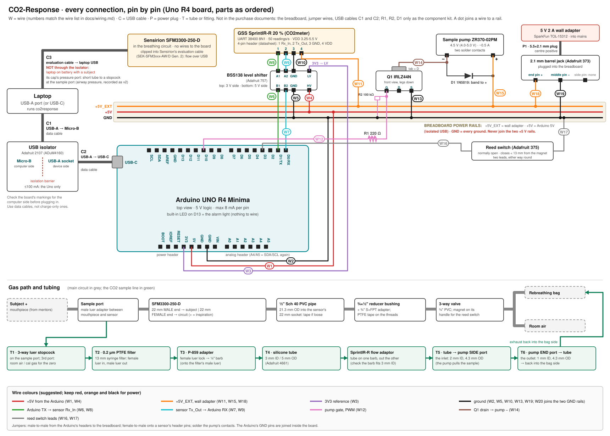
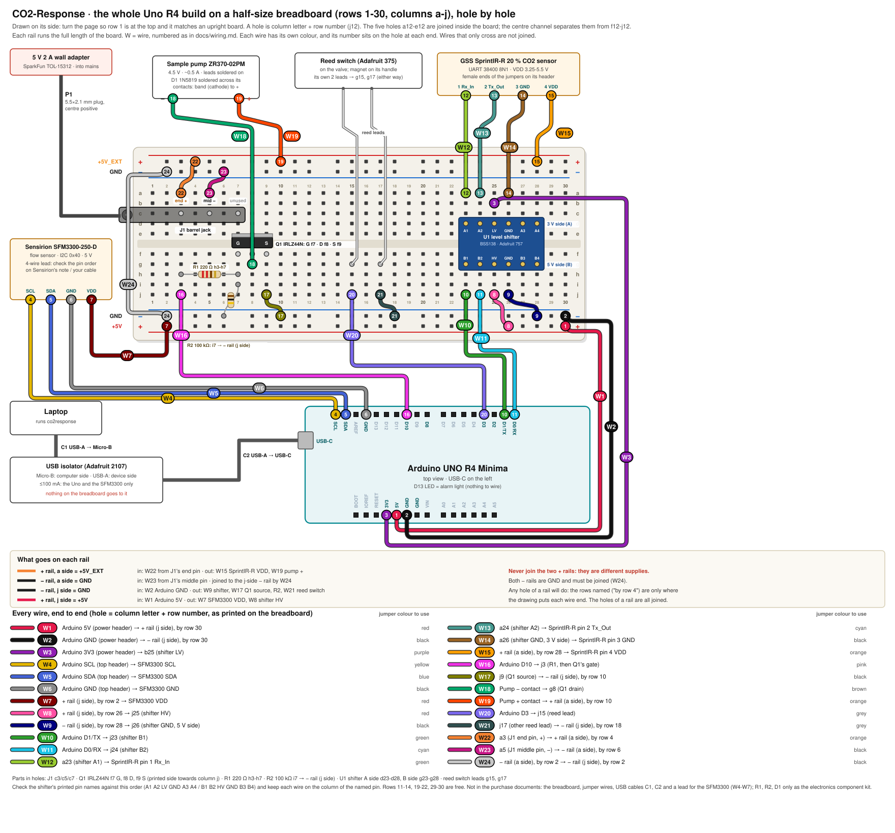
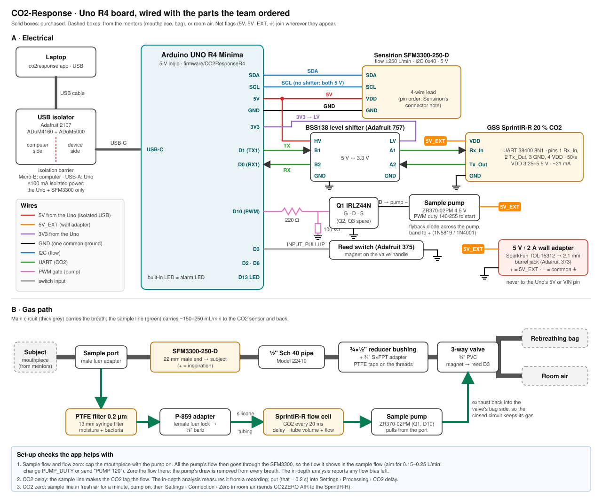
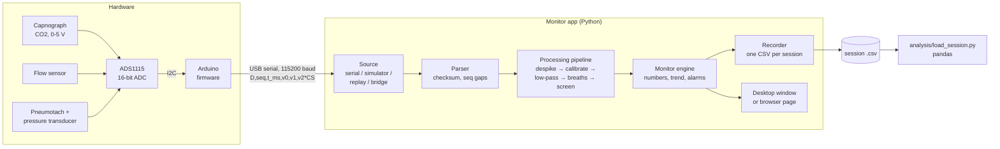

# CO2-Response

CMU BME 26-27 Capstone Project

[](https://github.com/shrlak/CO2-Response/actions/workflows/ci.yml)
[](https://github.com/shrlak/CO2-Response/actions/workflows/deploy.yml)

CO2-Response is a research capnography and airflow monitor for CO2 rebreathing tests. An Arduino streams the sensors over USB 100 times a second. Two boards are supported, and the app recognises which one is connected:

- **The Uno R4 board (current build, [wiring](docs/wiring.md#uno-r4-board-digital-sensors)):** an Arduino Uno R4 Minima reading a Sensirion **SFM3300-250-D** flow sensor (I2C, ±250 L/min) and a GSS **SprintIR-R-20** CO2 sensor (UART, 50 readings a second, sidestream with a sample pump), behind a USB isolator, with a reed switch on the valve handle and the board's LED as the alarm light. These are the parts on the team's purchase list; [the wiring diagram](docs/images/wiring-r4.svg) shows how they all connect. It sends % CO2 and L/min. One flow sensor gives the flow waveform, the breaths, tidal volume and minute ventilation.
- **The ADC board (earlier build):** an Arduino Uno with an ADS1115 16-bit ADC reading a capnograph, a flow sensor and a pneumotachograph as voltages.
- **A Medtronic Capnostream 35 as the CO2 source** (with the Uno R4 board): the app reads the monitor's CO2 waveform from its RS-232 or LAN data output and lines it up with the board's flow, in place of the SprintIR. See [docs/capnostream.md](docs/capnostream.md).

The monitor app turns that stream into a bedside-style display:

- sweeping waveforms and large numbers (EtCO2, respiratory rate to one decimal, live flow, tidal volume, minute ventilation)
- trends of EtCO2, MV and RR, and a ventilatory-response plot (each breath's minute ventilation against its EtCO2)
- keys that run a rebreathing test (baseline, rebreathing, end) and a PDF report of the result
- visual and audible CO2 alarms, with a warning limit and a stop limit

It records everything to one CSV file per session for analysis afterwards. Noisy samples and noisy breaths are removed before any number, plot or alarm uses them.

The app is written in Python. It runs in three places, from the same code:

- **In a terminal**, full screen, on any computer: Windows Terminal, macOS Terminal, the VS Code terminal, over SSH (`co2response-tui`, [§1](#in-a-terminal-any-computer))
- **Desktop app** on Windows, macOS and Linux (`python -m co2response`, or a standalone build that needs no Python)
- **In the browser** from GitHub Pages: **<https://shrlak.github.io/CO2-Response/>**. Nothing to install; reading the Arduino needs desktop Chrome or Edge. After one visit it also works with no internet.

> [!WARNING]
> **Research use only.** This is not a medical device. It must never be the only CO2 monitor on a person or animal; keep a certified monitor as the primary alarm. The alarm here works only while the app is running, the computer is awake and a sound output is armed. See [docs/safety.md](docs/safety.md).

## Contents

1. [Try it now (no hardware)](#1-try-it-now-no-hardware)
2. [What you need for a real session](#2-what-you-need-for-a-real-session)
   - [Wiring the Uno R4 board: every connection](#wiring-the-uno-r4-board-every-connection) (diagrams, cables, every wire, tubes, build order, first checks, troubleshooting)
3. [Running a session, step by step](#3-running-a-session-step-by-step)
4. [The monitor screen](#4-the-monitor-screen)
5. [How the system works](#5-how-the-system-works)
6. [The software](#6-the-software)
7. [Deploying to GitHub Pages](#7-deploying-to-github-pages)
8. [Development](#8-development)
9. [Assumptions and open questions](#9-assumptions-and-open-questions)
10. [Documentation](#10-documentation)

---

## 1. Try it now (no hardware)

### In a terminal (any computer)

Install it once (Python 3.10 or newer; the script makes its own environment and adds the commands to your PATH):

```bash
curl -fsSL https://raw.githubusercontent.com/shrlak/CO2-Response/main/scripts/install.sh | bash
```

On Windows, in PowerShell:

```powershell
irm https://raw.githubusercontent.com/shrlak/CO2-Response/main/scripts/install.ps1 | iex
```

From a downloaded copy of the repository, run `./scripts/install.sh` (or `.\scripts\install.ps1`). Add `--terminal-only` (`-TerminalOnly`) to leave out the Qt desktop window. Or, with [pipx](https://pipx.pypa.io): `pipx install "co2response[desktop] @ git+https://github.com/shrlak/CO2-Response"`. A [GitHub Release](https://github.com/shrlak/CO2-Response/releases) also has `co2response-terminal`, a single program file that needs no Python at all (see [Download the app](#download-the-app) below).

Then:

```bash
co2response-tui --sim
```

**Updating.** The **standalone app** (the downloaded `.exe`, `.dmg` or Linux app) updates itself: **every time the app is closed** it checks the project's GitHub Releases, downloads a newer version, checks its size and SHA-256 and installs it, so the next start runs it (a small window shows the progress; **Skip** stops it before anything is installed). While it runs it also checks once a day in the background and installs what it found at the next start. Nothing changes during a recording. The previous version is kept beside it (`CO2-Response.exe.old`, `CO2-Response.app.old`, `CO2-Response.old/`), and if an update cannot be installed the current version simply keeps running. Turn it off in **Settings → Display & units → Updates**, or set the environment variable `CO2R_NO_UPDATE=1` for a computer that must never change; `co2response --update` (or **Check now**) updates right away. Every recording's header says which version made it. The terminal program (`co2response-terminal`) and the pip/source installs do not update themselves. For those:

```bash
co2response --update
```

(or run the install script again). From a copy of the repository, `--update` runs `git pull`. In the standalone app, `--update` downloads and installs the latest release now. The terminal monitor shows its version in the top-left corner, and `co2response --version` prints it.

The whole monitor is drawn in the terminal, so it works in the terminal panel of VS Code or any other editor:

- the CO2 and flow waveforms, sweeping like a bedside monitor, as thin smooth lines like the web page's
- EtCO2, RR, live flow, VT and MV in large digits in the web page's font, all one size, with alarm colours, and the alarm messages above
- the test phase and timer
- the **ventilatory response graph**: each breath's own minute ventilation against its EtCO2, baseline breaths hollow (○), rebreathing breaths filled (●), a smooth curve with the least-squares line dashed under it (the curve runs through the baseline and the whole of rebreathing, so it starts flat and rises from the baseline like a ventilatory response; it is a robust, monotone penalized spline whose smoothness is chosen from the breaths themselves; erratic breaths do not drag it and it never runs the wrong way. It is always curved: the smoothing cannot stiffen into a straight line, and it bows at least 8 % of its rise away from the straight line between its ends, towards the way the breaths bend (steepening unless they flatten). The slope and r are always those of the straight least-squares line, which stays dashed under it. The PDF report draws the same curve and writes the time of the recording (m:s) beside the points, every point when there are few), and the labels "Response slope = … (L/min)/mmHg · r = …" and "Baseline Ave = … mmHg · MV = … L/min"
- a table of the last breaths: EtCO2, VT, the breath's own RR and MV (MV = VT × RR = VT × 60 / breath length)

**Pictures, like the web page.** In a terminal that can show images, the waveforms, the number tiles and the graphs are drawn as smooth pictures in the web page's colours and font (Barlow), instead of with text characters. The app finds out by itself (`--graphics auto`, the default). These terminals can:

| Terminal | Pictures |
| --- | --- |
| iTerm2 (macOS) | yes |
| VS Code's terminal | yes, after turning on **Settings > Terminal › Integrated: Enable Images** (`"terminal.integrated.enableImages": true`) |
| Windows Terminal (1.22 or later), WezTerm, Kitty, Ghostty, foot | yes |
| macOS Terminal.app, the Windows console host, tmux/screen | no: the text drawing is used |

`--graphics off` always uses text, and `--graphics on` draws pictures even where the terminal did not say it can (in coloured half blocks if it has no image protocol). The status bar says "text mode" when pictures are off. Over SSH, pictures work if the terminal on your own computer can show them.

**Text mode, as close to the web page as text allows.** Without pictures, each panel is still drawn as a picture first (the web page's line widths, font and colours) and then turned into text: every character cell becomes the block character (quarters, or eighths across or down) and the two colours that look most like that piece of the picture. So the waveforms are thin continuous lines and the numbers are in the web page's font, not stepped block digits.

- With 24-bit colour (iTerm2, VS Code, Windows Terminal) edges get in-between colours and look smooth.
- With 256 colours (macOS Terminal) every cell takes exactly two colours, the line's and the background's, since in-between colours would be rounded to whatever is nearest.
- macOS Terminal draws block characters a little shorter than the row, leaving a gap that shows the background colour. The drawing allows for it, so the numbers are not striped across. For the exact look of the web page, use iTerm2 (free) or the VS Code terminal with images turned on.

| Key | Does |
| --- | --- |
| `o` | Connect: the simulator (either board), an Arduino on a serial port, the sample session, or disconnect |
| `s` | Simulation situations, including a whole rebreathing test that runs by itself |
| `+` / `-` | Simulation speed, 1× to 50× |
| `b`, `r`, `e`, `x` | Start baseline, start rebreathing, end the test, emergency stop |
| `m`, `space`, `c` | Mark an event, silence alarms, start/stop recording (stopping also writes the PDF report next to the CSV) |
| `v` | The graph: ventilatory response (the default), EtCO2 trend, MV trend |
| `k` | Capnostream 35 as the CO2 source: a serial port, simulated, or off |
| `l` | In text mode: waveforms as a thin smooth line (the default) or a solid filled shape |
| `p`, `←` `→`, `Home`, `End` | Only while a recorded file is replayed: play/pause, 30 s back/on, the start, the whole recording. `+` / `-` change its speed (½× to 20×). A live or simulated test cannot be paused |
| `f`, `a`, `h`, `q` | Freeze the waveforms, arm the alarm sound, switch the expected board, quit |

`co2response-tui --situation test_normal --speed 10` starts a whole simulated test straight away, and `co2response-tui --port COM3` (or `/dev/ttyACM0`, `/dev/cu.usbmodem…`) connects to the Arduino.

**A whole test in a second, with no window:**

```bash
co2response --fast-test normal
```

It runs a whole simulated rebreathing test (`normal`, `blunted` or `brisk`) through the real engine as fast as the computer can, saves the session and its PDF report, and prints the MV-vs-EtCO2 graph in the terminal.

### In the browser

Open **<https://shrlak.github.io/CO2-Response/>** and press **Start simulator**.

The first load downloads the Python runtime (Pyodide, about 10 MB) and takes 10 to 30 seconds. After that it is cached.

The simulator breathes like a person, so every screen, alarm and recording feature can be tried without hardware. **Replay the sample session** plays a recorded session back through the monitor.

### Download the app

No Python needed. On the [Releases page](https://github.com/shrlak/CO2-Response/releases), under the newest version:

| Computer | Download | Then |
| --- | --- | --- |
| **Mac** (Apple silicon and Intel: one file for both) | `CO2-Response.dmg` | Open it, drag **CO2-Response** onto **Applications**, then open it from there. The first time, right-click it and choose **Open** (the app is not signed by Apple). |
| **Windows** | `CO2-Response.exe` | Double-click it; no installation. It takes a few seconds to start. If Windows SmartScreen warns, choose **More info**, then **Run anyway**. |

The same page has the terminal monitor (`CO2-Response-Terminal-…`) and a Linux app. The `.dmg` is built on an Apple-silicon and an Intel Mac and merged into one universal app (`scripts/fuse_macos_app.py`), and every release is built and started on both kinds of Mac before it is published.

### On your computer

You need Python 3.10 or newer.

```bash
python -m venv .venv
```

```bash
source .venv/bin/activate
```

(On Windows: `.venv\Scripts\activate`.)

```bash
pip install -r requirements.txt
```

```bash
python -m co2response --sim
```

`--sim` starts the simulator straight away. Other start options:

| Command | What it does |
| --- | --- |
| `python -m co2response` | Opens on the start screen. Choose the Arduino, the simulator or a replay. |
| `python -m co2response --port COM3` | Connects to the Arduino on that port (`/dev/ttyACM0` on Linux, `/dev/cu.usbmodem…` on macOS). |
| `python -m co2response --replay sample-data/synthetic_session.csv` | Replays a recorded session through the monitor. |
| `python -m co2response --list-ports` | Lists serial ports and exits. |
| `python -m co2response --report session.csv` | Writes the CO2 response report (`session.pdf`) and exits. `--out` names the file; `--skip 20` changes the seconds of rebreathing left out. |
| `python -m co2response --analyze session.csv` | The in-depth analysis: prints it and writes `session_analysis.csv` (every number, one per row) and `session_breath_detail.csv` (one row per breath with Ti, Te, Ti/Ttot, the capnogram's phase III slope, the CO2 delay). `--out DIR` picks the folder. |
| `python -m co2response --resume session.csv --port COM3` | Continues a saved recording: its breaths, markers and test phase go back on the monitor and recording carries on into `session_resumed.csv` (the earlier file is left as it was). Works with `--sim` and `--tui` too. |
| `python -m co2response --sim --exit-after 12` | Runs for 12 s, prints what the monitor measured and closes: a check that an installation works. |
| `python -m co2response --tui --sim` | The monitor full-screen in the terminal (the same as `co2response-tui --sim`). Without PySide6 installed, `python -m co2response` opens this by itself. |
| `python -m co2response --situation test_normal --speed 10` | Starts the simulator in a situation (`--list-situations` lists them) at a speed from 1 to 50. |
| `python -m co2response --fast-test normal` | A whole simulated test with no window in about a second: the session, its PDF report and the graph in the terminal. `--variability 15` sets the breath-to-breath variation, `--sessions DIR` where it is saved. |
| `python -m co2response --merge-capno rec.csv export.txt` | The offline path for a Capnostream 35: put the CO2 of an exported file together with an Arduino recording's flow into a new session file (`--capno-shift`, `--capno-start-offset`, `--capno-fields`, `--capno-units`, `--out`). See [docs/capnostream.md](docs/capnostream.md). |
| `python -m co2response --capnostream COM5` | Take the CO2 from a Capnostream 35 on that port (saved; `off` turns it off, `sim` uses a simulated one with `--sim`). `--capture COM5` records what the monitor sends, to set up its format. See [docs/capnostream.md](docs/capnostream.md). |
| `python -m co2response --board analog` | Expect (and simulate) the ADC board instead of the Uno R4 board, and remember that. |
| `python -m co2response --version` | Prints the version. |

`pip install -e ".[desktop]"` also adds the `co2response` and `co2response-tui` commands (`pip install -e .` alone installs the terminal monitor without Qt).

On Linux, alarm sounds need PortAudio (`sudo apt install libportaudio2`). Without it, the app falls back to the system beep and says so.

### Simulation panel

Press **Simulation** (the soft key next to Settings) to open the simulation panel beside the monitor. It works in the desktop app and in the browser, with or without the simulator already running.

- **Speed** (top of the panel): runs simulated time 1× to 50× faster than real time, like a replay at 2×–10×. Above 1× the waveforms show a **time-compressed** trace that still sweeps at the real-time pace (one sample in every *speed*; the tag reads, for example, "SIMULATED · 120 s/screen" at 10×), instead of racing across the screen faster than the eye can follow. At 10× a whole rebreathing test (38 → 58 mmHg, about 100 s of breathing) fills the ventilatory-response plot in about 14 s, with the same slope as at 1×, because everything the monitor measures runs on the device clock. Alarm delays (apnea 20 s, no data 3 s) stay in real seconds. The header shows the speed (e.g. "Simulator (5× speed) · 500 Hz"), and so does the source line of a recording made at that speed. Choosing a situation keeps the speed.
- **Record whole simulated tests** (switch under Speed): also saves a whole simulated test as a session, marked Simulator, so the review charts and the PDF report can be made from it too. A line under the switch says where the test stands ("Whole test: rebreathing 1:20, until the stop alarm").
- **Situations:** one click sets every simulator value for a ready-made situation and starts the simulator if it is not running. The monitor changes in place, with no gap in the data.

  | Group | Situations |
  | --- | --- |
  | Whole test (runs by itself) | Whole rebreathing test, blunted response, brisk response. The simulation presses the test keys itself: 30 s of baseline, the valve is "turned" and CO2 rises until the stop alarm, then the end of the test and 20 s of recovery. **Every graph fills in from it:** the three waveforms, the EtCO2, MV and RR trends, and the response plot with its baseline and fitted line. At 10× it takes about 20 s. |
  | Breathing patterns | Normal at rest, hyperventilation (EtCO2 20 mmHg), hypoventilation (EtCO2 63 mmHg, past the 60 mmHg warning limit), rapid shallow (RR 40), slow deep, light exercise, child (~6 years) |
  | Clinical | Bronchospasm / COPD ("shark fin" capnogram), raised inspired CO2 (FiCO2 12 mmHg), low cardiac output (EtCO2 12 mmHg), apnea |
  | CO2 challenge | Rebreathing test, blunted response (almost flat), brisk response. Each places a **Rebreathing** marker, so the ventilatory-response plot fits its line. |
  | Equipment problems | CO2 sensor, flow sensor or pneumotach unplugged; device stops sending; noisy signal; spikes + partial breaths; flow sensor drift (65 % of true flow + 8 L/min) |

- **Every value is a slider or a switch,** and dragging a slider changes the running simulator straight away:

  | Group | Controls |
  | --- | --- |
  | Breathing | respiratory rate, tidal volume, I:E ratio (sets peak inspiratory flow), end-tidal CO2, inspired CO2, airway obstruction (capnogram shape) |
  | CO2 challenge | CO2 rising on/off, rise rate (up to 60 mmHg/min), where the rise stops, breathing response (×0 to ×5) |
  | Events | apnea, CO2 sensor unplugged, flow sensor unplugged, pneumotach unplugged, device stops sending |
  | Safety channel | SpO2 (shown when the SpO2 channel is switched on in Settings > Display & units) |
  | Signal quality | sensor noise, ADC spikes, partial breaths, serial line errors |
  | Flow sensor calibration | gain (% of true flow) and zero offset |

- **Set vs Monitor:** a table at the top shows each value the simulator is producing next to what the monitor measures (EtCO2, FiCO2, RR, VT, MV, peak inspiratory flow). The monitor measures its numbers from the simulated waveforms, the same way it does from real sensors, so its numbers, waveforms, trend and alarms all agree. A new EtCO2 is on the next breath (or on the breath being drawn, if it is still inspiring). The large EtCO2 is the median of 3 breaths and RR averages 4 breaths, so those follow a little later; MV is the last breath's own (VT × 60 / its length), so it follows at once. Raise **Speed** to get there sooner.
- If the values chosen would push flow past a sensor's range (about ±100 L/min with the default calibration), the panel warns that the signal will clip at the ADC rail.

**Settings > Connection > Simulator** offers the same situations in a drop-down. The simulator's values are saved and come back next time.

---

## 2. What you need for a real session

**The Uno R4 board (current build).** Every connection is below in [Wiring the Uno R4 board](#wiring-the-uno-r4-board-every-connection): the diagrams, the cables, every wire numbered, the tubes, the build order and the first checks. The same is in [docs/wiring.md](docs/wiring.md#uno-r4-board-digital-sensors).

| Part | Notes |
| --- | --- |
| Arduino Uno R4 Minima (ABX00080) | USB-C to the computer, through the USB isolator |
| Adafruit 2107 USB isolator (ADuM4160 + ADuM5000) | Between the laptop and the Uno (Micro-B to the laptop, USB-A socket to the Uno); low or full speed (the Uno R4 is full speed); its isolated 5 V (100 mA) powers the Uno only |
| Sensirion SFM3300-250-D flow sensor | Clipped into Sensirion's evaluation cable (SEK-SFM3xxx-AW/D Gen. 2), which plugs straight into the laptop (C3); the app reads it and puts its flow into the Arduino's lines. ±250 L/min |
| GSS SprintIR-R-20 CO2 sensor (CO2meter) | UART 38,400 baud on D0/D1 through the BSS138 level shifter (pins 1 Rx_In, 2 Tx_Out, 3 GND, 4 VDD), 0–20 % CO2, 50 readings a second; powered from 5V_EXT |
| Adafruit 757 BSS138 4-channel level shifter | 5 V ↔ 3.3 V for the SprintIR-R's UART |
| ZR370-02PM 4.5 V air pump (Adafruit 4699) + IRLZ44N (×3, Q1 used) | The CO2 sample pump on D10 (PWM duty 140/255 to start, aim for 0.15–0.25 L/min); a flyback diode across it |
| 0.2 µm PTFE syringe filters (13 mm), P-859 luer-to-barb adapter, silicone tubing | The sample line: port → filter → adapter → SprintIR-R → pump → back to the bag side |
| Magnetic contact switch (Adafruit 375) on the valve handle (D3) | The board reports the valve position; the board's own LED (D13) shows the alarms |
| 5 V / 2 A wall adapter (SparkFun TOL-15312) + 2.1 mm barrel jack (Adafruit 373) | The 5V_EXT rail: the pump and the SprintIR-R. Never to the Uno's 5V or VIN |
| ½" Sch 40 PVC pipe, ¾×½" reducer bushing, ¾" S×FPT adapters, PTFE tape | The breathing circuit from the flow sensor to the valve |
| 3-way valve (¾" PVC) + reducer bushings, luer-to-barb adapters, 3-way luer stopcocks | The valve switches between the bag and room air; a luer adapter is the sample port; the stopcock switches the sample line to room air for zeroing |
| Mouthpiece, rebreathing bag | From the mentors |
| A computer | Any terminal (Windows, macOS, Linux) with Python 3.10+, or the standalone programs |

Firmware: `firmware/CO2ResponseR4/` (Arduino IDE, board "Arduino UNO R4 Minima", no extra libraries; or `pio run -d firmware/r4 -t upload`).

### Wiring the Uno R4 board: every connection

> [!CAUTION]
> Research use only, and **not yet tested on hardware**. One fact was not in any document available: **which isolator connector faces the computer** (check the board's markings). The flow sensor's evaluation cable goes **straight into the laptop, not through the isolator**: run the laptop on its **battery, mains unplugged**, whenever a person is connected. Never connect the 5 V wall adapter to the Arduino's **5V** or **VIN** pin.

#### The diagrams

**Every connection, pin by pin.** The Arduino's headers are in their real order (top view, USB-C on the left). The three coloured lines across the middle are the breadboard's power rails. A dot joins a wire to a rail; wires that only cross are not joined. W = wire, C = USB cable, P = power plug, T = tube; the numbers match the lists below. Redraw it with `python scripts/draw_connections.py`.



**On a half-size breadboard, hole by hole.** A 30-row board (rows 1–30, columns a–j) with every part in its holes, both pairs of power rails (a side: +5V_EXT and GND; j side: GND and +5V), and every wire from one named hole or pin to the next, each with its own number and colour. The hole-by-hole lists are in [docs/wiring.md](docs/wiring.md#on-the-breadboard-hole-by-hole). Redraw it with `python scripts/draw_breadboard.py`.



**Overview.** The same system as blocks: the electrical wiring on top, the gas path below.



#### What each part does

| Part (purchase list) | Its job | What it connects to |
| --- | --- | --- |
| Arduino UNO R4 Minima (ABX00080) | Reads the CO2 sensor, drives the pump, watches the valve switch, sends 100 lines a second to the laptop, lights its LED for alarms | USB-C to the isolator (C2); headers to the breadboard and sensors (W1–W20) |
| Adafruit 2107 USB isolator (ADuM4160 + ADuM5000) | Keeps the laptop and mains electrically apart from everything on the subject's side | Laptop → its Micro-B (C1); its USB-A socket → the Uno (C2). Its isolated 5 V supply gives up to **100 mA**: the Uno and the SFM3300 only |
| Sensirion SFM3300-250-D | Flow, ±250 L/min, a new value every 0.5 ms; breaths, VT, MV and RR all come from it | Clipped into Sensirion's evaluation cable, USB to the laptop (C3); no wires to the Arduino |
| GSS SprintIR-R-20 (from CO2meter) | CO2, 0–20 %, 50 readings a second, sidestream (the sample line runs through its flow adaptor) | UART through the level shifter (W6–W10), VDD from the +5V_EXT rail (W11) |
| Adafruit 757 BSS138 level shifter (4 channels) | Converts between the Uno's 5 V and the SprintIR-R's 3 V signals, both ways | HV side to the Uno (W4–W7), LV side to the SprintIR-R (W8–W10) and to 3V3 (W3); channels 3 and 4 spare |
| ZR370-02PM pump (Adafruit 4699) | Pulls about 0.2 L/min of breath through the filter and the CO2 sensor | + to the +5V_EXT rail (W15), − to Q1's drain (W14) |
| IRLZ44N MOSFET ×3 | Q1 switches the pump from D10 (PWM). Q2 and Q3 are spare | Q1: gate from D10 through R1 (W12), source to GND (W13), drain to the pump (W14) |
| 5 V / 2 A wall adapter (SparkFun TOL-15312) + 2.1 mm barrel jack (Adafruit 373) | The **+5V_EXT** supply: the pump (about 0.5 A) and the SprintIR-R | P1 into the jack; jack end pin → +5V_EXT rail (W18), middle pin → GND rail (W19) |
| Magnetic contact switch (Adafruit 375) | Tells the app where the valve handle is: at the bag the rebreathing phase starts, back at room air the test ends | One lead to D3 (W16), the other to GND (W17); the magnet on the valve handle |
| 3-way luer stopcock | Switches the sample line between the breath and room air (or calibration gas) | T1, right at the sample port |
| 0.2 µm PTFE syringe filters, 13 mm (ChromTech F13-PT020, pack of 100) | Keep moisture and droplets out of the CO2 sensor | T2, on the stopcock's outlet; change it when it gets wet |
| P-859 barbed adapter, female luer lock × ⅛" barb | Joins the filter's male luer to the silicone tube | T3 |
| Silicone tubing, 3 mm ID / 5 mm OD, 1 m (Adafruit 4661) ×2 | The sample line | T4–T6 |
| ½" Sch 40 PVC pipe, ¾×½" reducer bushings, ¾" S×FPT adapters, PTFE tape | The main breathing circuit from the flow sensor to the valve | The SFM3300's 22 mm socket, the valve's ports |

**What is purchased.** Everything above, and everything in the budget increase request except four items that will not be bought: the SparkFun pulse oximeter and heart rate sensor (MAX30101 & MAX32664), the assorted pediatric and infant masks, the pediatric EtCO2 nasal cannulas and the SFM3400-33-D infant flow sensor. From that request:

- In this build: the electronics component kit (expected to supply R1 220 Ω, R2 100 kΩ, the D1 flyback diode: check it), the ¾" three-way PVC ball valve, two more ¾×½" reducer bushings (one per valve port), the male and female luer-to-barb adapters (the sample port), the 3-way luer stopcocks (T1: switch the sample line between the breath and room air or calibration gas), a second 1 m of silicone tubing, and the ABS project enclosure for the electronics.
- Spares and supports: a spare SFM3300-250-D, the tubing stands and holders. The Sensirion Gen. 2 evaluation cable is in this build: it carries the flow sensor to the laptop (C3). The second level shifter and the Qwiic-to-breadboard cable were for the oximeter and are spare.

The mouthpieces, rebreathing bag and main tubing come from the mentors; the calibration syringe, CO2 calibration gas and test lung are borrowed from the PFT lab.

**Every electrical part in the diagrams, checked against the purchase documents** (the working budget's Purchased sheet and the budget increase request, without the four items that will not be bought):

| Part in the diagrams | In the purchase documents? |
| --- | --- |
| Arduino UNO R4 Minima (ABX00080) | Yes: Purchased sheet (Amazon) |
| USB isolator, Adafruit 2107 (ADuM4160 + ADuM5000) | Yes: Purchased sheet (DigiKey 1528-1784-ND) |
| SFM3300-250-D flow sensor | Yes: Purchased sheet (DigiKey); a spare in the request |
| SprintIR-R 20 % CO2 sensor | Yes: Purchased sheet (CO2meter) |
| BSS138 level shifter, Adafruit 757 | Yes: Purchased sheet (DigiKey 1528-1007-ND); a second in the request |
| IRLZ44N MOSFET ×3 (Q1 used) | Yes: Purchased sheet (DigiKey IRLZ44NPBF-ND) |
| ZR370-02PM sample pump | Yes: Purchased sheet (Adafruit 4699) |
| 5 V 2 A wall adapter, SparkFun TOL-15312 (P1) | Yes: Purchased sheet |
| 2.1 mm barrel jack, Adafruit 373 (J1) | Yes: Purchased sheet |
| Magnetic contact (reed) switch, Adafruit 375 | Yes: Purchased sheet |
| R1 220 Ω, R2 100 kΩ, D1 flyback diode (1N5819, or any 1N4001–1N4007) | Only as the "electronics component kit" (request, Amazon). Check the kit has these three |
| Half-size breadboard | **No** (the team has one; the kit may include one) |
| Jumper wires, male-to-male and female-to-male | **No** (the kit may include them) |
| C1 USB-A → Micro-B data cable (laptop → isolator) | **No** |
| C2 USB-A → USB-C data cable (isolator → Arduino) | **No** |
| C3 Sensirion evaluation cable, SEK-SFM3xxx-AW/D Gen. 2 (flow sensor → laptop USB) | Yes: budget request (Newark) |
| Hookup wire and solder for the pump's two contacts | **No** (usually from the lab) |

Purchased but not in the wiring: the ABS project enclosure (houses the Arduino and breadboard), the Qwiic-to-breadboard cable and the second level shifter (bought for the oximeter, now spare).

#### Facts from the datasheets

| Part | What the datasheet or product page says | Where it matters |
| --- | --- | --- |
| SprintIR-R (GSS datasheet rev 4.12) | Pins: **1 Rx_In, 2 Tx_Out, 3 GND, 4 VDD**. UART **38,400 baud**, 8 data bits, no parity, 1 stop bit. 50 readings a second. VDD 3.25–5.5 V, about 21 mA (peak 35–40 mA). Inputs: high ≥ 1.8 V, **5 V absolute maximum**. Output high 2.6–3.0 V. Tested at 0.2 L/min sample flow | `CO2_BAUD 38400`; the level shifter is needed both ways (5 V would sit at its limit, and 3 V is too low for the 5 V Uno to read reliably) |
| SFM3300-D (Sensirion datasheet v1.4) | I2C address **0x40 (64)**, up to 400 kHz. Supply 5 V ± 5 %, under 50 mW. I2C high ≥ 2.5 V, low ≤ 1.1 V, so 5 V signals are fine. Flow = (raw − **32768**) / **120** slm. Positive flow runs from the **22 mm female** end to the **22 mm male** end. Ports: one end 22 mm male outside / 15 mm female inside, the other 22 mm female socket / 15 mm male. Optional heater 51 Ω, 0.5 W max. Start-up 100 ms after power | Read through the evaluation cable, which applies the offset and scale itself; mount the male end towards the subject so inspiration reads positive |
| Arduino UNO R4 Minima (Arduino docs and pinout) | USB-C. **5 V-only** board. VIN takes 6–24 V. **8 mA per pin**, 60 mA for all pins together | Nothing drawing more than 8 mA hangs on a pin: the pump goes through Q1 |
| ZR370-02PM pump (Adafruit 4699 and its spec sheet) | Rated 4.5 V, works 4.0–5.0 V, about 0.5 A. **Side port = inlet** (2 mm ID, 4.3 mm OD), **end port = outlet** (1 mm ID, 4.3 mm OD). Reversing the wires does not reverse the air. Not rated for continuous use; about 50 % duty cycle recommended | The sample line goes onto the side port; give the pump rest between tests |
| Magnetic contact switch (Adafruit 375) | Normally open reed switch, two wires; closes when the magnet is within about 13 mm (15 mm max); 100 mA, 200 V DC max | Either wire to D3 |
| 2.1 mm barrel jack (Adafruit 373, CUI PJ-102AH) | Three pins: the pin at the **end** is **positive**, the **middle** pin is **negative**, the **side** pin is a switch (leave it unconnected) | W18, W19 |
| 5 V 2 A wall adapter (SparkFun TOL-15312) | 5.5 × 2.1 mm plug, centre positive | P1 |
| USB isolator (Adafruit 2107) | Isolated 5 V supply of up to 100 mA; works with low-speed and full-speed USB devices; a Micro USB and a USB-A connector | Keep the pump and the SprintIR-R off its supply |
| Silicone tubing (Adafruit 4661) | 3 mm ID, 5 mm OD; fits ports up to about 4 mm OD | It stretches over the pump's 4.3 mm ports |

#### Cables and plugs: from the laptop to the Arduino, and power

| # | From | To | Cable | Notes |
| --- | --- | --- | --- | --- |
| C1 | Laptop USB-A port | USB isolator **Micro-B** (computer side) | USB-A to Micro-B **data** cable (USB-C to Micro-B if the laptop has only USB-C) | A charge-only cable powers the board but shows no serial port |
| C2 | USB isolator **USB-A socket** (device side) | Arduino **USB-C** | USB-A to USB-C data cable | Also how the firmware is uploaded |
| P1 | 5 V 2 A wall adapter | 2.1 mm barrel jack on the breadboard | The adapter's own 5.5 × 2.1 mm plug | Plug in **last**, after checking the rails with a meter |

The Arduino is powered only through C2 (the isolator's 5 V). Nothing goes into its VIN or 5V pin from outside.

#### The Arduino's pins in use

| Header | Pin (left to right, USB-C on the left) | Used for |
| --- | --- | --- |
| Digital, top | SCL (left end), SDA, AREF, GND, D13, D12, D11, **D10**, D9, D8, D7, D6, D5, D4, **D3**, D2, **D1/TX**, **D0/RX** (right end) | D13: built-in alarm LED · D10: pump (PWM) · D3: valve switch · D1/D0: CO2 sensor (`Serial1`) |
| Power, bottom left | BOOT, IOREF, RESET, **3V3**, **5V**, **GND**, GND, VIN | 3V3: the shifter's LV reference · 5V: the +5V rail · GND: the GND rail · VIN: **nothing** |
| Analog, bottom right | A0–A5 | Nothing |

#### The breadboard's power rails

| Rail | Fed by | Feeds | Current |
| --- | --- | --- | --- |
| **+5V** (red) | Arduino 5V pin (W1): the isolator's 5 V | shifter HV (W4) | a few mA; the Uno itself takes most of the isolator's 100 mA |
| **+5V_EXT** (orange) | Barrel jack end pin (W18) | SprintIR-R VDD (W11), pump + (W15) | pump about 0.5 A, SprintIR-R about 21 mA (40 mA peak): well inside 2 A |
| **GND** (black) | Arduino GND (W2) and the barrel jack's middle pin (W19) | Every ground | |

**Never join +5V and +5V_EXT.** The breadboard's two GND rails are joined by W20. The adapter's ground joined to the Arduino's ground is expected: the adapter's output is isolated from mains, and the laptop stays isolated by the USB isolator.

#### Every wire

Arduino headers and breadboard holes are both sockets, so use **male-to-male** jumpers between them, **female-to-male** onto a sensor's header pins, and **solder** the pump's two contacts. Colours are a suggestion; keep red, orange and black for power.

| # | From | To | Colour | Notes |
| --- | --- | --- | --- | --- |
| W1 | Arduino **5V** (power header) | +5V rail | red | |
| W2 | Arduino **GND** (power header) | GND rail | black | |
| W3 | Arduino **3V3** (power header) | Shifter **LV** | purple | A reference only; the shifter draws almost nothing |
| W4 | +5V rail | Shifter **HV** | red | |
| W5 | GND rail | Shifter **GND** (HV side) | black | The shifter's two GND pins are joined on its board |
| W6 | Arduino **D1/TX** | Shifter **B1** | green | Arduino transmits |
| W7 | Arduino **D0/RX** | Shifter **B2** | cyan | Arduino receives |
| W8 | Shifter **A1** | SprintIR-R pin **1 Rx_In** | green | TX goes to Rx_In |
| W9 | Shifter **A2** | SprintIR-R pin **2 Tx_Out** | cyan | Tx_Out comes back to RX |
| W10 | Shifter **GND** (LV side) | SprintIR-R pin **3 GND** | black | |
| W11 | +5V_EXT rail | SprintIR-R pin **4 VDD** | orange | 3.25–5.5 V |
| W12 | Arduino **D10** | R1 **220 Ω** → Q1 **gate** | pink | R2 **100 kΩ** from the gate to the GND rail keeps the pump off while the Arduino starts |
| W13 | Q1 **source** | GND rail | black | |
| W14 | Q1 **drain** (middle leg or the metal tab) | Pump **−** contact | brown | |
| W15 | +5V_EXT rail | Pump **+** contact | orange | |
| W16 | Arduino **D3** | Reed switch, either wire | grey | The firmware turns on D3's pull-up |
| W17 | Reed switch, the other wire | GND rail | grey | |
| W18 | Barrel jack **end pin** (+) | +5V_EXT rail | orange | |
| W19 | Barrel jack **middle pin** (−) | GND rail | black | The **side pin** stays unconnected |
| W20 | GND rail (a side) | GND rail (j side) | black | Joins the breadboard's two GND rails; the pump's current returns through it |

#### The small parts

| Part | Value | Where | Which way round |
| --- | --- | --- | --- |
| Q1 | IRLZ44N (logic-level MOSFET, TO-220) | Pump switch | Facing its printed side, legs down: **G, D, S** from left to right. The metal tab is D |
| R1 | 220 Ω | In series between D10 and Q1's gate | Either way |
| R2 | 100 kΩ | From Q1's gate to the GND rail | Either way |
| D1 | 1N5819 (or 1N4001) | Across the pump's contacts | The **band** (cathode) to the pump's **+**, the other end to the pump's **−**. Without it, the pump's switching spikes can damage Q1 |

#### Tubes and the gas path

| # | Part | Connects | Notes |
| --- | --- | --- | --- |
| — | Mouthpiece | Subject → sample port | From the mentors |
| — | Sample port | Between the mouthpiece and the SFM3300's **male** end | A luer fitting (male luer adapters are in the budget request), as close to the mouth as possible |
| — | SFM3300-250-D | **Male** end (22 mm outside, 15 mm inside) towards the subject; **female** end (22 mm socket) towards the valve | Positive flow runs female → male, so inspiration reads positive. Mounted the other way, set **Flow direction** to **Reversed** (Settings > Connection > Flow sensor cable) |
| — | ½" Sch 40 PVC pipe | Into the SFM3300's 22 mm socket | The pipe is 21.3 mm across: wrap tape until it seals |
| — | ¾×½" reducer bushing + ¾" S×FPT adapter | Pipe → valve | PTFE tape on every thread |
| — | 3-way valve | Bag or room air | Requested; the magnet for the reed switch goes on its handle |
| T1 | 3-way luer stopcock | Sample port → stopcock; its third port is open to room air (or calibration gas) | Handle towards the breath for a test, towards room air to zero the CO2 sensor |
| T2 | 0.2 µm PTFE syringe filter | Stopcock → filter (female luer in, male luer out) | Keeps moisture out of the CO2 sensor |
| T3 | P-859 adapter | Filter's male luer → ⅛" barb | |
| T4 | Silicone tube | Barb → SprintIR-R flow adaptor, in | Short: every centimetre adds CO2 delay |
| T5 | Silicone tube | SprintIR-R flow adaptor, out → pump **side** port (inlet) | |
| T6 | Silicone tube | Pump **end** port (outlet) → the valve's **bag side** | So the closed rebreathing circuit keeps its gas |

The pump draws its sample on the subject's side of the flow sensor, so the SFM3300 reads the subject's flow plus the sample flow during inspiration and minus it during expiration. Zeroing the flow with the mouthpiece capped and the pump running removes that (step 6 below).

#### Building it, in order

1. Push the level shifter (with its headers soldered on), the barrel jack, Q1, R1, R2 and D1 into the breadboard.
2. Wire the rails: W18, W19 (barrel jack), then W1, W2 (Arduino power header), then W20 to join the two GND rails. Hole by hole: [the breadboard diagram](docs/images/breadboard-r4.svg).
3. Clip the SFM3300 into Sensirion's evaluation cable and plug the cable into the laptop (C3), not into the isolator.
4. Wire the CO2 sensor through the shifter: W3, W4–W11.
5. Wire the pump: W12–W15, with D1 across the pump, band to +.
6. Wire the reed switch: W16, W17. Fix the magnet on the valve handle so it is within 13 mm of the switch at the **bag** position.
7. Connect the gas path and the sample line (T1–T6).
8. Do **not** plug in P1 or C2 yet.

#### First power-up and checks

1. **Meter checks, nothing plugged in:** no continuity between +5V and +5V_EXT, between either 5 V rail and GND, or between any two of the shifter's pins.
2. **Upload the firmware** with only C2 plugged in (through the isolator, C1 to the laptop): open `firmware/CO2ResponseR4/CO2ResponseR4.ino` in the Arduino IDE, board **Arduino UNO R4 Minima**, no extra libraries, Upload. Or `pio run -d firmware/r4 -t upload`.
3. **Plug in P1.** The pump starts (the board streams on power-up). Measure +5V_EXT: about 5 V.
4. **Connect the app:** `python -m co2response` (or the website in Chrome/Edge) → **Connect Arduino (USB)**. The header shows about 100 Hz. **Settings > Connection > Connected device** lists what the board said: `FW 2.3.0`, `BOARD UNO_R4`, `CO2 SPRINTIR-R`, `FLOW CABLE`, `CO2_MULT 10`, `PUMP_DUTY 140`.
5. **Flow from the cable:** first check the cable on its own: `co2response --flow-cable PORT` (`co2response --list-ports` lists the ports; the cable shows as an FTDI USB serial port) prints the sensor's name and its flow twice a second. Then **Settings > Connection > Flow sensor cable**: choose its port and turn on **Use the flow cable**. The log says `Flow cable: SFM3300-D, serial ...`, and the flow follows your breathing. Breathe in: it should read positive; if not, set **Flow direction** to **Reversed**.
6. **Hardware check:** **Settings > Diagnostics > Hardware check**. A "FLOW SENSOR NOT ANSWERING" alarm means the cable is not chosen, not plugged in, or the sensor is not clipped in; "CO2 SENSOR NOT ANSWERING" means TX/RX swapped (W8/W9), the shifter's LV/HV, or VDD.
7. **Sample flow and flow zero:** cap the mouthpiece. All the pump's flow now goes through the SFM3300, so the flow shown is the sample flow. Aim for about 0.2 L/min: change `PUMP_DUTY` in `config.h`, or send `PUMP 120` (any duty 2–255) from **Settings > Connection**. Still capped, zero the flow in **Settings > Calibration**.
8. **CO2 zero:** with the pump running, turn the stopcock (T1) to room air (fresh air: outside, or a well-ventilated room) for a minute, then **Settings > Connection > CO2 sensor zero > Zero in room air** (sends `CO2ZERO AIR`; the SprintIR-R takes it as 400 ppm). With nitrogen from the lab, **Zero in nitrogen**.
9. **Valve switch (before recording):** turn the valve to the bag and back. The log says "Valve handle turned to the bag" and "... to room air". Turning it to the bag starts the rebreathing phase and back ends the test, so try it before pressing Record.
10. **CO2 delay:** record a minute of quiet breathing, open it in **Data & recordings** (or run `co2response --analyze file.csv`), and set **Settings > Processing > CO2 delay** to (the analysis's "CO2 delay after expiration starts" − 0.2 s) × 1000 ms.
10. **Alarm light:** **Settings > Alarms > Test alarm**. The Arduino's LED lights; close the app and within 3 s the LED flashes (the board's watchdog).

#### Firmware settings (`firmware/CO2ResponseR4/config.h`)

| Setting | Value | Meaning |
| --- | --- | --- |
| `BAUD_RATE` | 115200 | USB serial to the laptop |
| `DEFAULT_RATE_HZ` | 100 | Data lines per second (1–200 with `RATE n`) |
| `FLOW_ON_ARDUINO` | 0 | 0: the flow comes from the evaluation cable (this build). 1: the flow sensor on the Uno's I2C pins, with the settings below |
| `SFM_I2C_ADDRESS`, `I2C_CLOCK_HZ` | 0x40, 100 kHz | The flow sensor, with `FLOW_ON_ARDUINO 1` only |
| `SFM_OFFSET`, `SFM_SCALE` | 32768, 120 | Flow = (raw − 32768) / 120 L/min |
| `SFM_FLOW_SIGN` | 1 | With `FLOW_ON_ARDUINO 1`: −1 if the sensor is mounted backwards. Through the cable: **Settings > Connection > Flow sensor cable > Flow direction** |
| `SFM_AVERAGE`, `SFM_READ_US` | 1, 1000 µs | Read the flow every 1 ms and send the mean per line |
| `CO2_BAUD` | 38400 | The SprintIR-R |
| `CO2_USE_FILTERED` | 0 | 0 = raw CO2 (fastest), 1 = the sensor's own smoothing |
| `CO2_TIMEOUT_MS` | 500 | No CO2 reading for this long = not answering (sent as 9999) |
| `PUMP_PIN`, `PUMP_DUTY` | 10, 140 | The pump's PWM duty, 0–255 |
| `REED_PIN`, `REED_CLOSED_IS_BAG` | 3, 1 | The valve switch; closed = at the bag |
| `ALARM_LED_PIN` | `LED_BUILTIN` (D13) | Or D7 with an external LED and 330 Ω |
| `BUZZER_PIN`, `BUTTON_PIN` | 8, 2 | Not wired in this build: never pressed, silent |
| `HEATER_PIN`, `HEATER_DUTY` | −1 (off), 128 | Leave off: the heater is not wired in this build |
| `SERVO_PIN` | −1 | D6 for a valve servo (none in this build) |
| `WATCHDOG_TIMEOUT_MS` | 3000 | No heartbeat from the app for this long: the LED flashes, a servo valve goes to room air |

Commands the app (or **Settings > Connection**) can send: `INFO`, `START`, `STOP`, `RATE n`, `PUMP 0` / `PUMP 1` / `PUMP <2-255>`, `CO2ZERO AIR`, `CO2ZERO N2`, `ALARM 0|1|2`, `HB`. The full protocol is in [docs/protocol.md](docs/protocol.md#the-uno-r4-board-digital-sensors).

#### If something does not work

| Symptom | Likely cause |
| --- | --- |
| No serial port appears | A charge-only cable (C1 or C2); C1 and C2 swapped on the isolator; try another USB port |
| "FLOW SENSOR NOT ANSWERING" | The flow cable is off or on the wrong port (Settings > Connection > Flow sensor cable), unplugged, or the sensor is not clipped in fully; check it with `co2response --flow-cable PORT` |
| "CO2 SENSOR NOT ANSWERING" | W8/W9 swapped; shifter HV and LV swapped; no +5V_EXT (P1 not plugged in); `CO2_BAUD` not 38400 |
| Flow reads negative when breathing in | The SFM3300 is mounted backwards: turn it round, or set **Flow direction** to **Reversed** (Settings > Connection > Flow sensor cable) |
| Inspired and expired volumes differ, flow not 0 at rest | The pump's draw: zero the flow with the mouthpiece capped and the pump on (step 7) |
| CO2 rises late against the flow | The sample line's delay: shorten T4, then set the CO2 delay (step 10) |
| CO2 falls slowly or is noisy | A wet filter (change T2), a kink in the tube, too little sample flow |
| The pump does not run | Q1 legs in the wrong order; D1 the wrong way round (shorts the pump); no +5V_EXT |
| The valve phase is never detected | The magnet is too far from the switch (more than 13 mm) at the bag position |
| The Arduino resets when the pump starts | The pump is on the Arduino's 5 V instead of +5V_EXT |

**The ADC board (earlier build):**

| Part | Notes |
| --- | --- |
| Capnograph with an analog CO2 output | 0–5 V. Scaling is set in calibration. |
| Flow sensor with an analog output | Bidirectional, centred at 2.5 V by default |
| Pneumotachograph and differential-pressure transducer | Analog output; used for breath detection, tidal volume and minute ventilation |
| ADS1115 16-bit ADC breakout | I2C address 0x48 |
| Arduino Uno (or Mega / Nano) | Plus a USB cable straight to the computer, not through a hub |
| Piezo buzzer (optional) | On pin 8: the board sounds it if the monitor app stops running |
| A computer | Windows, macOS or Linux with Python 3.10+, or desktop Chrome/Edge for the browser version |
| Calibration gas and/or a 3 L syringe | For calibrating CO2 and the pneumotach |

Wiring, firmware upload and first checks are covered in detail, with a wiring diagram and a troubleshooting section, in the **[setup and operating guide](SETUP-GUIDE.md)**. Pin-by-pin wiring is in [docs/wiring.md](docs/wiring.md).

---

## 3. Running a session, step by step

### Once per setup

1. **Wire the board.** The Uno R4 board (current build): follow [Wiring the Uno R4 board](#wiring-the-uno-r4-board-every-connection) wire by wire, then its [first power-up checks](#first-power-up-and-checks). The ADC board (earlier build): each sensor output goes to an ADS1115 input (CO2 to A0, flow sensor to A1, pneumotach transducer to A2), and the ADS1115 connects to the Arduino over I2C (SDA, SCL, 5 V, GND). Every ground must be common. See [docs/wiring.md](docs/wiring.md).
2. **Flash the firmware.** The Uno R4 board: open `firmware/CO2ResponseR4/CO2ResponseR4.ino` in the Arduino IDE (board "Arduino UNO R4 Minima", no extra libraries), or `pio run -d firmware/r4 -t upload`. The ADC board, either of:
   - **Arduino IDE:** open `firmware/CO2Response/CO2Response.ino`, install **Adafruit ADS1X15** from the Library Manager, choose the board and port, and upload.
   - **PlatformIO:** `cd firmware && pio run -e uno -t upload` (environments: `uno`, `mega`, `nano`).
3. **Install the app** (see [Try it now](#on-your-computer)), or use the [browser version](https://shrlak.github.io/CO2-Response/) in Chrome or Edge.

### Every session

4. **Connect.** Plug in the Arduino and press **Connect Arduino (USB)**. Pick the port; likely Arduinos are listed first. The app sends `INFO` and `START`. The header then shows the firmware, the measured sample rate (about 100 Hz) and the dropped-sample count.
5. **Run the hardware check:** **Settings > Diagnostics > Hardware check**. It watches the stream for 10 s and gives each item a pass, warning or failure, with how to fix it. It checks:
   - the USB link: rate, dropped samples, checksum errors
   - the ADC: whether it was found, plus an I2C scan if not
   - each sensor: stuck at 0 V or 5 V, clipping, noise level
6. **Calibrate** each channel in **Settings > Calibration** ([docs/calibration.md](docs/calibration.md)):
   - **CO2:** zero with room air or nitrogen, then span with a certified gas (for example 5 % CO2).
   - **Pneumotach:** zero with no flow, then push a 3 L syringe through it. The app integrates the stroke and sets the flow constant.
   - **Flow sensor:** two-point, or enter the datasheet values.

   Each channel's card previews the new values live; nothing changes on the monitor until you press **Save**. Saved calibrations are written into every recording.
7. **Set the barometric pressure** in **Settings > Display & units**. Pittsburgh is usually about 735 mmHg; use the lab's reading. It converts % CO2 to mmHg.
8. **Check the alarms.** In **Settings > Alarms**:
   - set the warning limit (default 60 mmHg), the stop limit (default 65 mmHg) and the optional low limit
   - press **Arm audio** until the key turns green
   - press **Test alarm** to confirm you can see and hear both tones
9. **Enter a study code** (never a name or other identifier), and the subject's height and weight if the slope should be normalized for body size. Press **Record**. The file is saved every second while recording.
10. **Run the test** with the three keys under the trend tabs (Read's method, as CHOP runs it):
    - **Start baseline** once the subject is breathing room air through the mouthpiece. The line beside the keys says when breathing is steady.
    - **Start rebreathing** as the valve is turned to the bag. A timer runs against the time limit.
    - at the **warning** (amber) the end is near; at **STOP TEST** (red) turn the valve back to room air
    - **End test** as the valve is turned back
    - **Emergency stop** ends the test at once from anywhere in it
    - with a valve driver on the board and **Switch the valve from the app** on (Settings > Alarms), the keys turn the valve, and the stop alarm, apnea and a low SpO2 turn it back to room air by themselves ([§5.9](#59-alarms-co2responsealarms))
    - watch the **Ventilatory response** tab for the slope, r and x-intercept. Click a point to take an erratic breath out of the fit.
    - press **Mark event** (or the `M` key) to timestamp anything else; markers appear on the trend and in the file. A marker you label **Rebreathing** yourself works like the key.
    - if an alarm sounds, **Silence** mutes it for 120 s; **Acknowledge** clears a resolved alarm
11. **Stop rec.** The session is listed in **Settings > Data & recordings**.
12. **Review and export.** **Open** the session to see its summary (with the CO2 response), its response plot and zoomable charts. Click a breath on the response plot to take it out of the fit after the fact; the file remembers it. Then export:
    - the **CO2 response report** as a PDF: results, plots, and a table of every breath
    - the whole file
    - the per-breath table
    - the alarms/events table
    - any of the CSVs for a zoomed time range

    Analyse it with `analysis/load_session.py` ([§5.10](#510-review-export-and-analysis)).

If the USB cable comes out, the device-disconnected alarm sounds. Plugging the same Arduino back in reconnects by itself, and recording continues in the same file.

---

## 4. The monitor screen

- **Header:**
  - research-use tag, study code, data source and connection state
  - measured sample rate, dropped samples, recording status and the clock
  - alarm-system status: `ARMED`, `ALARM`, `SILENCED 1:42`, `AUDIO OFF` or `DISARMED`
- **Alarm strip:** a fixed-height strip under the header, so an alarm never moves the waveforms. Colours:
  - red, flashing: high priority
  - amber: medium (technical)
  - blue: advisories

  Alarms latch until you press **Acknowledge** or **Clear**. A high alarm also flashes the window title and taskbar entry.
- **Waveforms** sweep left to right like a bedside monitor: CO2 (yellow, with the warning limit dashed) and flow (cyan). With the Uno R4 board's one flow sensor, the Flow waveform takes two rows and VT and MV sit beside it; with the ADC board the pneumotach flow (green) has its own row. The graphs take all the space the numbers and keys do not, with thick traces and large scale labels. Faster than real time (a simulation or replay above 1×) the trace is time-compressed and still sweeps at the real-time pace.
- **Enlarge a graph:** the **⤢** button beside each graph's name (or a double-click on a waveform in the desktop app) makes that graph fill the monitor. Press it again, or `Esc`, to go back. The waveform carries on without losing what is on screen.
- **Numbers:**
  - EtCO2 with its limits beside it (warning / stop, and low), RR, live flow, VT and MV (FiCO2 and peak inspiratory flow are no longer on the monitor; they are still in every recording and the simulation panel's read-back)
  - SpO2 with its low limit, when an oximeter is connected ([§5.2](#52-hardware))
  - under VT, the expired volume of the same breath; MV is the last breath's own minute ventilation (VT × 60 / its length), not an average over a minute
  - a channel with no valid data for 2 s shows `---`
  - when the last breath was left out as noisy, the EtCO2 tile says so
- **Test keys** (under the trend tabs): **Start baseline**, **Start rebreathing**, **End test** and **Emergency stop**, and beside them where the test stands: `BASELINE 0:45 · steady (EtCO2 ±0.4 mmHg, MV ±6 % in the last minute)`, `REBREATHING 2:31 of 5:00`, `TEST ENDED after 3:40 of rebreathing`. It adds `NOT RECORDING` if nothing is being recorded, and where the valve is when the app switches it (`valve to the bag`, `VALVE ON ROOM AIR`).
- **Trend tab:**
  - one point per clean breath over 5 min, 15 min, 30 min, 2 h or the whole session: EtCO2, MV or RR (the drop-down beside Window)
  - for EtCO2: the continuous CO2 trace behind the points, the warning limit (dashed) and stop limit (solid) with their bands
  - alarm marks and your event markers
  - the caption counts breaths left out as noisy
- **Ventilatory response tab** (the screen opens on it, and the graph takes nearly half the height): both axes scale to the breaths, from the lowest to the highest value with a margin, and follow as new breaths arrive. Each clean breath's own minute ventilation (VT × 60 / its length) against its EtCO2, labelled like the lab's figures: "Response slope = 1.244 (L/min)/mmHg · r = 0.848" over the fitted line and "Baseline Ave = 43.64 mmHg · MV = 6.63 L/min" by the baseline breaths. Once rebreathing is marked:
  - baseline breaths are hollow rings, summarized as the baseline (mean EtCO2 and MV)
  - the least-squares line is fitted to the rebreathing breaths only, the way CHOP reports the test
  - breaths in the first 30 s of rebreathing and after the end of the test are faint rings and are not fitted
  - **click a point** to take a breath out of the fit by hand (a cross); click the cross to put it back
  - the caption shows the slope (L/min per mmHg), r, the x-intercept ("x-int", the EtCO2 where the line reaches MV = 0), n, the baseline means, and how many breaths are outside the fit or excluded

  Without a marker, every breath is fitted.
- **Soft keys:** Silence (120 s), Arm audio, Mark event (`M`), Record, Freeze, Alarm limits, Simulation ([the simulation panel](#simulation-panel)), Settings.
- **Settings** has these tabs: Connection, Calibration, Alarms, Display & units, Data & recordings, Diagnostics. Alarms keep running while you are in Settings.

---

## 5. How the system works

### 5.1 The big picture



The Arduino only measures volts. Everything else happens in the monitor app, so recalibrating never needs a firmware change:

- converting volts to CO2 and flow
- removing noise and finding breaths
- computing the numbers and raising alarms
- recording

The same engine code runs in the desktop app, in the browser and in the tests.

### 5.2 Hardware

| Channel | ADC input | Default scaling (until calibrated) | Used for |
| --- | --- | --- | --- |
| CO2 (capnograph analog out) | A0 | 0–5 V = 0–10 % CO2 | CO2 waveform, EtCO2, FiCO2, CO2 alarms |
| Flow sensor | A1 | 2.5 V = 0 L/min, 40 L/min per volt | Second flow waveform and live/peak flow |
| Pneumotach transducer | A2 | 2.5 V = 0 Pa, 200 Pa per volt; flow = 0.2 L/min per Pa | Breath detection, tidal volume, minute ventilation |
| Pulse oximeter analog out (optional; none is being bought) | A3 | 1 V = 100 % SpO2 | SpO2 tile, low-SpO2 alarm, a column in the recording |

Two optional outputs on the Arduino: a **piezo buzzer** on pin 8 (sounds if the app stops, [§5.3](#53-firmware-firmwareco2response)) and a **valve driver** on pin 7 (HIGH = to the bag; it needs a transistor or relay stage for the solenoid or servo, [docs/wiring.md](docs/wiring.md)).

The ADS1115 runs at ±6.144 V full scale from a 5 V supply, so a reading at 0 V or 5 V means a sensor is unplugged or saturated (the "rail" checks). The default scalings are placeholders; see [Assumptions](#9-assumptions-and-open-questions).

### 5.3 Firmware (`firmware/CO2Response/`)

The sketch reads the three channels in single-shot mode on a fixed 10 ms schedule (100 Hz; 1–200 Hz with the `RATE` command). It sends one text line per sample.

- **Sequence numbers:** each scheduled slot gets a sequence number. If the Arduino falls behind, it skips the slot, still advances the sequence number, and reports `E,OVERRUN`, so the app can count dropped samples exactly.
- **ADC errors:** if the ADC does not answer on I2C, the firmware reports `E,ADC_NOT_FOUND` with an I2C scan, keeps retrying, and does not stream until the ADC answers.
- **Host watchdog:** the monitor app sends `HB` once a second. If the heartbeats stop for 3 s (the app closed or crashed, the computer slept), the board sounds a piezo buzzer on pin 8 and blinks its LED until they return, because nothing on the computer is checking the CO2 alarms any more. It arms on the first heartbeat, so older software never triggers it.
- **Valve output:** `VALVE 1` sends the valve to the bag and `VALVE 0` back to room air. The board starts on room air and returns there by itself when the watchdog trips, so a crashed app never leaves the subject on the bag.
- **SpO2 channel:** built with `SPO2_CHANNEL 1`, the board also reads A3 and sends a fourth value on every data line. It is off by default, so the three-channel stream is unchanged.
- **Configuration:** pins, address, gain, baud rate, the watchdog timeout, the buzzer and valve pins and the SpO2 channel are in `config.h`.
- **Builds:** the same code builds for Uno, Mega and Nano.

### 5.4 Serial protocol ([docs/protocol.md](docs/protocol.md))

The device sends plain ASCII lines at 115200 baud:

```
I,FW,1.2.0,ADC,ADS1115,CH,3,RATE,100,BAUD,115200,ADDR,0x48,FSR,6.144,WD,3000,VALVE,1   ← info
D,1042,10420,2.6316,2.5000,2.5000*5C                                     ← data: seq, device ms, volts…, checksum
E,ADC_NOT_FOUND                                                          ← error
A,START                                                                  ← acknowledgement
```

The checksum is the XOR of the bytes between `D` and `*`. A line with a bad checksum, or one that fails to parse, is dropped and counted. A gap in `seq` (16-bit, wraps) counts as dropped samples.

The host sends `INFO`, `START`, `STOP`, `RATE <hz>` and, to firmware that says `WD` in its info line, the heartbeat `HB` (`HB OFF` before a deliberate disconnect), and `VALVE 1` / `VALVE 0` to firmware that says `VALVE`. A disconnect always sends `VALVE 0` first. Opening the port resets an Uno, so the app repeats `INFO` and `START` if no info line arrives within 2.5 s. The firmware's line formatter and the app's parser are tested against the same example lines, so they stay byte-for-byte compatible.

### 5.5 The monitor engine (`co2response/engine/monitor.py`)

The engine is the whole data path, with no user-interface code:

```
source → line parser → sequence tracker → processing pipeline → breaths → numbers / trend → alarm engine → recorder
                                                                                                  ↓
                                                                                     snapshot() → the screen
```

The window (or browser page) drives it on two timers:

- `poll()` every 20 ms reads whatever the source has, and processes every sample and every finished breath.
- `tick()` every 250 ms runs the time-based checks: no data, apnea, rails, dropped samples, checksum errors, noisy signal, the rebreathing time limit, volume mismatch, calibration age, audio. It also updates the alarm sounds, sends the device its heartbeat and saves the recording.

The screen reads a `snapshot()` and draws it. Alarms never depend on drawing. The engine takes its clock as a parameter, so tests run hours of simulated data in seconds.

**Sources** (`co2response/sources/`) all produce the same lines:

| Source | What it is |
| --- | --- |
| Serial | pyserial on the desktop; Web Serial in the browser |
| Simulator | A software Arduino that emits real protocol lines from a physiological model |
| Replay | Plays a recorded session's raw volts back through the live processing and alarms, with its markers, so a test is split and fitted as it was live |
| Bridge | A WebSocket client for `bridge/serial_ws_bridge.py` running on another computer |

When a serial device disappears, the engine raises **DEVICE DISCONNECTED** and keeps scanning for the same USB device. When it returns, the engine reconnects and resumes into the same recording.

### 5.6 Signal processing (`co2response/processing/`)

Every sample goes through these steps, in order:

1. **Spike removal** (Hampel filter) on the raw volts. See [Noise removal](#57-noise-removal).
2. **Rail check.** A channel at 0 V or 5 V (within 5 mV) is marked invalid and reads `---`. A channel held there for 2 s raises a "signal at ADC rail" alarm. The CO2 channel is checked only at the high rail, because a capnograph reads 0 V at 0 % CO2.
3. **Calibration:** volts become engineering units through each channel's calibration, then its zero offset is subtracted. A calibration is linear (gain and offset), a polynomial, or a lookup table with interpolation (`channels.json`).
4. **Low-pass filter:** a 2nd-order Butterworth, 10 Hz by default, on every channel.
5. **Unit conversion:**
   - CO2 % to mmHg: P<sub>CO2</sub> = F<sub>CO2</sub>/100 · (P<sub>B</sub> − P<sub>H2O</sub>), where P<sub>B</sub> is the barometric pressure set in Display & units. The optional BTPS water-vapor correction subtracts 47 mmHg.
   - Pneumotach pressure to flow: flow = k1·ΔP + k2·ΔP·|ΔP| (k1 from the syringe calibration).
   - Optional gas conditions for the pneumotach flow, both off by default ([docs/calibration.md](docs/calibration.md#gas-conditions-and-timing-settings--display--units)): volumes at body conditions (BTPS, about ×1.09 at 22 °C), and a bag-gas factor between the Rebreathing and End-of-test markers (a pneumotach calibrated in air over-reads in an oxygen-rich bag).
   - **CO2 delay:** if a CO2 delay is set (a sidestream analyser's sample line), the flow signals are held back by that much, so each breath's CO2 lines up with its flow.
6. **Breath detection** ([§5.8](#58-breath-detection-and-the-numbers)) and the **breath screen** ([§5.7](#57-noise-removal)).

### 5.7 Noise removal

Noisy signals are removed **before** anything is interpreted. That covers the numbers, the EtCO2 trend, the CO2 response plot, the alarms, the review screen and the analysis loader. There are two layers.

**Sample level: every sample, before it is calibrated or plotted.**

- **Hampel spike filter.** Each sample is compared with the median of the 7 samples centred on it. If it differs by more than 3.5 robust standard deviations (the scaled median absolute deviation), it is replaced by that median.
  - Single-sample glitches (ADC hiccups, electrical pickup, a bumped cable) disappear.
  - A real fast change, such as the capnogram's upstroke, is kept, because the median follows a monotonic edge.
  - It delays the signal by 30 ms (3 samples) and drops nothing.
- **Butterworth low-pass filter** (above), for broadband noise.

**Breath level: every finished breath, before it is used.**

The breath screen gives each breath a quality:

| Quality | Why a breath gets it |
| --- | --- |
| `ok` | Used everywhere |
| `noisy` | Signal-to-noise ratio below 8. The noise is measured during that breath, before filtering, from sample-to-sample second differences (median \|Δ²\|/1.65, which ignores the slow breathing itself). It is compared with the breath's CO2 amplitude, or with its peak flow. |
| `artifact` | A partial breath with no alveolar plateau (less than 10 % of expiration within 90 % of EtCO2: a shallow breath, cough or kinked sample line); an impossible EtCO2 (outside −2 to 120 mmHg); no inspiration (VT under 1 mL); or inspiratory flow beyond the sensor's range for more than 20 ms (the volume under-reads) |
| `outlier` | An isolated EtCO2 jump. It is more than 5 mmHg, and 3 robust SDs of the recent breath-to-breath change, away from both the breath before and the breath after, in the same direction. A real step change (the start of rebreathing) is kept, because the next breath stays at the new level. Outliers are known one breath later, so they are recorded as a `BREATH_REJECTED` event. |

Breaths that are not `ok`:

- are left out of the EtCO2/RR/VT/MV numbers, the EtCO2 trend (the breath points, and the continuous CO2 line behind them, which breaks over a rejected breath), the MV-against-EtCO2 fit, the review summary and charts, the EtCO2 alarms, and `s.breaths` in the analysis loader
- have their samples blanked in the analysis loader: in `s.samples`, the calibrated values of every sample inside a rejected breath are NaN, so averages, plots and fits of the samples skip them too (the raw volts stay)
- stay in the recording, marked in the `breath_quality` column, so nothing is lost and the decision can be revisited

If 3 of the last 5 breaths are rejected as noisy or partial, a **SIGNAL TOO NOISY** technical alarm sounds, instead of false CO2 alarms. A flat CO2 trace (sample line off) is not called noisy, so the low-CO2 and apnea alarms still see it.

Both layers can be switched off in **Settings > Display & units** (**Remove spikes**, **Leave noisy breaths out**), for example to look at the raw signal while calibrating. The raw volts (`v0`–`v2`) are always recorded untouched, so a session can be re-processed later.

### 5.8 Breath detection and the numbers

**Finding breaths.** Breaths are found on the pneumotach flow:

- An inspiration starts when flow rises above +0.05 L/s (the deadband, adjustable) at least 1 s after the previous one began.
- Expiration starts when flow falls below −0.05 L/s.
- A breath runs from one inspiration start to the next.

If there is no valid flow signal, detection falls back to the capnogram: a breath ends when CO2 drops from above half the last EtCO2 to below 30 % of it.

A flow dropout shorter than 0.5 s is bridged with the last valid value instead of restarting detection. The usual cause is a hard breath taking the sensor past its range (the sample sits at the ADC rail). Without the bridge every such breath would be lost, and the monitor would call it apnea. A breath whose inspiration was bridged is then left out as an artifact, because its volume under-reads.

**Per-breath values:**

| Value | How it is computed |
| --- | --- |
| EtCO2 | Peak CO2 during expiration |
| FiCO2 | Minimum CO2 during inspiration |
| VT | Inspiratory flow integrated over the inspiration (trapezoidal rule, device clock) |
| Expired volume (VTe) | Outward flow integrated over the breath. It should match VT; a difference means a leak or a drifted flow zero |
| Period, and the breath's own MV | The breath's length, and VT × 60 / period |
| Peak inspiratory flow | Maximum flow during inspiration |
| CO2 lag | Time from the start of expiration to the capnogram's upstroke. Beyond 0.1 to 0.3 s of dead-space washout, it is the CO2 sensor's delay |
| Plateau, level, noise, clipped time | Used by the breath screen |

**Numbers shown large** (from clean breaths only):

| Number | How it is computed |
| --- | --- |
| EtCO2 | Median of the last 3 breaths |
| RR | 60 / mean breath period of the last 4 breaths |
| MV | The last breath's own minute ventilation: VT × 60 / its length, in L/min. The MV trend plots the same value for every breath, as a line with a dot per breath. (The 60 s average, ΣVT / Σbreath period over the last 60 s, is still written to the recording as `mv_lpm`.) |
| Ventilatory response | Ordinary least-squares fit of each breath's own MV against its EtCO2 over the trend window (`processing/metrics.py` → `co2_response`); slope in L/min per mmHg, r, x-intercept and n, plus the baseline means |

**Which breaths the response uses.** A 60 s average MV would lag the EtCO2 it is paired with, and for the first minute of rebreathing it would still contain baseline breaths. So the fit uses each breath's own MV, the same value the monitor shows, as CHOP's breath-by-breath analysis does. From the markers (`test_window`):

| Breaths | What happens to them |
| --- | --- |
| Before the **Baseline** marker (or the end of an earlier test) | Not used |
| From there to the **Rebreathing** marker | The baseline: averaged, not fitted |
| The calibration at the start of rebreathing (**Calibration at the start** in Data & recordings: the first 4 breaths and 15 s) | Watched, drawn faintly, not fitted. The status line says `CALIBRATING: breath 2 of 4`, then the response is recorded (`RECORDING RESPONSE`) |
| The first 30 s of rebreathing (**Leave out the start of rebreathing** in Data & recordings) | Drawn faintly, not fitted: the coached deep breaths, and the bag, lungs and blood coming to equilibrium. The calibration is part of this: the longer of the two decides where the fit begins |
| The rest of rebreathing | Fitted |
| From the **End of test** marker on | Drawn faintly, not fitted: recovery |
| Rejected by the noise screen | Not drawn, not fitted |
| Excluded by hand (a click on the plot) | Drawn as crosses, not fitted; written to the recording as `BREATH_EXCLUDED` |

With several tests in one session, the latest is shown. With height and weight entered, the report also gives the slope per kg and per m² of body surface (Mosteller).

### 5.9 Alarms (`co2response/alarms/`)

**Physiological alarms:**

- **Warning limit: high EtCO2** (default 60 mmHg) and **low EtCO2** (off by default). Both use clean breaths only.
  - They trigger after 2 consecutive breaths beyond the limit. With the alarm source set to live CO2 instead, they trigger after 5 continuous seconds.
  - The warning is medium priority while a stop limit is set, and high priority on its own. Low EtCO2 is medium.
- **Stop limit** (default 65 mmHg; high priority, "STOP TEST: … turn the valve to room air"). It triggers when CO2 stays at or above it for half a second, checked on every sample, or when a single breath ends above it. It does not wait for a second breath, and it does not depend on the breath screen.
- They clear only once EtCO2 is 2 mmHg back inside the limit (hysteresis).
- **Apnea** (high): no breath for 20 s while the signal is present.
- **Rebreathing time limit** (medium): 5 minutes (adjustable) since the Rebreathing marker without an end marker.
- **Low SpO2** (high; default below 90 % for 10 s), when the SpO2 channel is on. An advisory says when the oximeter gives no reading.

The defaults follow the team's design (warn near 60, stop at 65) and CHOP's practice of ending the test at 60 to 65 mmHg. Confirm them with the clinicians ([open question 9](docs/open-questions.md)).

**The valve.** By default the software only alarms and the operator turns a manual valve. With a valve driver on the board and **Switch the valve from the app** on:

- **Start rebreathing** sends the valve to the bag and **End test** back to room air
- the **stop alarm**, **apnea** and **low SpO2** send it back to room air by themselves and end the test in the record ("automatic stop")
- **Emergency stop** sends it to room air at once, whether or not the app normally switches it
- disconnecting, and the board's own watchdog, return it to room air

The automatic stop is a backstop, not a replacement for watching the subject: it has not been tested on hardware ([docs/safety.md](docs/safety.md)).

**Technical alarms** (always on):

| Alarm | Priority |
| --- | --- |
| No data from device (3 s) | medium |
| Device disconnected | medium |
| ADC not found | medium |
| CO2/flow/pneumotach signal at ADC rail | medium |
| Signal too noisy | medium |
| Dropped samples above 0.1 % | advisory |
| Corrupt lines in the last minute | advisory |
| Audible alarm not armed | advisory |
| Volume mismatch: expired volume more than 20 % from inspired over 5 breaths (a leak, or a drifted pneumotach zero) | advisory |
| Calibration older than 24 h, or never done, on a real device | advisory |
| Settings or calibration could not be saved | advisory |

**Behaviour:**

- High and medium alarms **latch**: when the condition clears, they stay on screen marked resolved until acknowledged.
- **Silence** mutes the sound for up to 120 s, then re-arms by itself. A new high-priority alarm cancels a silence, so silencing the warning never mutes the stop alarm.
- The tones follow the IEC 60601-1-8 pattern: high is 10 pulses, medium is 3 pulses. The warning and the stop alarm therefore sound different.
- With firmware 1.1 or later and a buzzer on the board, the Arduino itself sounds if the app's heartbeat stops ([§5.3](#53-firmware-firmwareco2response)).
- On the desktop, the app keeps the computer from sleeping while a device is connected. In the browser it holds a screen wake lock.
- Every alarm start, acknowledge, silence and resolve is written to the recording.

### 5.10 Recording, review, export and analysis

**Recording.** **Record** writes one CSV per session, `co2r_<study code>_<YYYYMMDD-HHMMSS>.csv`, every second, so a crash loses at most a second. An unfinished file is listed as **Recovered** next time. The file contains:

- `#` metadata lines: the study code, start time, firmware, sample rate, the calibration, processing and alarm settings in use, and the test settings (seconds left out of the fit, the calibration at the start of rebreathing; the subject's height, weight and age if entered)
- then one row per sample, with 25 columns:
  - time on both clocks, device ms, sequence number
  - raw volts `v0`–`v2` (and `v3`, the oximeter's, when an SpO2 channel is connected)
  - the cleaned, calibrated values (and `spo2_pct`)
  - on the sample where a breath ended: that breath's EtCO2, FiCO2, RR, VT, MV (60 s average), peak flow, its own length (`period_s`), its expired volume (`vte_ml`) and `breath_quality`
  - any alarms, markers, breaths excluded by hand, connection changes and calibration changes, in the `event` column

Every row has the same columns, so it opens directly in Excel, pandas, MATLAB or R. The full format (v4) is in [docs/data-format.md](docs/data-format.md). Files from earlier versions still open.

**Review** (Settings > Data & recordings > Open):

- a summary: length, breaths and how many were left out, mean/min/max EtCO2, mean RR/VT/MV, alarms, markers, sample rate, dropped samples, and the CO2 response (slope, r, x-intercept, baseline)
- the response plot, as on the monitor. Click a breath to take it out of the fit (or put it back): the slope, the summary and the report follow, and the choice is written into the file as an event, so it is still there next time and in every export.
- zoomable EtCO2/RR, VT/MV and waveform charts (drag to zoom all three)
- the event list; click an event to jump to it
- the **in-depth analysis**: every number worked out again from the samples. The recording (sample rate, gaps, dropped samples, times resumed), data quality (breaths left out and why, flow at the sensor's limit, CO2 missing), the set-up (the sample line's CO2 delay, the flow bias a sample pump adds, inspired − expired volume), each phase of the test (EtCO2, RR, VT, MV, Ti, Te, Ti/Ttot, mean inspiratory flow, phase III slope, with SDs and CVs), and the response with its 95 % confidence interval, r², x-intercept and how fast EtCO2 rose. **In-depth analysis (.csv)** saves it, with a per-breath table
- **Replay on the monitor**: the whole recording, start to end, with a bar under the waveforms (only for a replayed file, never during a live or simulated test): a timeline to drag to any moment, start, play/pause (or P), show all, the speed (½× to 20×) and close. At the end the whole recording stays on the monitor. The start screen's **Replay a recorded CSV…** opens a file straight away
- **Continue recording**: the session goes back on the monitor (breaths, markers, the test phase, the response graph) and recording carries on into `<name>_resumed.csv`, which holds the whole earlier session followed by the new data. The earlier file is not changed. **Settings > Connection > Continue recording a file…** does the same for a CSV from anywhere (another computer, a USB stick), in the desktop app and the browser

**Import.** Besides its own files, the app imports a **LabChart (PowerLab) text export** (`.txt`) that has a flow channel and a CO2 channel, such as CHOP's current recordings. It finds the channels by name and unit, converts the units (mL/s, L/s or L/min; mmHg, % or kPa), turns the flow the right way up, and keeps LabChart comments as markers. The breaths, the response and the report are then worked out by this app, so an old test can be compared with a new one. No real CHOP export was available to test against ([open question 34](docs/open-questions.md)): check the first imported file against LabChart's own numbers.

A long recording is read in small steps, so the monitor keeps polling the device and checking alarms while it opens (an hour of recording, about 39 MB, takes about a second to read on a laptop).

**Export:**

- the whole session, the per-breath table (with a `quality` column) or the alarms/events table
- any of these for the whole session or just the zoomed range
- the **CO2 response report** as a PDF: the results, the response plot, EtCO2 and MV against time, how it was measured, and a table of every breath saying how it was used. The desktop app, the browser and `python -m co2response --report file.csv` make the same report, with a small PDF writer inside the app (nothing to install).

**Analysis in Python:**

```python
import sys; sys.path.append("analysis")
from load_session import load_session

s = load_session("co2r_STUDY-01_20261105-010203.csv")
s.samples       # one row per sample: cleaned values (blanked inside noisy breaths) + raw volts + breath_quality
s.breaths       # one row per CLEAN breath: etco2_mmHg, rr_bpm, vt_ml, mv_lpm, mv_breath_lpm, period_s, vte_ml, ...
s.breaths_all   # every breath, with breath_quality
s.events        # alarms, markers, connections

from co2r.session import co2_response
co2_response(s)   # baseline, then slope, r, x-intercept of the rebreathing breaths: the same rules as the live monitor
co2_response(s, skip_s=20, exclude=[41, 42])   # another skip; leave breaths 41 and 42 out
```

From the command line, `python analysis/load_session.py session.csv --breaths breaths.csv` prints a summary (including the CO2 response) and writes the clean breath table. `--all-breaths` keeps the rejected breaths, marked; `--skip` and `--exclude` change the fit. A test checks that this loader and the app's report give the same slope for the sample session.

### 5.11 Calibration ([docs/calibration.md](docs/calibration.md))

**Methods** (Settings > Calibration):

| Method | How it works |
| --- | --- |
| Enter values | Type the gain and offset from a datasheet |
| Zero & span / two-point | Capture the live reading at two known references (room air or N₂ and a certified CO2 gas; no flow and a known flow) |
| Multi-point fit | Capture several points; the app fits a line or polynomial and shows the largest error at the reference points |
| 3 L syringe (pneumotach only) | Push a calibrated syringe through; the app integrates the pressure stroke and sets the flow constant k1 |

**Zero now** sets a channel's zero offset from the current reading.

Each channel's card previews the new calibration live; nothing changes on the monitor until you press **Save**. Saved calibrations persist between runs, are written into every recording, and can be exported and imported as JSON.

While a real device is connected, a notice names any channel calibrated more than 24 hours ago, or never. Gas conditions (BTPS volumes, the bag-gas factor) and the CO2 delay are in **Settings > Display & units**; the CO2 delay field shows the lag the monitor measures, to help set it.

The starting values come from `co2response/config/channels.json`, which can be edited without touching code.

The rules of this screen (converting between calibration types, zeroing, fitting the captured points, integrating the syringe stroke, saving) are in `co2response/calibration_draft.py`, with no UI code. The desktop window and the browser page both draw that one model, so they cannot disagree, and it is tested directly.

### 5.12 Simulator (`co2response/sim/`)

The simulator emulates either board (**Settings**, `--board`, or `h` in the terminal monitor): the Uno R4 board sends % CO2 (held between the SprintIR's 20 Hz updates) and L/min with `UNITS,1` in its info line, and `9999` for a sensor that is unplugged; the ADC board sends volts. Its speed runs from 1× to 50×. **Breath-to-breath variability** (a slider; 15 % in the whole-test situations, 0 % elsewhere) varies each breath's tidal volume and length, so the response plot scatters around its line as real data does instead of lying on it.

A physiological model (`physiology.py`) generates the CO2 and flow waveforms. Every value the monitor shows can be set: EtCO2 and FiCO2, RR, VT and the I:E ratio (and so peak inspiratory flow), the capnogram's shape, a CO2 rise with an adjustable breathing response, apnea, unplugged sensors, a stalled data stream, sensor noise, ADC spikes, partial breaths, serial line errors and a miscalibrated flow sensor. An emulated firmware (`core.py`) turns the waveforms into real protocol lines with real checksums and sequence numbers.

A **whole simulated test** is a situation that also presses the test keys (`engine/monitor.py`, `_run_sim_test`): baseline, the "valve" (which decides whether the simulated CO2 rises), the end of the test when the stop alarm sounds or the CO2 stops rising, then recovery. It is timed on the simulated clock, so at 10× the whole test takes about 20 s, and the engine scales its own test timers, the skipped first seconds and the steadiness window by the same factor, so the fit is the same at any speed. The simulated board has a valve output and, with the SpO2 channel on, an oximeter.

`controls.py` lists the panel's sliders, switches and situations ([§1](#simulation-panel)); the desktop window and the browser page both build their panel from it. The old single-choice scenarios (`normal`, `co2Ramp`, `apnea`, `co2Disconnect`, `noData`, `noisy`, `artifacts`) still work, and a test runs every situation through the real engine and checks the monitor reads what was set.

It is seeded, so the tests and the sample session are reproducible. `sample-data/synthetic_session.csv` is made by `scripts/make_sample_session.py`, which drives the real engine on a fake clock through a whole rebreathing test (180 s): 60 s of quiet breathing with spikes and partial breaths and a **Baseline** marker at 20 s, then a "CO2 rebreathing started" marker and an 18 mmHg/min CO2 rise through the 60 mmHg warning to the 65 mmHg stop limit, then **End of test** and 10 s of recovery. A test checks the script still reproduces the file byte for byte. It keeps the simulator's original pacing (EtCO2 halves its distance to a new value each breath, `settle=0.5`), and a test checks the script still reproduces the file byte for byte.

---

## 6. The software

### 6.1 One engine, three ways to run it

| | Desktop app | Browser (GitHub Pages) | Bridge |
| --- | --- | --- | --- |
| Start | `python -m co2response` | open the Pages URL | `python bridge/serial_ws_bridge.py --port COM3` |
| User interface | PySide6 (Qt) + pyqtgraph | HTML page drawn by Python (Pyodide) | none |
| Reads the Arduino with | pyserial | Web Serial (desktop Chrome/Edge) | pyserial, relayed over WebSocket |
| Alarm sound | sounddevice (PortAudio) | Web Audio | n/a |
| Sessions stored in | `Documents/CO2-Response/sessions` | the browser's storage (IndexedDB); export to keep a copy | n/a |
| Works in | Windows, macOS, Linux | Chrome/Edge for hardware; any modern browser for the simulator, replay and review | any OS |
| Without internet | yes | yes, after one visit online (or from a build with the runtime bundled) | yes |
| In the background | keeps running | a background tab is slowed by the browser; keep the tab in front | n/a |

Both front ends use the same `co2response` engine, processing, alarms, session-file and report code; only the drawing and the platform adapters differ. The alarm, signal-processing and test/subject forms are described once, in `co2response/forms.py`, and each front end builds its form from that list (`ui/spec_form.py`, `web/spec_form.py`), so a setting is added, worded and limited in one place. The calibration and connection screens are still written separately for each front end.

**The standalone desktop app.** `.github/workflows/release.yml` builds the desktop app with PyInstaller for Windows, macOS and Linux (`packaging/CO2-Response.spec`) and checks that each built program writes a report and runs the simulator. Pushing a tag like `v0.7.0` attaches the downloads to a GitHub Release: `CO2-Response.exe` (Windows, one file), `CO2-Response.dmg` (macOS, one universal app for Apple-silicon and Intel Macs) and the Linux app; a lab computer then needs no Python. To build one locally: `pip install pyinstaller` and `pyinstaller --noconfirm packaging/CO2-Response.spec`.

**How the browser version works.** `site/index.html` and the small service worker `site/sw.js` are the only JavaScript:

1. `index.html` loads Pyodide (CPython compiled to WebAssembly) and numpy from the jsDelivr CDN.
2. It unpacks `co2response.zip` (this package without the Qt window) and runs `co2response.web.app.main()`.
3. `sw.js` stores the site and the Python runtime in the browser on the first visit. After that the monitor starts with no internet at all, for example on a lab or hospital network that blocks it. The site's own files are still fetched fresh whenever there is a network, so a new deploy arrives at once.

From there everything is Python: the page's HTML is built in `co2response/web/`, and browser APIs are called through Pyodide's `js` module.

**The bridge** (`bridge/serial_ws_bridge.py`) relays the Arduino's serial lines over WebSocket. It lets a second computer watch the session, or lets Safari/Firefox reach the Arduino.

- By default it listens on localhost only. Use `--host 0.0.0.0` only on a trusted network.
- `--simulate` runs it without hardware.
- Browsers block a plain `ws://` connection from an https page to another computer. So the Pages site can use a bridge on the same computer (`ws://localhost:8765`); to watch from another computer, use the desktop app.

### 6.2 Repository layout

```
co2response/                    the monitor (python -m co2response)
  __main__.py                   command-line options
  protocol.py                   line format, checksum, parser, line splitter, sequence/drop tracking
  channels.py, config/          per-channel calibration model; defaults in config/channels.json
  settings.py                   all settings (display, processing, alarms, test and subject), saved as JSON
  forms.py                      the alarm, processing, test and SpO2 forms, described once for both front ends
  calibration_draft.py          the Calibration screen's rules (drafts, fits, the syringe stroke), drawn by both front ends
  connection_form.py            the Connection screen's choices, limits and wording, for both front ends
  paths.py                      where settings and sessions are stored (CO2R_HOME overrides)
  keep_awake.py                 keeps the computer awake while a device is connected
  jsfmt.py                      number/time formatting that keeps session files stable across versions
  sim/                          physiological model (physiology.py), firmware emulation (core.py), simulation panel controls and situations (controls.py)
  processing/
    pipeline.py                 per-sample path: despike → rail check → calibrate → low-pass → units → breaths
    denoise.py                  Hampel spike filter, noise meter, breath screen (noise removal)
    filter.py                   2nd-order Butterworth low-pass
    calibration.py              apply/invert calibrations, fits, syringe integration, pneumotach flow model
    co2.py                      % ↔ mmHg (barometric pressure, water vapor); BTPS and gas-viscosity factors
    breath.py                   breath detector and per-breath values (VT, expired volume, period, CO2 lag)
    metrics.py                  EtCO2 median, RR, MV, least-squares fit; the test's phases and the CO2 response
    quality.py                  ADC rail detection
  alarms/
    engine.py                   alarm state machine: limits, delays, hysteresis, latching, silence
    audio.py                    alarm tones
  sources/                      serial (pyserial), simulator, CSV replay, WebSocket bridge client
  storage/
    session_file.py             session CSV format: writer cells, parser, summaries, exports
    report.py                   the test report: the response of a recorded session, its numbers and its PDF
    pdf.py                      a small PDF writer (text, lines, circles), so the report needs nothing installed
    recorder.py                 writes the session as it is recorded
    library.py                  the sessions folder: list, import, recover, delete
    labchart.py                 reads a LabChart (PowerLab) text export and turns it into a session
    capno_export.py             puts a Capnostream 35's exported CO2 (a file, after the study) together with an Arduino recording's flow
  engine/
    monitor.py                  the engine: everything between the source and the screen
    link_test.py                the hardware check
  ui/                           desktop window (PySide6): monitor, settings pages, session review
  web/                          browser front end (Pyodide): DOM helpers, views, Web Serial/Audio, storage
  fonts/                        Barlow Semi Condensed (SIL OFL)
site/                           index.html (Pyodide loader), sw.js (offline copy) and styles.css for the Pages build
packaging/                      PyInstaller recipe for the standalone desktop app
scripts/
  build_site.py                 builds the Pages site into dist/site (--vendor-pyodide bundles the Python runtime)
  make_sample_session.py        regenerates sample-data/synthetic_session.csv
firmware/                       PlatformIO project; the sketch in CO2Response/ also opens in Arduino IDE
bridge/                         serial → WebSocket relay
analysis/                       pandas loader for session files
sample-data/                    a synthetic recorded session
tests/                          pytest suites (see Development)
docs/                           protocol, wiring, calibration, safety, data format, UI mockup
.github/workflows/              ci.yml (tests on every PR), deploy.yml (GitHub Pages), release.yml (standalone apps)
```

Everything apart from `firmware/` (C++), the small Pyodide loader in `site/index.html` and the service worker `site/sw.js` is Python.

### 6.3 Where things are stored

| What | Desktop | Browser |
| --- | --- | --- |
| Settings and saved calibration | Windows `%APPDATA%\CO2-Response`, macOS `~/Library/Application Support/CO2-Response`, Linux `~/.local/share/co2response` | Browser storage for the site |
| Recorded sessions | `Documents/CO2-Response/sessions` (or a folder you pick in Data & recordings) | Browser storage. Export sessions you want to keep: clearing site data deletes them. |

Set `CO2R_HOME` to keep everything in one folder (for example on a USB stick).

### 6.4 Design rules

- **The device sends volts; the app does the rest.** Calibration and processing changes never need a firmware upload.
- **The engine has no UI code.** Alarms are evaluated on every sample and breath, not in drawing code, and everything can be tested with a fake clock.
- **Two front ends, one set of rules.** What a settings screen offers and does is described once, without UI code (`forms.py`, `calibration_draft.py`, `connection_form.py`, `sim/controls.py`); the desktop window and the browser page only draw it.
- **Clean before interpreting; never throw data away.** Rejected breaths are marked, not deleted, and the raw volts are always recorded.
- **One file per session**, with the same columns on every row, readable without this software.

---

## 7. Deploying to GitHub Pages

The site is built and published by GitHub Actions (`.github/workflows/deploy.yml`).

**One-time setup** (a repository admin):

1. Open the repository on GitHub, then **Settings > Pages**.
2. Under **Build and deployment > Source**, choose **GitHub Actions**.

**After that:**

- Every push to `main` runs the workflow. It:
  1. builds the site with `python scripts/build_site.py dist/site`
  2. boots the built site in Chromium and drives it with the browser tests (`tests/test_web.py`)
  3. publishes it only if they pass
- The site appears at **<https://shrlak.github.io/CO2-Response/>**.
- To redeploy by hand: **Actions > Deploy to GitHub Pages > Run workflow**.

**To build and preview locally:**

```bash
python scripts/build_site.py
```

```bash
python -m http.server 8000 --directory dist/site
```

Then open <http://localhost:8000>. Web Serial works on `localhost` as it does on the https site.

The built site is about 2 MB: the page, the fonts, the sample session and `co2response.zip`. Pyodide itself comes from the jsDelivr CDN, and the service worker keeps a copy in the browser after the first visit.

**A site for a network with no internet.** `python scripts/build_site.py dist/site --vendor-pyodide` downloads the Python runtime into the site (about 19 MB in all). Nothing is then fetched from outside the site, even on the first visit, so it can be served from a computer on an isolated network (for example `python -m http.server 8000 --directory dist/site`).

---

## 8. Development

```bash
pip install -r requirements-dev.txt
```

```bash
pytest
```

```bash
ruff check .
```

```bash
mypy
```

`mypy` type-checks the code with no user interface in it: signal processing, alarm rules, file format and report, protocol, settings and forms, simulator (`[tool.mypy]` in `pyproject.toml`). `pytest --cov` adds a coverage table; CI fails under 80 % (it is about 89 % now, not counting the browser front end, which is tested in Chromium instead).

`pytest` runs the whole suite:

| Tests | What they cover |
| --- | --- |
| `test_protocol.py` | parser, checksums, sequence gaps, and the shared vectors in `docs/protocol-fixtures.json` |
| `test_simulator.py` | physiological model and firmware emulation |
| `test_simulation_controls.py` | every simulation control, and every situation run through the engine to the monitor's numbers |
| `test_processing.py` | calibration, filter, breath detection, metrics |
| `test_denoise.py` | spike removal, breath screen, and noise removal through the pipeline, the engine, the alarms and the analysis loader |
| `test_alarms.py` | alarm state machine |
| `test_engine.py` | the full data path on a fake clock, including a pseudo-terminal posing as the Arduino (Linux/macOS) |
| `test_recording.py` | session file, recovery, import/export; the sample file reproduces byte for byte |
| `test_report.py` | the test report: the response of a recorded session, agreement with the pandas loader, the PDF, the `--report` command |
| `test_link_test.py` | hardware check |
| `test_python_daq.py` | the monitor fed by a real `co2r-daq serve` process (simulated DAQ), and a DAQ that cannot be opened |
| `test_ui.py` | the desktop window, headless (`QT_QPA_PLATFORM=offscreen` if there is no display) |
| `test_web.py` | the browser build in Chromium |

`test_web.py` runs only when Playwright is installed:

```bash
pip install playwright
```

```bash
python -m playwright install chromium
```

It needs internet access to download Pyodide. It covers:

- boot, the simulator and alarms
- a fake Arduino over Web Serial, including unplug and reconnect
- recording, import, review, the PDF report and storage that survives a reload
- the test keys, the MV and RR trends, and taking a breath out of the fit with a click
- starting with no internet after one visit; the build with the runtime bundled
- calibration edits
- the browser build fed by a `co2r-daq serve` process (needs `pip install -e python`; skipped otherwise)

**The acquisition package** has its own tests (Python 3.9–3.13):

```bash
pip install -e "python[test]"
```

```bash
python -m pytest python/tests
```

**Other commands:**

- `python scripts/make_sample_session.py` regenerates the sample session. Do this only when a change to processing or the file format is meant to change it; the byte-for-byte test will tell you.
- Firmware: `cd firmware && pio run` builds every board.
- Firmware line format: `g++ -std=c++11 -I CO2Response test/test_line_format.cpp -o t && ./t` checks the firmware's data lines against the app's parser.

**CI** (`.github/workflows/ci.yml`) runs on every pull request:

| Job | What it runs |
| --- | --- |
| app | lint, type check and the full suite with coverage on Linux, Windows and macOS |
| web | the browser tests in Chromium |
| python, python-oldest | the `co2r` acquisition package on Python 3.9–3.13 (Linux, Windows, macOS) and with its oldest supported dependencies; its command line and the analysis loader |
| bridge | a smoke test of `bridge/serial_ws_bridge.py` |
| firmware | builds for Uno, Mega and Nano, plus the line-format test |

`release.yml` (the standalone apps) also runs on pull requests that touch `packaging/`, as a check that the apps still build and run.

Which test covers which design input is in [docs/requirements-traceability.md](docs/requirements-traceability.md).

---

## 9. Assumptions and open questions

These are placeholders until the [open questions](docs/open-questions.md) are answered; discuss them in [issue #4](https://github.com/shrlak/CO2-Response/issues/4). Each is marked `TODO` in the code or config.

- **CO2 sensor:** analog output 0–5 V, linear, 0–10 % CO2 (gain 2 %/V). Replace with the real capnograph scaling.
- **Flow sensor:** bidirectional, 2.5 V = 0 L/min, 40 L/min per volt. It is treated as a second airway flow signal in its own panel. If it measures a gas-delivery line instead, relabel it in `channels.json`.
- **Pneumotach transducer:** 2.5 V = 0 Pa, 200 Pa per volt; flow = k1·ΔP with k1 = 0.2 L/min/Pa until a syringe calibration is done.
- **ADC:** ADS1115 at I2C address 0x48, PGA ±6.144 V, 5 V supply (rails at 0 and 5 V).
- **Arduino:** Uno by default (Mega and Nano also build). **Sample rate:** 100 Hz per channel.
- **Alarm defaults:** warning at 60 mmHg and stop at 65 mmHg (the team's design; CHOP ends the test at 60 to 65), low off, 2-breath delay for the warning, 0.5 s for the stop, 2 mmHg hysteresis, 120 s silence, apnea after 20 s, keyed on EtCO2 per breath, rebreathing time limit 5 min.
- **Response analysis:** the first 30 s of rebreathing are left out of the fit, and the first 4 breaths / 15 s are a calibration (watched, not fitted); the baseline is "steady" at 6 or more breaths in a minute with EtCO2 SD ≤ 1.5 mmHg and MV variation ≤ 20 %. Both are assumptions to confirm with CHOP and the mentors.
- **Volumes:** as measured (no BTPS correction, no bag-gas factor) unless switched on. Which convention to report is a clinical decision.
- **Noise screen:** signal-to-noise ratio of 8, a plateau over 10 % of expiration, and outliers over 5 mmHg. These were tuned on simulated data. Check them against real recordings with `--all-breaths` and adjust them in `co2response/processing/denoise.py` if real breaths are being left out.
- **Barometric pressure:** 760 mmHg default; Pittsburgh is usually near 735 mmHg. Set the lab's value in Display & units.
- **Valve:** a manual valve turned by the operator (the app only alarms) unless **Switch the valve from the app** is on. The valve output's polarity (HIGH = bag) and which events stop the test automatically (stop alarm, apnea, low SpO2) are assumptions to confirm.
- **SpO2:** off. When on: 1 V = 100 %, alarm below 90 % for 10 s. Use the oximeter's own scaling and the clinicians' limit.
- **LabChart import:** written from LabChart's documented text-export layout; not yet tried on a real CHOP export.
- **Hardware:** the firmware (including the heartbeat watchdog and buzzer, the valve output and the SpO2 channel) and the hardware check have not yet been run on a real Arduino with the lab's sensors. The NI and LabJack drivers have been tested against stand-ins for their vendor libraries, not on real devices.

## 10. Documentation

| Document | Contents |
| --- | --- |
| **[SETUP-GUIDE.md](SETUP-GUIDE.md)** | Step-by-step setup and operation: wiring, firmware, install, checks, calibration, sessions, troubleshooting |
| [docs/wiring.md](docs/wiring.md) | Pin-by-pin wiring |
| [docs/protocol.md](docs/protocol.md) | Serial protocol (test vectors in `docs/protocol-fixtures.json`) |
| [docs/capnostream.md](docs/capnostream.md) | A Medtronic Capnostream 35 as the CO2 source: cabling, capturing its output, setting up its format and delay |
| [docs/python-daq.md](docs/python-daq.md) | Python acquisition: NI, LabJack and other DAQs, `co2r-daq` |
| [docs/calibration.md](docs/calibration.md) | Calibration procedures |
| [docs/data-format.md](docs/data-format.md) | Session file format (v4), noise-removal details, import/export, the test report, analysis in Python/MATLAB/Excel |
| [docs/safety.md](docs/safety.md) | Safety and limitations |
| [docs/requirements-traceability.md](docs/requirements-traceability.md) | Each design input, where it is implemented, and the test that checks it |
| [docs/project-background.md](docs/project-background.md) | The clinical test (Read's rebreathing method at CHOP), what the mentors and the capstone team's documents ask for, and how the repo measures up |
| [docs/open-questions.md](docs/open-questions.md) | Open questions for the lab ([issue #4](https://github.com/shrlak/CO2-Response/issues/4)) |
| [PLAN.md](PLAN.md) | Build plan and requirements |
| [docs/design/monitor-mockup.html](docs/design/monitor-mockup.html) | Phase 0 UI mockup |
| [sample-data/synthetic_session.csv](sample-data/synthetic_session.csv) | A sample recorded session |

## License

None chosen yet (see [LICENSE](LICENSE)). The bundled Barlow Semi Condensed font is under the SIL Open Font License (`co2response/fonts/OFL.txt`).
