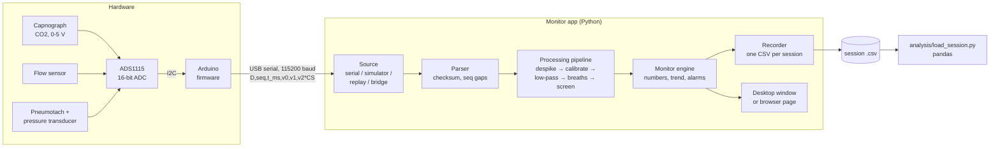

# CO2-Response

CMU BME 26-27 Capstone Project

[](https://github.com/shrlak/CO2-Response/actions/workflows/ci.yml)
[](https://github.com/shrlak/CO2-Response/actions/workflows/deploy.yml)

CO2-Response is a research capnography and airflow monitor. An Arduino with a 16-bit ADC reads three analog sensors 100 times a second and streams the voltages over USB:

- a capnograph (CO2)
- a flow sensor
- a pneumotachograph

The monitor app turns those voltages into a bedside-style display:

- sweeping waveforms and large numbers (EtCO2, FiCO2, respiratory rate, tidal volume, minute ventilation)
- trends of EtCO2, MV and RR, and a ventilatory-response plot (each breath's minute ventilation against its EtCO2)
- keys that run a rebreathing test (baseline, rebreathing, end) and a PDF report of the result
- visual and audible CO2 alarms, with a warning limit and a stop limit

It records everything to one CSV file per session for analysis afterwards. Noisy samples and noisy breaths are removed before any number, plot or alarm uses them.

The app is written in Python. It runs in two places, from the same code:

- **Desktop app** on Windows, macOS and Linux (`python -m co2response`, or a standalone build that needs no Python)
- **In the browser** from GitHub Pages: **<https://shrlak.github.io/CO2-Response/>**. Nothing to install; reading the Arduino needs desktop Chrome or Edge. After one visit it also works with no internet.

> [!WARNING]
> **Research use only.** This is not a medical device. It must never be the only CO2 monitor on a person or animal; keep a certified monitor as the primary alarm. The alarm here works only while the app is running, the computer is awake and a sound output is armed. See [docs/safety.md](docs/safety.md).

## Contents

1. [Try it now (no hardware)](#1-try-it-now-no-hardware)
2. [What you need for a real session](#2-what-you-need-for-a-real-session)
3. [Running a session, step by step](#3-running-a-session-step-by-step)
4. [The monitor screen](#4-the-monitor-screen)
5. [How the system works](#5-how-the-system-works)
6. [The software](#6-the-software)
7. [Deploying to GitHub Pages](#7-deploying-to-github-pages)
8. [Development](#8-development)
9. [Assumptions and open questions](#9-assumptions-and-open-questions)
10. [Documentation](#10-documentation)

---

## 1. Try it now (no hardware)

### In the browser

Open **<https://shrlak.github.io/CO2-Response/>** and press **Start simulator**.

The first load downloads the Python runtime (Pyodide, about 10 MB) and takes 10 to 30 seconds. After that it is cached.

The simulator breathes like a person, so every screen, alarm and recording feature can be tried without hardware. **Replay the sample session** plays a recorded session back through the monitor.

### On your computer

You need Python 3.10 or newer.

```bash
python -m venv .venv
```

```bash
source .venv/bin/activate
```

(On Windows: `.venv\Scripts\activate`.)

```bash
pip install -r requirements.txt
```

```bash
python -m co2response --sim
```

`--sim` starts the simulator straight away. Other start options:

| Command | What it does |
| --- | --- |
| `python -m co2response` | Opens on the start screen. Choose the Arduino, the simulator or a replay. |
| `python -m co2response --port COM3` | Connects to the Arduino on that port (`/dev/ttyACM0` on Linux, `/dev/cu.usbmodem…` on macOS). |
| `python -m co2response --replay sample-data/synthetic_session.csv` | Replays a recorded session through the monitor. |
| `python -m co2response --list-ports` | Lists serial ports and exits. |
| `python -m co2response --report session.csv` | Writes the CO2 response report (`session.pdf`) and exits. `--out` names the file; `--skip 20` changes the seconds of rebreathing left out. |
| `python -m co2response --sim --exit-after 12` | Runs for 12 s, prints what the monitor measured and closes: a check that an installation works. |
| `python -m co2response --version` | Prints the version. |

`pip install -e .` also adds a `co2response` command.

On Linux, alarm sounds need PortAudio (`sudo apt install libportaudio2`). Without it, the app falls back to the system beep and says so.

### Simulation panel

Press **Simulation** (the soft key next to Settings) to open the simulation panel beside the monitor. It works in the desktop app and in the browser, with or without the simulator already running.

- **Speed** (top of the panel): runs simulated time 1× to 10× faster than real time, like a replay at 2×–10×. At 10× a whole rebreathing test (38 → 58 mmHg, about 100 s of breathing) fills the ventilatory-response plot in about 14 s, with the same slope as at 1×, because everything the monitor measures runs on the device clock. Alarm delays (apnea 20 s, no data 3 s) stay in real seconds. The header shows the speed (e.g. "Simulator (5× speed) · 500 Hz"), and so does the source line of a recording made at that speed. Choosing a situation keeps the speed.
- **Record whole simulated tests** (switch under Speed): also saves a whole simulated test as a session, marked Simulator, so the review charts and the PDF report can be made from it too. A line under the switch says where the test stands ("Whole test: rebreathing 1:20, until the stop alarm").
- **Situations:** one click sets every simulator value for a ready-made situation and starts the simulator if it is not running. The monitor changes in place, with no gap in the data.

  | Group | Situations |
  | --- | --- |
  | Whole test (runs by itself) | Whole rebreathing test, blunted response, brisk response. The simulation presses the test keys itself: 30 s of baseline, the valve is "turned" and CO2 rises until the stop alarm, then the end of the test and 20 s of recovery. **Every graph fills in from it:** the three waveforms, the EtCO2, MV and RR trends, and the response plot with its baseline and fitted line. At 10× it takes about 20 s. |
  | Breathing patterns | Normal at rest, hyperventilation (EtCO2 20 mmHg), hypoventilation (EtCO2 63 mmHg, past the 60 mmHg warning limit), rapid shallow (RR 40), slow deep, light exercise, child (~6 years) |
  | Clinical | Bronchospasm / COPD ("shark fin" capnogram), raised inspired CO2 (FiCO2 12 mmHg), low cardiac output (EtCO2 12 mmHg), apnea |
  | CO2 challenge | Rebreathing test, blunted response (almost flat), brisk response. Each places a **Rebreathing** marker, so the ventilatory-response plot fits its line. |
  | Equipment problems | CO2 sensor, flow sensor or pneumotach unplugged; device stops sending; noisy signal; spikes + partial breaths; flow sensor drift (65 % of true flow + 8 L/min) |

- **Every value is a slider or a switch,** and dragging a slider changes the running simulator straight away:

  | Group | Controls |
  | --- | --- |
  | Breathing | respiratory rate, tidal volume, I:E ratio (sets peak inspiratory flow), end-tidal CO2, inspired CO2, airway obstruction (capnogram shape) |
  | CO2 challenge | CO2 rising on/off, rise rate (up to 60 mmHg/min), where the rise stops, breathing response (×0 to ×5) |
  | Events | apnea, CO2 sensor unplugged, flow sensor unplugged, pneumotach unplugged, device stops sending |
  | Safety channel | SpO2 (shown when the SpO2 channel is switched on in Settings > Display & units) |
  | Signal quality | sensor noise, ADC spikes, partial breaths, serial line errors |
  | Flow sensor calibration | gain (% of true flow) and zero offset |

- **Set vs Monitor:** a table at the top shows each value the simulator is producing next to what the monitor measures (EtCO2, FiCO2, RR, VT, MV, peak inspiratory flow). The monitor measures its numbers from the simulated waveforms, the same way it does from real sensors, so its numbers, waveforms, trend and alarms all agree. A new EtCO2 is on the next breath (or on the breath being drawn, if it is still inspiring). The large EtCO2 is the median of 3 breaths, RR averages 4 breaths and MV the last minute, so those follow a little later; raise **Speed** to get there sooner. A rise rate much above about 12 mmHg/min outruns MV's one-minute average, so the response plot under-reads the slope; use Speed rather than a faster rise to run a test quickly.
- If the values chosen would push flow past a sensor's range (about ±100 L/min with the default calibration), the panel warns that the signal will clip at the ADC rail.

**Settings > Connection > Simulator** offers the same situations in a drop-down. The simulator's values are saved and come back next time.

---

## 2. What you need for a real session

| Part | Notes |
| --- | --- |
| Capnograph with an analog CO2 output | 0–5 V. Scaling is set in calibration. |
| Flow sensor with an analog output | Bidirectional, centred at 2.5 V by default |
| Pneumotachograph and differential-pressure transducer | Analog output; used for breath detection, tidal volume and minute ventilation |
| ADS1115 16-bit ADC breakout | I2C address 0x48 |
| Arduino Uno (or Mega / Nano) | Plus a USB cable straight to the computer, not through a hub |
| Piezo buzzer (optional) | On pin 8: the board sounds it if the monitor app stops running |
| A computer | Windows, macOS or Linux with Python 3.10+, or desktop Chrome/Edge for the browser version |
| Calibration gas and/or a 3 L syringe | For calibrating CO2 and the pneumotach |

Wiring, firmware upload and first checks are covered in detail, with a wiring diagram and a troubleshooting section, in the **[setup and operating guide](SETUP-GUIDE.md)**. Pin-by-pin wiring is in [docs/wiring.md](docs/wiring.md).

---

## 3. Running a session, step by step

### Once per setup

1. **Wire the sensors.** Each sensor output goes to an ADS1115 input: CO2 to A0, flow sensor to A1, pneumotach transducer to A2. The ADS1115 connects to the Arduino over I2C (SDA, SCL, 5 V, GND). Every ground must be common. See [docs/wiring.md](docs/wiring.md).
2. **Flash the firmware.** Use either of:
   - **Arduino IDE:** open `firmware/CO2Response/CO2Response.ino`, install **Adafruit ADS1X15** from the Library Manager, choose the board and port, and upload.
   - **PlatformIO:** `cd firmware && pio run -e uno -t upload` (environments: `uno`, `mega`, `nano`).
3. **Install the app** (see [Try it now](#on-your-computer)), or use the [browser version](https://shrlak.github.io/CO2-Response/) in Chrome or Edge.

### Every session

4. **Connect.** Plug in the Arduino and press **Connect Arduino (USB)**. Pick the port; likely Arduinos are listed first. The app sends `INFO` and `START`. The header then shows the firmware, the measured sample rate (about 100 Hz) and the dropped-sample count.
5. **Run the hardware check:** **Settings > Diagnostics > Hardware check**. It watches the stream for 10 s and gives each item a pass, warning or failure, with how to fix it. It checks:
   - the USB link: rate, dropped samples, checksum errors
   - the ADC: whether it was found, plus an I2C scan if not
   - each sensor: stuck at 0 V or 5 V, clipping, noise level
6. **Calibrate** each channel in **Settings > Calibration** ([docs/calibration.md](docs/calibration.md)):
   - **CO2:** zero with room air or nitrogen, then span with a certified gas (for example 5 % CO2).
   - **Pneumotach:** zero with no flow, then push a 3 L syringe through it. The app integrates the stroke and sets the flow constant.
   - **Flow sensor:** two-point, or enter the datasheet values.

   Each channel's card previews the new values live; nothing changes on the monitor until you press **Save**. Saved calibrations are written into every recording.
7. **Set the barometric pressure** in **Settings > Display & units**. Pittsburgh is usually about 735 mmHg; use the lab's reading. It converts % CO2 to mmHg.
8. **Check the alarms.** In **Settings > Alarms**:
   - set the warning limit (default 60 mmHg), the stop limit (default 65 mmHg) and the optional low limit
   - press **Arm audio** until the key turns green
   - press **Test alarm** to confirm you can see and hear both tones
9. **Enter a study code** (never a name or other identifier), and the subject's height and weight if the slope should be normalized for body size. Press **Record**. The file is saved every second while recording.
10. **Run the test** with the three keys under the trend tabs (Read's method, as CHOP runs it):
    - **Start baseline** once the subject is breathing room air through the mouthpiece. The line beside the keys says when breathing is steady.
    - **Start rebreathing** as the valve is turned to the bag. A timer runs against the time limit.
    - at the **warning** (amber) the end is near; at **STOP TEST** (red) turn the valve back to room air
    - **End test** as the valve is turned back
    - **Emergency stop** ends the test at once from anywhere in it
    - with a valve driver on the board and **Switch the valve from the app** on (Settings > Alarms), the keys turn the valve, and the stop alarm, apnea and a low SpO2 turn it back to room air by themselves ([§5.9](#59-alarms-co2responsealarms))
    - watch the **Ventilatory response** tab for the slope, r and x-intercept. Click a point to take an erratic breath out of the fit.
    - press **Mark event** (or the `M` key) to timestamp anything else; markers appear on the trend and in the file. A marker you label **Rebreathing** yourself works like the key.
    - if an alarm sounds, **Silence** mutes it for 120 s; **Acknowledge** clears a resolved alarm
11. **Stop rec.** The session is listed in **Settings > Data & recordings**.
12. **Review and export.** **Open** the session to see its summary (with the CO2 response), its response plot and zoomable charts. Click a breath on the response plot to take it out of the fit after the fact; the file remembers it. Then export:
    - the **CO2 response report** as a PDF: results, plots, and a table of every breath
    - the whole file
    - the per-breath table
    - the alarms/events table
    - any of the CSVs for a zoomed time range

    Analyse it with `analysis/load_session.py` ([§5.10](#510-review-export-and-analysis)).

If the USB cable comes out, the device-disconnected alarm sounds. Plugging the same Arduino back in reconnects by itself, and recording continues in the same file.

---

## 4. The monitor screen

- **Header:**
  - research-use tag, study code, data source and connection state
  - measured sample rate, dropped samples, recording status and the clock
  - alarm-system status: `ARMED`, `ALARM`, `SILENCED 1:42`, `AUDIO OFF` or `DISARMED`
- **Alarm strip:** a fixed-height strip under the header, so an alarm never moves the waveforms. Colours:
  - red, flashing: high priority
  - amber: medium (technical)
  - blue: advisories

  Alarms latch until you press **Acknowledge** or **Clear**. A high alarm also flashes the window title and taskbar entry.
- **Waveforms** sweep left to right like a bedside monitor: CO2 (yellow, with the warning limit dashed), flow sensor (cyan) and pneumotach flow (green). The graphs take all the space the numbers and keys do not, with thick traces and large scale labels.
- **Enlarge a graph:** the **⤢** button beside each graph's name (or a double-click on a waveform in the desktop app) makes that graph fill the monitor. Press it again, or `Esc`, to go back. The waveform carries on without losing what is on screen.
- **Numbers:**
  - EtCO2 with its limits beside it (warning / stop, and low), RR, FiCO2, live and peak flow, VT and MV
  - SpO2 with its low limit, when an oximeter is connected ([§5.2](#52-hardware))
  - under VT, the expired volume of the same breath; MV is the average over the last 60 s
  - a channel with no valid data for 2 s shows `---`
  - when the last breath was left out as noisy, the EtCO2 tile says so
- **Test keys** (under the trend tabs): **Start baseline**, **Start rebreathing**, **End test** and **Emergency stop**, and beside them where the test stands: `BASELINE 0:45 · steady (EtCO2 ±0.4 mmHg, MV ±6 % in the last minute)`, `REBREATHING 2:31 of 5:00`, `TEST ENDED after 3:40 of rebreathing`. It adds `NOT RECORDING` if nothing is being recorded, and where the valve is when the app switches it (`valve to the bag`, `VALVE ON ROOM AIR`).
- **Trend tab:**
  - one point per clean breath over 5 min, 15 min, 30 min, 2 h or the whole session: EtCO2, MV or RR (the drop-down beside Window)
  - for EtCO2: the continuous CO2 trace behind the points, the warning limit (dashed) and stop limit (solid) with their bands
  - alarm marks and your event markers
  - the caption counts breaths left out as noisy
- **Ventilatory response tab:** each clean breath's own minute ventilation (VT × 60 / its length) against its EtCO2. Once rebreathing is marked:
  - baseline breaths are hollow rings, summarized as the baseline (mean EtCO2 and MV)
  - the least-squares line is fitted to the rebreathing breaths only, the way CHOP reports the test
  - breaths in the first 30 s of rebreathing and after the end of the test are faint rings and are not fitted
  - **click a point** to take a breath out of the fit by hand (a cross); click the cross to put it back
  - the caption shows the slope (L/min per mmHg), r, the x-intercept ("x-int", the EtCO2 where the line reaches MV = 0), n, the baseline means, and how many breaths are outside the fit or excluded

  Without a marker, every breath is fitted.
- **Soft keys:** Silence (120 s), Arm audio, Mark event (`M`), Record, Freeze, Alarm limits, Simulation ([the simulation panel](#simulation-panel)), Settings.
- **Settings** has these tabs: Connection, Calibration, Alarms, Display & units, Data & recordings, Diagnostics. Alarms keep running while you are in Settings.

---

## 5. How the system works

### 5.1 The big picture



The Arduino only measures volts. Everything else happens in the monitor app, so recalibrating never needs a firmware change:

- converting volts to CO2 and flow
- removing noise and finding breaths
- computing the numbers and raising alarms
- recording

The same engine code runs in the desktop app, in the browser and in the tests.

### 5.2 Hardware

| Channel | ADC input | Default scaling (until calibrated) | Used for |
| --- | --- | --- | --- |
| CO2 (capnograph analog out) | A0 | 0–5 V = 0–10 % CO2 | CO2 waveform, EtCO2, FiCO2, CO2 alarms |
| Flow sensor | A1 | 2.5 V = 0 L/min, 40 L/min per volt | Second flow waveform and live/peak flow |
| Pneumotach transducer | A2 | 2.5 V = 0 Pa, 200 Pa per volt; flow = 0.2 L/min per Pa | Breath detection, tidal volume, minute ventilation |
| Pulse oximeter analog out (optional) | A3 | 1 V = 100 % SpO2 | SpO2 tile, low-SpO2 alarm, a column in the recording |

Two optional outputs on the Arduino: a **piezo buzzer** on pin 8 (sounds if the app stops, [§5.3](#53-firmware-firmwareco2response)) and a **valve driver** on pin 7 (HIGH = to the bag; it needs a transistor or relay stage for the solenoid or servo, [docs/wiring.md](docs/wiring.md)).

The ADS1115 runs at ±6.144 V full scale from a 5 V supply, so a reading at 0 V or 5 V means a sensor is unplugged or saturated (the "rail" checks). The default scalings are placeholders; see [Assumptions](#9-assumptions-and-open-questions).

### 5.3 Firmware (`firmware/CO2Response/`)

The sketch reads the three channels in single-shot mode on a fixed 10 ms schedule (100 Hz; 1–200 Hz with the `RATE` command). It sends one text line per sample.

- **Sequence numbers:** each scheduled slot gets a sequence number. If the Arduino falls behind, it skips the slot, still advances the sequence number, and reports `E,OVERRUN`, so the app can count dropped samples exactly.
- **ADC errors:** if the ADC does not answer on I2C, the firmware reports `E,ADC_NOT_FOUND` with an I2C scan, keeps retrying, and does not stream until the ADC answers.
- **Host watchdog:** the monitor app sends `HB` once a second. If the heartbeats stop for 3 s (the app closed or crashed, the computer slept), the board sounds a piezo buzzer on pin 8 and blinks its LED until they return, because nothing on the computer is checking the CO2 alarms any more. It arms on the first heartbeat, so older software never triggers it.
- **Valve output:** `VALVE 1` sends the valve to the bag and `VALVE 0` back to room air. The board starts on room air and returns there by itself when the watchdog trips, so a crashed app never leaves the subject on the bag.
- **SpO2 channel:** built with `SPO2_CHANNEL 1`, the board also reads A3 and sends a fourth value on every data line. It is off by default, so the three-channel stream is unchanged.
- **Configuration:** pins, address, gain, baud rate, the watchdog timeout, the buzzer and valve pins and the SpO2 channel are in `config.h`.
- **Builds:** the same code builds for Uno, Mega and Nano.

### 5.4 Serial protocol ([docs/protocol.md](docs/protocol.md))

The device sends plain ASCII lines at 115200 baud:

```
I,FW,1.2.0,ADC,ADS1115,CH,3,RATE,100,BAUD,115200,ADDR,0x48,FSR,6.144,WD,3000,VALVE,1   ← info
D,1042,10420,2.6316,2.5000,2.5000*5C                                     ← data: seq, device ms, volts…, checksum
E,ADC_NOT_FOUND                                                          ← error
A,START                                                                  ← acknowledgement
```

The checksum is the XOR of the bytes between `D` and `*`. A line with a bad checksum, or one that fails to parse, is dropped and counted. A gap in `seq` (16-bit, wraps) counts as dropped samples.

The host sends `INFO`, `START`, `STOP`, `RATE <hz>` and, to firmware that says `WD` in its info line, the heartbeat `HB` (`HB OFF` before a deliberate disconnect), and `VALVE 1` / `VALVE 0` to firmware that says `VALVE`. A disconnect always sends `VALVE 0` first. Opening the port resets an Uno, so the app repeats `INFO` and `START` if no info line arrives within 2.5 s. The firmware's line formatter and the app's parser are tested against the same example lines, so they stay byte-for-byte compatible.

### 5.5 The monitor engine (`co2response/engine/monitor.py`)

The engine is the whole data path, with no user-interface code:

```
source → line parser → sequence tracker → processing pipeline → breaths → numbers / trend → alarm engine → recorder
                                                                                                  ↓
                                                                                     snapshot() → the screen
```

The window (or browser page) drives it on two timers:

- `poll()` every 20 ms reads whatever the source has, and processes every sample and every finished breath.
- `tick()` every 250 ms runs the time-based checks: no data, apnea, rails, dropped samples, checksum errors, noisy signal, the rebreathing time limit, volume mismatch, calibration age, audio. It also updates the alarm sounds, sends the device its heartbeat and saves the recording.

The screen reads a `snapshot()` and draws it. Alarms never depend on drawing. The engine takes its clock as a parameter, so tests run hours of simulated data in seconds.

**Sources** (`co2response/sources/`) all produce the same lines:

| Source | What it is |
| --- | --- |
| Serial | pyserial on the desktop; Web Serial in the browser |
| Simulator | A software Arduino that emits real protocol lines from a physiological model |
| Replay | Plays a recorded session's raw volts back through the live processing and alarms, with its markers, so a test is split and fitted as it was live |
| Bridge | A WebSocket client for `bridge/serial_ws_bridge.py` running on another computer |

When a serial device disappears, the engine raises **DEVICE DISCONNECTED** and keeps scanning for the same USB device. When it returns, the engine reconnects and resumes into the same recording.

### 5.6 Signal processing (`co2response/processing/`)

Every sample goes through these steps, in order:

1. **Spike removal** (Hampel filter) on the raw volts. See [Noise removal](#57-noise-removal).
2. **Rail check.** A channel at 0 V or 5 V (within 5 mV) is marked invalid and reads `---`. A channel held there for 2 s raises a "signal at ADC rail" alarm. The CO2 channel is checked only at the high rail, because a capnograph reads 0 V at 0 % CO2.
3. **Calibration:** volts become engineering units through each channel's calibration, then its zero offset is subtracted. A calibration is linear (gain and offset), a polynomial, or a lookup table with interpolation (`channels.json`).
4. **Low-pass filter:** a 2nd-order Butterworth, 10 Hz by default, on every channel.
5. **Unit conversion:**
   - CO2 % to mmHg: P<sub>CO2</sub> = F<sub>CO2</sub>/100 · (P<sub>B</sub> − P<sub>H2O</sub>), where P<sub>B</sub> is the barometric pressure set in Display & units. The optional BTPS water-vapor correction subtracts 47 mmHg.
   - Pneumotach pressure to flow: flow = k1·ΔP + k2·ΔP·|ΔP| (k1 from the syringe calibration).
   - Optional gas conditions for the pneumotach flow, both off by default ([docs/calibration.md](docs/calibration.md#gas-conditions-and-timing-settings--display--units)): volumes at body conditions (BTPS, about ×1.09 at 22 °C), and a bag-gas factor between the Rebreathing and End-of-test markers (a pneumotach calibrated in air over-reads in an oxygen-rich bag).
   - **CO2 delay:** if a CO2 delay is set (a sidestream analyser's sample line), the flow signals are held back by that much, so each breath's CO2 lines up with its flow.
6. **Breath detection** ([§5.8](#58-breath-detection-and-the-numbers)) and the **breath screen** ([§5.7](#57-noise-removal)).

### 5.7 Noise removal

Noisy signals are removed **before** anything is interpreted. That covers the numbers, the EtCO2 trend, the CO2 response plot, the alarms, the review screen and the analysis loader. There are two layers.

**Sample level: every sample, before it is calibrated or plotted.**

- **Hampel spike filter.** Each sample is compared with the median of the 7 samples centred on it. If it differs by more than 3.5 robust standard deviations (the scaled median absolute deviation), it is replaced by that median.
  - Single-sample glitches (ADC hiccups, electrical pickup, a bumped cable) disappear.
  - A real fast change, such as the capnogram's upstroke, is kept, because the median follows a monotonic edge.
  - It delays the signal by 30 ms (3 samples) and drops nothing.
- **Butterworth low-pass filter** (above), for broadband noise.

**Breath level: every finished breath, before it is used.**

The breath screen gives each breath a quality:

| Quality | Why a breath gets it |
| --- | --- |
| `ok` | Used everywhere |
| `noisy` | Signal-to-noise ratio below 8. The noise is measured during that breath, before filtering, from sample-to-sample second differences (median \|Δ²\|/1.65, which ignores the slow breathing itself). It is compared with the breath's CO2 amplitude, or with its peak flow. |
| `artifact` | A partial breath with no alveolar plateau (less than 10 % of expiration within 90 % of EtCO2: a shallow breath, cough or kinked sample line); an impossible EtCO2 (outside −2 to 120 mmHg); no inspiration (VT under 1 mL); or inspiratory flow beyond the sensor's range for more than 20 ms (the volume under-reads) |
| `outlier` | An isolated EtCO2 jump. It is more than 5 mmHg, and 3 robust SDs of the recent breath-to-breath change, away from both the breath before and the breath after, in the same direction. A real step change (the start of rebreathing) is kept, because the next breath stays at the new level. Outliers are known one breath later, so they are recorded as a `BREATH_REJECTED` event. |

Breaths that are not `ok`:

- are left out of the EtCO2/RR/VT/MV numbers, the EtCO2 trend (the breath points, and the continuous CO2 line behind them, which breaks over a rejected breath), the MV-against-EtCO2 fit, the review summary and charts, the EtCO2 alarms, and `s.breaths` in the analysis loader
- have their samples blanked in the analysis loader: in `s.samples`, the calibrated values of every sample inside a rejected breath are NaN, so averages, plots and fits of the samples skip them too (the raw volts stay)
- stay in the recording, marked in the `breath_quality` column, so nothing is lost and the decision can be revisited

If 3 of the last 5 breaths are rejected as noisy or partial, a **SIGNAL TOO NOISY** technical alarm sounds, instead of false CO2 alarms. A flat CO2 trace (sample line off) is not called noisy, so the low-CO2 and apnea alarms still see it.

Both layers can be switched off in **Settings > Display & units** (**Remove spikes**, **Leave noisy breaths out**), for example to look at the raw signal while calibrating. The raw volts (`v0`–`v2`) are always recorded untouched, so a session can be re-processed later.

### 5.8 Breath detection and the numbers

**Finding breaths.** Breaths are found on the pneumotach flow:

- An inspiration starts when flow rises above +0.05 L/s (the deadband, adjustable) at least 1 s after the previous one began.
- Expiration starts when flow falls below −0.05 L/s.
- A breath runs from one inspiration start to the next.

If there is no valid flow signal, detection falls back to the capnogram: a breath ends when CO2 drops from above half the last EtCO2 to below 30 % of it.

A flow dropout shorter than 0.5 s is bridged with the last valid value instead of restarting detection. The usual cause is a hard breath taking the sensor past its range (the sample sits at the ADC rail). Without the bridge every such breath would be lost, and the monitor would call it apnea. A breath whose inspiration was bridged is then left out as an artifact, because its volume under-reads.

**Per-breath values:**

| Value | How it is computed |
| --- | --- |
| EtCO2 | Peak CO2 during expiration |
| FiCO2 | Minimum CO2 during inspiration |
| VT | Inspiratory flow integrated over the inspiration (trapezoidal rule, device clock) |
| Expired volume (VTe) | Outward flow integrated over the breath. It should match VT; a difference means a leak or a drifted flow zero |
| Period, and the breath's own MV | The breath's length, and VT × 60 / period |
| Peak inspiratory flow | Maximum flow during inspiration |
| CO2 lag | Time from the start of expiration to the capnogram's upstroke. Beyond 0.1 to 0.3 s of dead-space washout, it is the CO2 sensor's delay |
| Plateau, level, noise, clipped time | Used by the breath screen |

**Numbers shown large** (from clean breaths only):

| Number | How it is computed |
| --- | --- |
| EtCO2 | Median of the last 3 breaths |
| RR | 60 / mean breath period of the last 4 breaths |
| MV | ΣVT / Σbreath period over the last 60 s, in L/min. This is correct from the first minute, rather than under-reading until 60 s have passed. |
| Ventilatory response | Ordinary least-squares fit of each breath's own MV against its EtCO2 over the trend window (`processing/metrics.py` → `co2_response`); slope in L/min per mmHg, r, x-intercept and n, plus the baseline means |

**Which breaths the response uses.** The 60 s average MV shown on the monitor lags the EtCO2 it would be paired with, and for the first minute of rebreathing it still contains baseline breaths. So the fit uses each breath's own MV, as CHOP's breath-by-breath analysis does. From the markers (`test_window`):

| Breaths | What happens to them |
| --- | --- |
| Before the **Baseline** marker (or the end of an earlier test) | Not used |
| From there to the **Rebreathing** marker | The baseline: averaged, not fitted |
| The first 30 s of rebreathing (**Leave out the start of rebreathing** in Data & recordings) | Drawn faintly, not fitted: the coached deep breaths, and the bag, lungs and blood coming to equilibrium |
| The rest of rebreathing | Fitted |
| From the **End of test** marker on | Drawn faintly, not fitted: recovery |
| Rejected by the noise screen | Not drawn, not fitted |
| Excluded by hand (a click on the plot) | Drawn as crosses, not fitted; written to the recording as `BREATH_EXCLUDED` |

With several tests in one session, the latest is shown. With height and weight entered, the report also gives the slope per kg and per m² of body surface (Mosteller).

### 5.9 Alarms (`co2response/alarms/`)

**Physiological alarms:**

- **Warning limit: high EtCO2** (default 60 mmHg) and **low EtCO2** (off by default). Both use clean breaths only.
  - They trigger after 2 consecutive breaths beyond the limit. With the alarm source set to live CO2 instead, they trigger after 5 continuous seconds.
  - The warning is medium priority while a stop limit is set, and high priority on its own. Low EtCO2 is medium.
- **Stop limit** (default 65 mmHg; high priority, "STOP TEST: … turn the valve to room air"). It triggers when CO2 stays at or above it for half a second, checked on every sample, or when a single breath ends above it. It does not wait for a second breath, and it does not depend on the breath screen.
- They clear only once EtCO2 is 2 mmHg back inside the limit (hysteresis).
- **Apnea** (high): no breath for 20 s while the signal is present.
- **Rebreathing time limit** (medium): 5 minutes (adjustable) since the Rebreathing marker without an end marker.
- **Low SpO2** (high; default below 90 % for 10 s), when the SpO2 channel is on. An advisory says when the oximeter gives no reading.

The defaults follow the team's design (warn near 60, stop at 65) and CHOP's practice of ending the test at 60 to 65 mmHg. Confirm them with the clinicians ([open question 9](docs/open-questions.md)).

**The valve.** By default the software only alarms and the operator turns a manual valve. With a valve driver on the board and **Switch the valve from the app** on:

- **Start rebreathing** sends the valve to the bag and **End test** back to room air
- the **stop alarm**, **apnea** and **low SpO2** send it back to room air by themselves and end the test in the record ("automatic stop")
- **Emergency stop** sends it to room air at once, whether or not the app normally switches it
- disconnecting, and the board's own watchdog, return it to room air

The automatic stop is a backstop, not a replacement for watching the subject: it has not been tested on hardware ([docs/safety.md](docs/safety.md)).

**Technical alarms** (always on):

| Alarm | Priority |
| --- | --- |
| No data from device (3 s) | medium |
| Device disconnected | medium |
| ADC not found | medium |
| CO2/flow/pneumotach signal at ADC rail | medium |
| Signal too noisy | medium |
| Dropped samples above 0.1 % | advisory |
| Corrupt lines in the last minute | advisory |
| Audible alarm not armed | advisory |
| Volume mismatch: expired volume more than 20 % from inspired over 5 breaths (a leak, or a drifted pneumotach zero) | advisory |
| Calibration older than 24 h, or never done, on a real device | advisory |
| Settings or calibration could not be saved | advisory |

**Behaviour:**

- High and medium alarms **latch**: when the condition clears, they stay on screen marked resolved until acknowledged.
- **Silence** mutes the sound for up to 120 s, then re-arms by itself. A new high-priority alarm cancels a silence, so silencing the warning never mutes the stop alarm.
- The tones follow the IEC 60601-1-8 pattern: high is 10 pulses, medium is 3 pulses. The warning and the stop alarm therefore sound different.
- With firmware 1.1 or later and a buzzer on the board, the Arduino itself sounds if the app's heartbeat stops ([§5.3](#53-firmware-firmwareco2response)).
- On the desktop, the app keeps the computer from sleeping while a device is connected. In the browser it holds a screen wake lock.
- Every alarm start, acknowledge, silence and resolve is written to the recording.

### 5.10 Recording, review, export and analysis

**Recording.** **Record** writes one CSV per session, `co2r_<study code>_<YYYYMMDD-HHMMSS>.csv`, every second, so a crash loses at most a second. An unfinished file is listed as **Recovered** next time. The file contains:

- `#` metadata lines: the study code, start time, firmware, sample rate, the calibration, processing and alarm settings in use, and the test settings (seconds left out of the fit; the subject's height, weight and age if entered)
- then one row per sample, with 25 columns:
  - time on both clocks, device ms, sequence number
  - raw volts `v0`–`v2` (and `v3`, the oximeter's, when an SpO2 channel is connected)
  - the cleaned, calibrated values (and `spo2_pct`)
  - on the sample where a breath ended: that breath's EtCO2, FiCO2, RR, VT, MV (60 s average), peak flow, its own length (`period_s`), its expired volume (`vte_ml`) and `breath_quality`
  - any alarms, markers, breaths excluded by hand, connection changes and calibration changes, in the `event` column

Every row has the same columns, so it opens directly in Excel, pandas, MATLAB or R. The full format (v4) is in [docs/data-format.md](docs/data-format.md). Files from earlier versions still open.

**Review** (Settings > Data & recordings > Open):

- a summary: length, breaths and how many were left out, mean/min/max EtCO2, mean RR/VT/MV, alarms, markers, sample rate, dropped samples, and the CO2 response (slope, r, x-intercept, baseline)
- the response plot, as on the monitor. Click a breath to take it out of the fit (or put it back): the slope, the summary and the report follow, and the choice is written into the file as an event, so it is still there next time and in every export.
- zoomable EtCO2/RR, VT/MV and waveform charts (drag to zoom all three)
- the event list; click an event to jump to it

**Import.** Besides its own files, the app imports a **LabChart (PowerLab) text export** (`.txt`) that has a flow channel and a CO2 channel, such as CHOP's current recordings. It finds the channels by name and unit, converts the units (mL/s, L/s or L/min; mmHg, % or kPa), turns the flow the right way up, and keeps LabChart comments as markers. The breaths, the response and the report are then worked out by this app, so an old test can be compared with a new one. No real CHOP export was available to test against ([open question 34](docs/open-questions.md)): check the first imported file against LabChart's own numbers.

A long recording is read in small steps, so the monitor keeps polling the device and checking alarms while it opens (an hour of recording, about 39 MB, takes about a second to read on a laptop).

**Export:**

- the whole session, the per-breath table (with a `quality` column) or the alarms/events table
- any of these for the whole session or just the zoomed range
- the **CO2 response report** as a PDF: the results, the response plot, EtCO2 and MV against time, how it was measured, and a table of every breath saying how it was used. The desktop app, the browser and `python -m co2response --report file.csv` make the same report, with a small PDF writer inside the app (nothing to install).

**Analysis in Python:**

```python
import sys; sys.path.append("analysis")
from load_session import load_session

s = load_session("co2r_STUDY-01_20261105-010203.csv")
s.samples       # one row per sample: cleaned values (blanked inside noisy breaths) + raw volts + breath_quality
s.breaths       # one row per CLEAN breath: etco2_mmHg, rr_bpm, vt_ml, mv_lpm, mv_breath_lpm, period_s, vte_ml, ...
s.breaths_all   # every breath, with breath_quality
s.events        # alarms, markers, connections

from co2r.session import co2_response
co2_response(s)   # baseline, then slope, r, x-intercept of the rebreathing breaths: the same rules as the live monitor
co2_response(s, skip_s=20, exclude=[41, 42])   # another skip; leave breaths 41 and 42 out
```

From the command line, `python analysis/load_session.py session.csv --breaths breaths.csv` prints a summary (including the CO2 response) and writes the clean breath table. `--all-breaths` keeps the rejected breaths, marked; `--skip` and `--exclude` change the fit. A test checks that this loader and the app's report give the same slope for the sample session.

### 5.11 Calibration ([docs/calibration.md](docs/calibration.md))

**Methods** (Settings > Calibration):

| Method | How it works |
| --- | --- |
| Enter values | Type the gain and offset from a datasheet |
| Zero & span / two-point | Capture the live reading at two known references (room air or N₂ and a certified CO2 gas; no flow and a known flow) |
| Multi-point fit | Capture several points; the app fits a line or polynomial and shows the largest error at the reference points |
| 3 L syringe (pneumotach only) | Push a calibrated syringe through; the app integrates the pressure stroke and sets the flow constant k1 |

**Zero now** sets a channel's zero offset from the current reading.

Each channel's card previews the new calibration live; nothing changes on the monitor until you press **Save**. Saved calibrations persist between runs, are written into every recording, and can be exported and imported as JSON.

While a real device is connected, a notice names any channel calibrated more than 24 hours ago, or never. Gas conditions (BTPS volumes, the bag-gas factor) and the CO2 delay are in **Settings > Display & units**; the CO2 delay field shows the lag the monitor measures, to help set it.

The starting values come from `co2response/config/channels.json`, which can be edited without touching code.

The rules of this screen (converting between calibration types, zeroing, fitting the captured points, integrating the syringe stroke, saving) are in `co2response/calibration_draft.py`, with no UI code. The desktop window and the browser page both draw that one model, so they cannot disagree, and it is tested directly.

### 5.12 Simulator (`co2response/sim/`)

A physiological model (`physiology.py`) generates the CO2 and flow waveforms. Every value the monitor shows can be set: EtCO2 and FiCO2, RR, VT and the I:E ratio (and so peak inspiratory flow), the capnogram's shape, a CO2 rise with an adjustable breathing response, apnea, unplugged sensors, a stalled data stream, sensor noise, ADC spikes, partial breaths, serial line errors and a miscalibrated flow sensor. An emulated firmware (`core.py`) turns the waveforms into real protocol lines with real checksums and sequence numbers.

A **whole simulated test** is a situation that also presses the test keys (`engine/monitor.py`, `_run_sim_test`): baseline, the "valve" (which decides whether the simulated CO2 rises), the end of the test when the stop alarm sounds or the CO2 stops rising, then recovery. It is timed on the simulated clock, so at 10× the whole test takes about 20 s, and the engine scales its own test timers, the skipped first seconds and the steadiness window by the same factor, so the fit is the same at any speed. The simulated board has a valve output and, with the SpO2 channel on, an oximeter.

`controls.py` lists the panel's sliders, switches and situations ([§1](#simulation-panel)); the desktop window and the browser page both build their panel from it. The old single-choice scenarios (`normal`, `co2Ramp`, `apnea`, `co2Disconnect`, `noData`, `noisy`, `artifacts`) still work, and a test runs every situation through the real engine and checks the monitor reads what was set.

It is seeded, so the tests and the sample session are reproducible. `sample-data/synthetic_session.csv` is made by `scripts/make_sample_session.py`, which drives the real engine on a fake clock through a whole rebreathing test (180 s): 60 s of quiet breathing with spikes and partial breaths and a **Baseline** marker at 20 s, then a "CO2 rebreathing started" marker and an 18 mmHg/min CO2 rise through the 60 mmHg warning to the 65 mmHg stop limit, then **End of test** and 10 s of recovery. A test checks the script still reproduces the file byte for byte. It keeps the simulator's original pacing (EtCO2 halves its distance to a new value each breath, `settle=0.5`), and a test checks the script still reproduces the file byte for byte.

---

## 6. The software

### 6.1 One engine, three ways to run it

| | Desktop app | Browser (GitHub Pages) | Bridge |
| --- | --- | --- | --- |
| Start | `python -m co2response` | open the Pages URL | `python bridge/serial_ws_bridge.py --port COM3` |
| User interface | PySide6 (Qt) + pyqtgraph | HTML page drawn by Python (Pyodide) | none |
| Reads the Arduino with | pyserial | Web Serial (desktop Chrome/Edge) | pyserial, relayed over WebSocket |
| Alarm sound | sounddevice (PortAudio) | Web Audio | n/a |
| Sessions stored in | `Documents/CO2-Response/sessions` | the browser's storage (IndexedDB); export to keep a copy | n/a |
| Works in | Windows, macOS, Linux | Chrome/Edge for hardware; any modern browser for the simulator, replay and review | any OS |
| Without internet | yes | yes, after one visit online (or from a build with the runtime bundled) | yes |
| In the background | keeps running | a background tab is slowed by the browser; keep the tab in front | n/a |

Both front ends use the same `co2response` engine, processing, alarms, session-file and report code; only the drawing and the platform adapters differ. The alarm, signal-processing and test/subject forms are described once, in `co2response/forms.py`, and each front end builds its form from that list (`ui/spec_form.py`, `web/spec_form.py`), so a setting is added, worded and limited in one place. The calibration and connection screens are still written separately for each front end.

**The standalone desktop app.** `.github/workflows/release.yml` builds the desktop app with PyInstaller for Windows, macOS and Linux (`packaging/CO2-Response.spec`) and checks that each built program writes a report and runs the simulator. Pushing a tag like `v0.4.0` attaches the three apps to a GitHub Release; a lab computer then needs no Python. To build one locally: `pip install pyinstaller` and `pyinstaller --noconfirm packaging/CO2-Response.spec`.

**How the browser version works.** `site/index.html` and the small service worker `site/sw.js` are the only JavaScript:

1. `index.html` loads Pyodide (CPython compiled to WebAssembly) and numpy from the jsDelivr CDN.
2. It unpacks `co2response.zip` (this package without the Qt window) and runs `co2response.web.app.main()`.
3. `sw.js` stores the site and the Python runtime in the browser on the first visit. After that the monitor starts with no internet at all, for example on a lab or hospital network that blocks it. The site's own files are still fetched fresh whenever there is a network, so a new deploy arrives at once.

From there everything is Python: the page's HTML is built in `co2response/web/`, and browser APIs are called through Pyodide's `js` module.

**The bridge** (`bridge/serial_ws_bridge.py`) relays the Arduino's serial lines over WebSocket. It lets a second computer watch the session, or lets Safari/Firefox reach the Arduino.

- By default it listens on localhost only. Use `--host 0.0.0.0` only on a trusted network.
- `--simulate` runs it without hardware.
- Browsers block a plain `ws://` connection from an https page to another computer. So the Pages site can use a bridge on the same computer (`ws://localhost:8765`); to watch from another computer, use the desktop app.

### 6.2 Repository layout

```
co2response/                    the monitor (python -m co2response)
  __main__.py                   command-line options
  protocol.py                   line format, checksum, parser, line splitter, sequence/drop tracking
  channels.py, config/          per-channel calibration model; defaults in config/channels.json
  settings.py                   all settings (display, processing, alarms, test and subject), saved as JSON
  forms.py                      the alarm, processing, test and SpO2 forms, described once for both front ends
  calibration_draft.py          the Calibration screen's rules (drafts, fits, the syringe stroke), drawn by both front ends
  connection_form.py            the Connection screen's choices, limits and wording, for both front ends
  paths.py                      where settings and sessions are stored (CO2R_HOME overrides)
  keep_awake.py                 keeps the computer awake while a device is connected
  jsfmt.py                      number/time formatting that keeps session files stable across versions
  sim/                          physiological model (physiology.py), firmware emulation (core.py), simulation panel controls and situations (controls.py)
  processing/
    pipeline.py                 per-sample path: despike → rail check → calibrate → low-pass → units → breaths
    denoise.py                  Hampel spike filter, noise meter, breath screen (noise removal)
    filter.py                   2nd-order Butterworth low-pass
    calibration.py              apply/invert calibrations, fits, syringe integration, pneumotach flow model
    co2.py                      % ↔ mmHg (barometric pressure, water vapor); BTPS and gas-viscosity factors
    breath.py                   breath detector and per-breath values (VT, expired volume, period, CO2 lag)
    metrics.py                  EtCO2 median, RR, MV, least-squares fit; the test's phases and the CO2 response
    quality.py                  ADC rail detection
  alarms/
    engine.py                   alarm state machine: limits, delays, hysteresis, latching, silence
    audio.py                    alarm tones
  sources/                      serial (pyserial), simulator, CSV replay, WebSocket bridge client
  storage/
    session_file.py             session CSV format: writer cells, parser, summaries, exports
    report.py                   the test report: the response of a recorded session, its numbers and its PDF
    pdf.py                      a small PDF writer (text, lines, circles), so the report needs nothing installed
    recorder.py                 writes the session as it is recorded
    library.py                  the sessions folder: list, import, recover, delete
    labchart.py                 reads a LabChart (PowerLab) text export and turns it into a session
  engine/
    monitor.py                  the engine: everything between the source and the screen
    link_test.py                the hardware check
  ui/                           desktop window (PySide6): monitor, settings pages, session review
  web/                          browser front end (Pyodide): DOM helpers, views, Web Serial/Audio, storage
  fonts/                        Barlow Semi Condensed (SIL OFL)
site/                           index.html (Pyodide loader), sw.js (offline copy) and styles.css for the Pages build
packaging/                      PyInstaller recipe for the standalone desktop app
scripts/
  build_site.py                 builds the Pages site into dist/site (--vendor-pyodide bundles the Python runtime)
  make_sample_session.py        regenerates sample-data/synthetic_session.csv
firmware/                       PlatformIO project; the sketch in CO2Response/ also opens in Arduino IDE
bridge/                         serial → WebSocket relay
analysis/                       pandas loader for session files
sample-data/                    a synthetic recorded session
tests/                          pytest suites (see Development)
docs/                           protocol, wiring, calibration, safety, data format, UI mockup
.github/workflows/              ci.yml (tests on every PR), deploy.yml (GitHub Pages), release.yml (standalone apps)
```

Everything apart from `firmware/` (C++), the small Pyodide loader in `site/index.html` and the service worker `site/sw.js` is Python.

### 6.3 Where things are stored

| What | Desktop | Browser |
| --- | --- | --- |
| Settings and saved calibration | Windows `%APPDATA%\CO2-Response`, macOS `~/Library/Application Support/CO2-Response`, Linux `~/.local/share/co2response` | Browser storage for the site |
| Recorded sessions | `Documents/CO2-Response/sessions` (or a folder you pick in Data & recordings) | Browser storage. Export sessions you want to keep: clearing site data deletes them. |

Set `CO2R_HOME` to keep everything in one folder (for example on a USB stick).

### 6.4 Design rules

- **The device sends volts; the app does the rest.** Calibration and processing changes never need a firmware upload.
- **The engine has no UI code.** Alarms are evaluated on every sample and breath, not in drawing code, and everything can be tested with a fake clock.
- **Two front ends, one set of rules.** What a settings screen offers and does is described once, without UI code (`forms.py`, `calibration_draft.py`, `connection_form.py`, `sim/controls.py`); the desktop window and the browser page only draw it.
- **Clean before interpreting; never throw data away.** Rejected breaths are marked, not deleted, and the raw volts are always recorded.
- **One file per session**, with the same columns on every row, readable without this software.

---

## 7. Deploying to GitHub Pages

The site is built and published by GitHub Actions (`.github/workflows/deploy.yml`).

**One-time setup** (a repository admin):

1. Open the repository on GitHub, then **Settings > Pages**.
2. Under **Build and deployment > Source**, choose **GitHub Actions**.

**After that:**

- Every push to `main` runs the workflow. It:
  1. builds the site with `python scripts/build_site.py dist/site`
  2. boots the built site in Chromium and drives it with the browser tests (`tests/test_web.py`)
  3. publishes it only if they pass
- The site appears at **<https://shrlak.github.io/CO2-Response/>**.
- To redeploy by hand: **Actions > Deploy to GitHub Pages > Run workflow**.

**To build and preview locally:**

```bash
python scripts/build_site.py
```

```bash
python -m http.server 8000 --directory dist/site
```

Then open <http://localhost:8000>. Web Serial works on `localhost` as it does on the https site.

The built site is about 2 MB: the page, the fonts, the sample session and `co2response.zip`. Pyodide itself comes from the jsDelivr CDN, and the service worker keeps a copy in the browser after the first visit.

**A site for a network with no internet.** `python scripts/build_site.py dist/site --vendor-pyodide` downloads the Python runtime into the site (about 19 MB in all). Nothing is then fetched from outside the site, even on the first visit, so it can be served from a computer on an isolated network (for example `python -m http.server 8000 --directory dist/site`).

---

## 8. Development

```bash
pip install -r requirements-dev.txt
```

```bash
pytest
```

```bash
ruff check .
```

```bash
mypy
```

`mypy` type-checks the code with no user interface in it: signal processing, alarm rules, file format and report, protocol, settings and forms, simulator (`[tool.mypy]` in `pyproject.toml`). `pytest --cov` adds a coverage table; CI fails under 80 % (it is about 89 % now, not counting the browser front end, which is tested in Chromium instead).

`pytest` runs the whole suite:

| Tests | What they cover |
| --- | --- |
| `test_protocol.py` | parser, checksums, sequence gaps, and the shared vectors in `docs/protocol-fixtures.json` |
| `test_simulator.py` | physiological model and firmware emulation |
| `test_simulation_controls.py` | every simulation control, and every situation run through the engine to the monitor's numbers |
| `test_processing.py` | calibration, filter, breath detection, metrics |
| `test_denoise.py` | spike removal, breath screen, and noise removal through the pipeline, the engine, the alarms and the analysis loader |
| `test_alarms.py` | alarm state machine |
| `test_engine.py` | the full data path on a fake clock, including a pseudo-terminal posing as the Arduino (Linux/macOS) |
| `test_recording.py` | session file, recovery, import/export; the sample file reproduces byte for byte |
| `test_report.py` | the test report: the response of a recorded session, agreement with the pandas loader, the PDF, the `--report` command |
| `test_link_test.py` | hardware check |
| `test_python_daq.py` | the monitor fed by a real `co2r-daq serve` process (simulated DAQ), and a DAQ that cannot be opened |
| `test_ui.py` | the desktop window, headless (`QT_QPA_PLATFORM=offscreen` if there is no display) |
| `test_web.py` | the browser build in Chromium |

`test_web.py` runs only when Playwright is installed:

```bash
pip install playwright
```

```bash
python -m playwright install chromium
```

It needs internet access to download Pyodide. It covers:

- boot, the simulator and alarms
- a fake Arduino over Web Serial, including unplug and reconnect
- recording, import, review, the PDF report and storage that survives a reload
- the test keys, the MV and RR trends, and taking a breath out of the fit with a click
- starting with no internet after one visit; the build with the runtime bundled
- calibration edits
- the browser build fed by a `co2r-daq serve` process (needs `pip install -e python`; skipped otherwise)

**The acquisition package** has its own tests (Python 3.9–3.13):

```bash
pip install -e "python[test]"
```

```bash
python -m pytest python/tests
```

**Other commands:**

- `python scripts/make_sample_session.py` regenerates the sample session. Do this only when a change to processing or the file format is meant to change it; the byte-for-byte test will tell you.
- Firmware: `cd firmware && pio run` builds every board.
- Firmware line format: `g++ -std=c++11 -I CO2Response test/test_line_format.cpp -o t && ./t` checks the firmware's data lines against the app's parser.

**CI** (`.github/workflows/ci.yml`) runs on every pull request:

| Job | What it runs |
| --- | --- |
| app | lint, type check and the full suite with coverage on Linux, Windows and macOS |
| web | the browser tests in Chromium |
| python, python-oldest | the `co2r` acquisition package on Python 3.9–3.13 (Linux, Windows, macOS) and with its oldest supported dependencies; its command line and the analysis loader |
| bridge | a smoke test of `bridge/serial_ws_bridge.py` |
| firmware | builds for Uno, Mega and Nano, plus the line-format test |

`release.yml` (the standalone apps) also runs on pull requests that touch `packaging/`, as a check that the apps still build and run.

Which test covers which design input is in [docs/requirements-traceability.md](docs/requirements-traceability.md).

---

## 9. Assumptions and open questions

These are placeholders until the [open questions](docs/open-questions.md) are answered; discuss them in [issue #4](https://github.com/shrlak/CO2-Response/issues/4). Each is marked `TODO` in the code or config.

- **CO2 sensor:** analog output 0–5 V, linear, 0–10 % CO2 (gain 2 %/V). Replace with the real capnograph scaling.
- **Flow sensor:** bidirectional, 2.5 V = 0 L/min, 40 L/min per volt. It is treated as a second airway flow signal in its own panel. If it measures a gas-delivery line instead, relabel it in `channels.json`.
- **Pneumotach transducer:** 2.5 V = 0 Pa, 200 Pa per volt; flow = k1·ΔP with k1 = 0.2 L/min/Pa until a syringe calibration is done.
- **ADC:** ADS1115 at I2C address 0x48, PGA ±6.144 V, 5 V supply (rails at 0 and 5 V).
- **Arduino:** Uno by default (Mega and Nano also build). **Sample rate:** 100 Hz per channel.
- **Alarm defaults:** warning at 60 mmHg and stop at 65 mmHg (the team's design; CHOP ends the test at 60 to 65), low off, 2-breath delay for the warning, 0.5 s for the stop, 2 mmHg hysteresis, 120 s silence, apnea after 20 s, keyed on EtCO2 per breath, rebreathing time limit 5 min.
- **Response analysis:** the first 30 s of rebreathing are left out of the fit; the baseline is "steady" at 6 or more breaths in a minute with EtCO2 SD ≤ 1.5 mmHg and MV variation ≤ 20 %. Both are assumptions to confirm with CHOP and the mentors.
- **Volumes:** as measured (no BTPS correction, no bag-gas factor) unless switched on. Which convention to report is a clinical decision.
- **Noise screen:** signal-to-noise ratio of 8, a plateau over 10 % of expiration, and outliers over 5 mmHg. These were tuned on simulated data. Check them against real recordings with `--all-breaths` and adjust them in `co2response/processing/denoise.py` if real breaths are being left out.
- **Barometric pressure:** 760 mmHg default; Pittsburgh is usually near 735 mmHg. Set the lab's value in Display & units.
- **Valve:** a manual valve turned by the operator (the app only alarms) unless **Switch the valve from the app** is on. The valve output's polarity (HIGH = bag) and which events stop the test automatically (stop alarm, apnea, low SpO2) are assumptions to confirm.
- **SpO2:** off. When on: 1 V = 100 %, alarm below 90 % for 10 s. Use the oximeter's own scaling and the clinicians' limit.
- **LabChart import:** written from LabChart's documented text-export layout; not yet tried on a real CHOP export.
- **Hardware:** the firmware (including the heartbeat watchdog and buzzer, the valve output and the SpO2 channel) and the hardware check have not yet been run on a real Arduino with the lab's sensors. The NI and LabJack drivers have been tested against stand-ins for their vendor libraries, not on real devices.

## 10. Documentation

| Document | Contents |
| --- | --- |
| **[SETUP-GUIDE.md](SETUP-GUIDE.md)** | Step-by-step setup and operation: wiring, firmware, install, checks, calibration, sessions, troubleshooting |
| [docs/wiring.md](docs/wiring.md) | Pin-by-pin wiring |
| [docs/protocol.md](docs/protocol.md) | Serial protocol (test vectors in `docs/protocol-fixtures.json`) |
| [docs/python-daq.md](docs/python-daq.md) | Python acquisition: NI, LabJack and other DAQs, `co2r-daq` |
| [docs/calibration.md](docs/calibration.md) | Calibration procedures |
| [docs/data-format.md](docs/data-format.md) | Session file format (v4), noise-removal details, import/export, the test report, analysis in Python/MATLAB/Excel |
| [docs/safety.md](docs/safety.md) | Safety and limitations |
| [docs/requirements-traceability.md](docs/requirements-traceability.md) | Each design input, where it is implemented, and the test that checks it |
| [docs/project-background.md](docs/project-background.md) | The clinical test (Read's rebreathing method at CHOP), what the mentors and the capstone team's documents ask for, and how the repo measures up |
| [docs/open-questions.md](docs/open-questions.md) | Open questions for the lab ([issue #4](https://github.com/shrlak/CO2-Response/issues/4)) |
| [PLAN.md](PLAN.md) | Build plan and requirements |
| [docs/design/monitor-mockup.html](docs/design/monitor-mockup.html) | Phase 0 UI mockup |
| [sample-data/synthetic_session.csv](sample-data/synthetic_session.csv) | A sample recorded session |

## License

None chosen yet (see [LICENSE](LICENSE)). The bundled Barlow Semi Condensed font is under the SIL Open Font License (`co2response/fonts/OFL.txt`).
