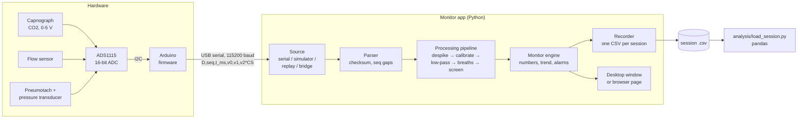

# CO2-Response

CMU BME 26-27 Capstone Project

[](https://github.com/shrlak/CO2-Response/actions/workflows/ci.yml)
[](https://github.com/shrlak/CO2-Response/actions/workflows/deploy.yml)

CO2-Response is a research capnography and airflow monitor. An Arduino with a 16-bit ADC reads three analog sensors 100 times a second and streams the voltages over USB:

- a capnograph (CO2)
- a flow sensor
- a pneumotachograph

The monitor app turns those voltages into a bedside-style display:

- sweeping waveforms and large numbers (EtCO2, FiCO2, respiratory rate, tidal volume, minute ventilation)
- an EtCO2 trend and a ventilatory-response plot (minute ventilation against EtCO2)
- visual and audible CO2 alarms

It records everything to one CSV file per session for analysis afterwards. Noisy samples and noisy breaths are removed before any number, plot or alarm uses them.

The app is written in Python. It runs in two places, from the same code:

- **Desktop app** on Windows, macOS and Linux (`python -m co2response`)
- **In the browser** from GitHub Pages: **<https://shrlak.github.io/CO2-Response/>**. Nothing to install; reading the Arduino needs desktop Chrome or Edge.

> [!WARNING]
> **Research use only.** This is not a medical device. It must never be the only CO2 monitor on a person or animal; keep a certified monitor as the primary alarm. The alarm here works only while the app is running, the computer is awake and a sound output is armed. See [docs/safety.md](docs/safety.md).

## Contents

1. [Try it now (no hardware)](#1-try-it-now-no-hardware)
2. [What you need for a real session](#2-what-you-need-for-a-real-session)
3. [Running a session, step by step](#3-running-a-session-step-by-step)
4. [The monitor screen](#4-the-monitor-screen)
5. [How the system works](#5-how-the-system-works)
6. [The software](#6-the-software)
7. [Deploying to GitHub Pages](#7-deploying-to-github-pages)
8. [Development](#8-development)
9. [Assumptions and open questions](#9-assumptions-and-open-questions)
10. [Documentation](#10-documentation)

---

## 1. Try it now (no hardware)

### In the browser

Open **<https://shrlak.github.io/CO2-Response/>** and press **Start simulator**.

The first load downloads the Python runtime (Pyodide, about 10 MB) and takes 10 to 30 seconds. After that it is cached.

The simulator breathes like a person, so every screen, alarm and recording feature can be tried without hardware. **Replay the sample session** plays a recorded session back through the monitor.

### On your computer

You need Python 3.10 or newer.

```bash
python -m venv .venv
```

```bash
source .venv/bin/activate
```

(On Windows: `.venv\Scripts\activate`.)

```bash
pip install -r requirements.txt
```

```bash
python -m co2response --sim
```

`--sim` starts the simulator straight away. Other start options:

| Command | What it does |
| --- | --- |
| `python -m co2response` | Opens on the start screen. Choose the Arduino, the simulator or a replay. |
| `python -m co2response --port COM3` | Connects to the Arduino on that port (`/dev/ttyACM0` on Linux, `/dev/cu.usbmodem…` on macOS). |
| `python -m co2response --replay sample-data/synthetic_session.csv` | Replays a recorded session through the monitor. |
| `python -m co2response --list-ports` | Lists serial ports and exits. |
| `python -m co2response --version` | Prints the version. |

`pip install -e .` also adds a `co2response` command.

On Linux, alarm sounds need PortAudio (`sudo apt install libportaudio2`). Without it, the app falls back to the system beep and says so.

### Simulator scenarios

Choose the scenario in **Settings > Connection > Simulator**:

| Scenario | What it shows |
| --- | --- |
| Normal breathing | About 15 breaths/min, EtCO2 38 mmHg, VT 500 mL |
| CO2 ramp (rebreathing) | EtCO2 climbing 15 mmHg/min (up to 62 mmHg), as in a rebreathing test. Raises the high-CO2 alarm and builds the ventilatory-response plot. |
| Apnea | Breathing stops; the apnea alarm sounds after 20 s |
| CO2 sensor disconnected | The CO2 channel sits at the ADC rail; a technical alarm sounds and CO2 shows `---` |
| Device stops sending | The data stream stops; the no-data alarm sounds |
| Noisy signal + line errors | Extra noise and corrupted serial lines (counted as checksum errors) |
| Spikes + partial breaths | Single-sample spikes and shallow breaths, to show the noise removal at work |

---

## 2. What you need for a real session

| Part | Notes |
| --- | --- |
| Capnograph with an analog CO2 output | 0–5 V. Scaling is set in calibration. |
| Flow sensor with an analog output | Bidirectional, centred at 2.5 V by default |
| Pneumotachograph and differential-pressure transducer | Analog output; used for breath detection, tidal volume and minute ventilation |
| ADS1115 16-bit ADC breakout | I2C address 0x48 |
| Arduino Uno (or Mega / Nano) | Plus a USB cable straight to the computer, not through a hub |
| A computer | Windows, macOS or Linux with Python 3.10+, or desktop Chrome/Edge for the browser version |
| Calibration gas and/or a 3 L syringe | For calibrating CO2 and the pneumotach |

Wiring, firmware upload and first checks are covered in detail, with a wiring diagram and a troubleshooting section, in the **[setup and operating guide](SETUP-GUIDE.md)**. Pin-by-pin wiring is in [docs/wiring.md](docs/wiring.md).

---

## 3. Running a session, step by step

### Once per setup

1. **Wire the sensors.** Each sensor output goes to an ADS1115 input: CO2 to A0, flow sensor to A1, pneumotach transducer to A2. The ADS1115 connects to the Arduino over I2C (SDA, SCL, 5 V, GND). Every ground must be common. See [docs/wiring.md](docs/wiring.md).
2. **Flash the firmware.** Use either of:
   - **Arduino IDE:** open `firmware/CO2Response/CO2Response.ino`, install **Adafruit ADS1X15** from the Library Manager, choose the board and port, and upload.
   - **PlatformIO:** `cd firmware && pio run -e uno -t upload` (environments: `uno`, `mega`, `nano`).
3. **Install the app** (see [Try it now](#on-your-computer)), or use the [browser version](https://shrlak.github.io/CO2-Response/) in Chrome or Edge.

### Every session

4. **Connect.** Plug in the Arduino and press **Connect Arduino (USB)**. Pick the port; likely Arduinos are listed first. The app sends `INFO` and `START`. The header then shows the firmware, the measured sample rate (about 100 Hz) and the dropped-sample count.
5. **Run the hardware check:** **Settings > Diagnostics > Hardware check**. It watches the stream for 10 s and gives each item a pass, warning or failure, with how to fix it. It checks:
   - the USB link: rate, dropped samples, checksum errors
   - the ADC: whether it was found, plus an I2C scan if not
   - each sensor: stuck at 0 V or 5 V, clipping, noise level
6. **Calibrate** each channel in **Settings > Calibration** ([docs/calibration.md](docs/calibration.md)):
   - **CO2:** zero with room air or nitrogen, then span with a certified gas (for example 5 % CO2).
   - **Pneumotach:** zero with no flow, then push a 3 L syringe through it. The app integrates the stroke and sets the flow constant.
   - **Flow sensor:** two-point, or enter the datasheet values.

   Each channel's card previews the new values live; nothing changes on the monitor until you press **Save**. Saved calibrations are written into every recording.
7. **Set the barometric pressure** in **Settings > Display & units**. Pittsburgh is usually about 735 mmHg; use the lab's reading. It converts % CO2 to mmHg.
8. **Check the alarms.** In **Settings > Alarms**:
   - set the high (and optional low) EtCO2 limits
   - press **Arm audio** until the key turns green
   - press **Test alarm** to confirm you can see and hear both tones
9. **Enter a study code** (never a name or other identifier) and press **Record**. The file is saved every second while recording.
10. **During the session:**
    - press **Mark event** (or the `M` key) to timestamp events; markers appear on the trend and in the file
    - when the valve is turned to the rebreathing bag, press `M` and label the marker **Rebreathing**. Breaths before it are the baseline; the response line is fitted to the breaths after it (Read's method, as CHOP runs the test)
    - watch the **Ventilatory response** tab for the slope, r and x-intercept
    - if an alarm sounds, **Silence** mutes it for 120 s; **Acknowledge** clears a resolved alarm
11. **Stop rec.** The session is listed in **Settings > Data & recordings**.
12. **Review and export.** **Open** the session to see its summary and zoomable charts, then export:
    - the whole file
    - the per-breath table
    - the alarms/events table
    - any of these for a zoomed time range

    Analyse it with `analysis/load_session.py` ([§5.10](#510-review-export-and-analysis)).

If the USB cable comes out, the device-disconnected alarm sounds. Plugging the same Arduino back in reconnects by itself, and recording continues in the same file.

---

## 4. The monitor screen

- **Header:**
  - research-use tag, study code, data source and connection state
  - measured sample rate, dropped samples, recording status and the clock
  - alarm-system status: `ARMED`, `ALARM`, `SILENCED 1:42`, `AUDIO OFF` or `DISARMED`
- **Alarm strip:** a fixed-height strip under the header, so an alarm never moves the waveforms. Colours:
  - red, flashing: high priority
  - amber: medium (technical)
  - blue: advisories

  Alarms latch until you press **Acknowledge** or **Clear**. A high alarm also flashes the window title and taskbar entry.
- **Waveforms** sweep left to right like a bedside monitor: CO2 (yellow, with the high limit dashed), flow sensor (cyan) and pneumotach flow (green).
- **Numbers:**
  - EtCO2 with its limits beside it, RR, FiCO2, live and peak flow, VT and MV
  - a channel with no valid data for 2 s shows `---`
  - when the last breath was left out as noisy, the EtCO2 tile says so
- **Trend tab:**
  - one EtCO2 point per clean breath over 15 min, 30 min, 2 h or the whole session
  - the continuous CO2 trace behind the points, the alarm-limit bands, alarm marks and your event markers
  - the caption counts breaths left out as noisy
- **Ventilatory response tab:** MV against EtCO2 for clean breaths. Once a marker labelled **Rebreathing** is placed, breaths before it are drawn as hollow rings and summarized as the baseline (mean EtCO2 and MV), and the least-squares line is fitted to the rebreathing breaths only, the way CHOP reports the test. It shows the slope (L/min per mmHg), r, the x-intercept ("x-int", the EtCO2 where the line reaches MV = 0) and n, then the baseline mean EtCO2 and MV. Without the marker, every breath is fitted.
- **Soft keys:** Silence (120 s), Arm audio, Mark event (`M`), Record, Freeze, Alarm limits, Settings.
- **Settings** has these tabs: Connection, Calibration, Alarms, Display & units, Data & recordings, Diagnostics. Alarms keep running while you are in Settings.

---

## 5. How the system works

### 5.1 The big picture



The Arduino only measures volts. Everything else happens in the monitor app, so recalibrating never needs a firmware change:

- converting volts to CO2 and flow
- removing noise and finding breaths
- computing the numbers and raising alarms
- recording

The same engine code runs in the desktop app, in the browser and in the tests.

### 5.2 Hardware

| Channel | ADC input | Default scaling (until calibrated) | Used for |
| --- | --- | --- | --- |
| CO2 (capnograph analog out) | A0 | 0–5 V = 0–10 % CO2 | CO2 waveform, EtCO2, FiCO2, CO2 alarms |
| Flow sensor | A1 | 2.5 V = 0 L/min, 40 L/min per volt | Second flow waveform and live/peak flow |
| Pneumotach transducer | A2 | 2.5 V = 0 Pa, 200 Pa per volt; flow = 0.2 L/min per Pa | Breath detection, tidal volume, minute ventilation |

The ADS1115 runs at ±6.144 V full scale from a 5 V supply, so a reading at 0 V or 5 V means a sensor is unplugged or saturated (the "rail" checks). The default scalings are placeholders; see [Assumptions](#9-assumptions-and-open-questions).

### 5.3 Firmware (`firmware/CO2Response/`)

The sketch reads the three channels in single-shot mode on a fixed 10 ms schedule (100 Hz; 1–200 Hz with the `RATE` command). It sends one text line per sample.

- **Sequence numbers:** each scheduled slot gets a sequence number. If the Arduino falls behind, it skips the slot, still advances the sequence number, and reports `E,OVERRUN`, so the app can count dropped samples exactly.
- **ADC errors:** if the ADC does not answer on I2C, the firmware reports `E,ADC_NOT_FOUND` with an I2C scan, keeps retrying, and does not stream until the ADC answers.
- **Configuration:** pins, address, gain and baud rate are in `config.h`.
- **Builds:** the same code builds for Uno, Mega and Nano.

### 5.4 Serial protocol ([docs/protocol.md](docs/protocol.md))

The device sends plain ASCII lines at 115200 baud:

```
I,FW,1.0.0,ADC,ADS1115,CH,3,RATE,100,BAUD,115200,ADDR,0x48,FSR,6.144    ← info
D,1042,10420,2.6316,2.5000,2.5000*5C                                     ← data: seq, device ms, volts…, checksum
E,ADC_NOT_FOUND                                                          ← error
A,START                                                                  ← acknowledgement
```

The checksum is the XOR of the bytes between `D` and `*`. A line with a bad checksum, or one that fails to parse, is dropped and counted. A gap in `seq` (16-bit, wraps) counts as dropped samples.

The host sends `INFO`, `START`, `STOP` and `RATE <hz>`. Opening the port resets an Uno, so the app repeats `INFO` and `START` if no info line arrives within 2.5 s. The firmware's line formatter and the app's parser are tested against the same example lines, so they stay byte-for-byte compatible.

### 5.5 The monitor engine (`co2response/engine/monitor.py`)

The engine is the whole data path, with no user-interface code:

```
source → line parser → sequence tracker → processing pipeline → breaths → numbers / trend → alarm engine → recorder
                                                                                                  ↓
                                                                                     snapshot() → the screen
```

The window (or browser page) drives it on two timers:

- `poll()` every 20 ms reads whatever the source has, and processes every sample and every finished breath.
- `tick()` every 250 ms runs the time-based checks: no data, apnea, rails, dropped samples, checksum errors, noisy signal, audio. It also updates the alarm sounds and saves the recording.

The screen reads a `snapshot()` and draws it. Alarms never depend on drawing. The engine takes its clock as a parameter, so tests run hours of simulated data in seconds.

**Sources** (`co2response/sources/`) all produce the same lines:

| Source | What it is |
| --- | --- |
| Serial | pyserial on the desktop; Web Serial in the browser |
| Simulator | A software Arduino that emits real protocol lines from a physiological model |
| Replay | Plays a recorded session's raw volts back through the live processing and alarms |
| Bridge | A WebSocket client for `bridge/serial_ws_bridge.py` running on another computer |

When a serial device disappears, the engine raises **DEVICE DISCONNECTED** and keeps scanning for the same USB device. When it returns, the engine reconnects and resumes into the same recording.

### 5.6 Signal processing (`co2response/processing/`)

Every sample goes through these steps, in order:

1. **Spike removal** (Hampel filter) on the raw volts. See [Noise removal](#57-noise-removal).
2. **Rail check.** A channel at 0 V or 5 V (within 5 mV) is marked invalid and reads `---`. A channel held there for 2 s raises a "signal at ADC rail" alarm. The CO2 channel is checked only at the high rail, because a capnograph reads 0 V at 0 % CO2.
3. **Calibration:** volts become engineering units through each channel's calibration, then its zero offset is subtracted. A calibration is linear (gain and offset), a polynomial, or a lookup table with interpolation (`channels.json`).
4. **Low-pass filter:** a 2nd-order Butterworth, 10 Hz by default, on every channel.
5. **Unit conversion:**
   - CO2 % to mmHg: P<sub>CO2</sub> = F<sub>CO2</sub>/100 · (P<sub>B</sub> − P<sub>H2O</sub>), where P<sub>B</sub> is the barometric pressure set in Display & units. The optional BTPS water-vapor correction subtracts 47 mmHg.
   - Pneumotach pressure to flow: flow = k1·ΔP + k2·ΔP·|ΔP| (k1 from the syringe calibration).
6. **Breath detection** ([§5.8](#58-breath-detection-and-the-numbers)) and the **breath screen** ([§5.7](#57-noise-removal)).

### 5.7 Noise removal

Noisy signals are removed **before** anything is interpreted. That covers the numbers, the EtCO2 trend, the CO2 response plot, the alarms, the review screen and the analysis loader. There are two layers.

**Sample level: every sample, before it is calibrated or plotted.**

- **Hampel spike filter.** Each sample is compared with the median of the 7 samples centred on it. If it differs by more than 3.5 robust standard deviations (the scaled median absolute deviation), it is replaced by that median.
  - Single-sample glitches (ADC hiccups, electrical pickup, a bumped cable) disappear.
  - A real fast change, such as the capnogram's upstroke, is kept, because the median follows a monotonic edge.
  - It delays the signal by 30 ms (3 samples) and drops nothing.
- **Butterworth low-pass filter** (above), for broadband noise.

**Breath level: every finished breath, before it is used.**

The breath screen gives each breath a quality:

| Quality | Why a breath gets it |
| --- | --- |
| `ok` | Used everywhere |
| `noisy` | Signal-to-noise ratio below 8. The noise is measured during that breath, before filtering, from sample-to-sample second differences (median \|Δ²\|/1.65, which ignores the slow breathing itself). It is compared with the breath's CO2 amplitude, or with its peak flow. |
| `artifact` | A partial breath with no alveolar plateau (less than 10 % of expiration within 90 % of EtCO2: a shallow breath, cough or kinked sample line); an impossible EtCO2 (outside −2 to 120 mmHg); or no inspiration (VT under 1 mL) |
| `outlier` | An isolated EtCO2 jump. It is more than 5 mmHg, and 3 robust SDs of the recent breath-to-breath change, away from both the breath before and the breath after, in the same direction. A real step change (the start of rebreathing) is kept, because the next breath stays at the new level. Outliers are known one breath later, so they are recorded as a `BREATH_REJECTED` event. |

Breaths that are not `ok`:

- are left out of the EtCO2/RR/VT/MV numbers, the EtCO2 trend (the breath points, and the continuous CO2 line behind them, which breaks over a rejected breath), the MV-against-EtCO2 fit, the review summary and charts, the EtCO2 alarms, and `s.breaths` in the analysis loader
- have their samples blanked in the analysis loader: in `s.samples`, the calibrated values of every sample inside a rejected breath are NaN, so averages, plots and fits of the samples skip them too (the raw volts stay)
- stay in the recording, marked in the `breath_quality` column, so nothing is lost and the decision can be revisited

If 3 of the last 5 breaths are rejected as noisy or partial, a **SIGNAL TOO NOISY** technical alarm sounds, instead of false CO2 alarms. A flat CO2 trace (sample line off) is not called noisy, so the low-CO2 and apnea alarms still see it.

Both layers can be switched off in **Settings > Display & units** (**Remove spikes**, **Leave noisy breaths out**), for example to look at the raw signal while calibrating. The raw volts (`v0`–`v2`) are always recorded untouched, so a session can be re-processed later.

### 5.8 Breath detection and the numbers

**Finding breaths.** Breaths are found on the pneumotach flow:

- An inspiration starts when flow rises above +0.05 L/s (the deadband, adjustable) at least 1 s after the previous one began.
- Expiration starts when flow falls below −0.05 L/s.
- A breath runs from one inspiration start to the next.

If there is no valid flow signal, detection falls back to the capnogram: a breath ends when CO2 drops from above half the last EtCO2 to below 30 % of it.

**Per-breath values:**

| Value | How it is computed |
| --- | --- |
| EtCO2 | Peak CO2 during expiration |
| FiCO2 | Minimum CO2 during inspiration |
| VT | Inspiratory flow integrated over the inspiration (trapezoidal rule, device clock) |
| Peak inspiratory flow | Maximum flow during inspiration |
| Plateau, level, noise | Used by the breath screen |

**Numbers shown large** (from clean breaths only):

| Number | How it is computed |
| --- | --- |
| EtCO2 | Median of the last 3 breaths |
| RR | 60 / mean breath period of the last 4 breaths |
| MV | ΣVT / Σbreath period over the last 60 s, in L/min. This is correct from the first minute, rather than under-reading until 60 s have passed. |
| Ventilatory response | Ordinary least-squares fit of MV against EtCO2 over the trend window, on the breaths after the **Rebreathing** marker (all breaths if there is none); slope in L/min per mmHg, r, x-intercept and n, plus the baseline mean EtCO2 and MV before the marker (`processing/metrics.py` → `co2_response`) |

### 5.9 Alarms (`co2response/alarms/`)

**Physiological alarms:**

- **High EtCO2** (high priority) and **low EtCO2** (medium; off by default). Both use clean breaths only.
- They trigger after 2 consecutive breaths beyond the limit. With the alarm source set to live CO2 instead, they trigger after 5 continuous seconds.
- They clear only once EtCO2 is 2 mmHg back inside the limit (hysteresis).
- **Apnea** (high): no breath for 20 s while the signal is present.

**Technical alarms** (always on):

| Alarm | Priority |
| --- | --- |
| No data from device (3 s) | medium |
| Device disconnected | medium |
| ADC not found | medium |
| CO2/flow/pneumotach signal at ADC rail | medium |
| Signal too noisy | medium |
| Dropped samples above 0.1 % | advisory |
| Corrupt lines in the last minute | advisory |
| Audible alarm not armed | advisory |

**Behaviour:**

- High and medium alarms **latch**: when the condition clears, they stay on screen marked resolved until acknowledged.
- **Silence** mutes the sound for up to 120 s, then re-arms by itself.
- The tones follow the IEC 60601-1-8 pattern: high is 10 pulses, medium is 3 pulses.
- On the desktop, the app keeps the computer from sleeping while a device is connected. In the browser it holds a screen wake lock.
- Every alarm start, acknowledge, silence and resolve is written to the recording.

### 5.10 Recording, review, export and analysis

**Recording.** **Record** writes one CSV per session, `co2r_<study code>_<YYYYMMDD-HHMMSS>.csv`, every second, so a crash loses at most a second. An unfinished file is listed as **Recovered** next time. The file contains:

- `#` metadata lines: the study code, start time, firmware, sample rate, and the calibration, processing and alarm settings in use
- then one row per sample, with 21 columns:
  - time on both clocks, device ms, sequence number
  - raw volts `v0`–`v2`
  - the cleaned, calibrated values
  - on the sample where a breath ended: that breath's EtCO2, FiCO2, RR, VT, MV, peak flow and `breath_quality`
  - any alarms, markers, connection changes and calibration changes, in the `event` column

Every row has the same columns, so it opens directly in Excel, pandas, MATLAB or R. The full format (v3) is in [docs/data-format.md](docs/data-format.md).

**Review** (Settings > Data & recordings > Open):

- a summary: length, breaths and how many were left out, mean/min/max EtCO2, mean RR/VT/MV, alarms, markers, sample rate, dropped samples
- zoomable EtCO2/RR, VT/MV and waveform charts (drag to zoom all three)
- the event list; click an event to jump to it

**Export:**

- the whole session, the per-breath table (with a `quality` column) or the alarms/events table
- any of these for the whole session or just the zoomed range

**Analysis in Python:**

```python
import sys; sys.path.append("analysis")
from load_session import load_session

s = load_session("co2r_STUDY-01_20261105-010203.csv")
s.samples       # one row per sample: cleaned values (blanked inside noisy breaths) + raw volts + breath_quality
s.breaths       # one row per CLEAN breath: etco2_mmHg, rr_bpm, vt_ml, mv_lpm, ...
s.breaths_all   # every breath, with breath_quality
s.events        # alarms, markers, connections

from co2r.session import co2_response
co2_response(s)   # baseline before the "Rebreathing" marker, then slope, r, x-intercept of the rebreathing breaths
```

From the command line, `python analysis/load_session.py session.csv --breaths breaths.csv` prints a summary (including the CO2 response) and writes the clean breath table. `--all-breaths` keeps the rejected breaths, marked.

### 5.11 Calibration ([docs/calibration.md](docs/calibration.md))

**Methods** (Settings > Calibration):

| Method | How it works |
| --- | --- |
| Enter values | Type the gain and offset from a datasheet |
| Zero & span / two-point | Capture the live reading at two known references (room air or N₂ and a certified CO2 gas; no flow and a known flow) |
| Multi-point fit | Capture several points; the app fits a line or polynomial and shows the largest error at the reference points |
| 3 L syringe (pneumotach only) | Push a calibrated syringe through; the app integrates the pressure stroke and sets the flow constant k1 |

**Zero now** sets a channel's zero offset from the current reading.

Each channel's card previews the new calibration live; nothing changes on the monitor until you press **Save**. Saved calibrations persist between runs, are written into every recording, and can be exported and imported as JSON.

The starting values come from `co2response/config/channels.json`, which can be edited without touching code.

### 5.12 Simulator (`co2response/sim/`)

A physiological model generates CO2 and flow waveforms with adjustable RR, EtCO2 and VT, plus the scenarios listed in [§1](#simulator-scenarios). An emulated firmware turns them into real protocol lines with real checksums and sequence numbers.

It is seeded, so the tests and the sample session are reproducible. `sample-data/synthetic_session.csv` is made by `scripts/make_sample_session.py`, which drives the real engine on a fake clock: 60 s of spikes and partial breaths, then a 12 mmHg/min CO2 ramp with a "CO2 rebreathing started" marker. A test checks the script still reproduces the file byte for byte.

---

## 6. The software

### 6.1 One engine, three ways to run it

| | Desktop app | Browser (GitHub Pages) | Bridge |
| --- | --- | --- | --- |
| Start | `python -m co2response` | open the Pages URL | `python bridge/serial_ws_bridge.py --port COM3` |
| User interface | PySide6 (Qt) + pyqtgraph | HTML page drawn by Python (Pyodide) | none |
| Reads the Arduino with | pyserial | Web Serial (desktop Chrome/Edge) | pyserial, relayed over WebSocket |
| Alarm sound | sounddevice (PortAudio) | Web Audio | n/a |
| Sessions stored in | `Documents/CO2-Response/sessions` | the browser's storage (IndexedDB); export to keep a copy | n/a |
| Works in | Windows, macOS, Linux | Chrome/Edge for hardware; any modern browser for the simulator, replay and review | any OS |

Both front ends use the same `co2response` engine, processing, alarms and session-file code; only the drawing and the platform adapters differ.

**How the browser version works.** `site/index.html` is the only JavaScript:

1. It loads Pyodide (CPython compiled to WebAssembly) and numpy from the jsDelivr CDN.
2. It unpacks `co2response.zip` (this package without the Qt window) and runs `co2response.web.app.main()`.

From there everything is Python: the page's HTML is built in `co2response/web/`, and browser APIs are called through Pyodide's `js` module.

**The bridge** (`bridge/serial_ws_bridge.py`) relays the Arduino's serial lines over WebSocket. It lets a second computer watch the session, or lets Safari/Firefox reach the Arduino.

- By default it listens on localhost only. Use `--host 0.0.0.0` only on a trusted network.
- `--simulate` runs it without hardware.
- Browsers block a plain `ws://` connection from an https page to another computer. So the Pages site can use a bridge on the same computer (`ws://localhost:8765`); to watch from another computer, use the desktop app.

### 6.2 Repository layout

```
co2response/                    the monitor (python -m co2response)
  __main__.py                   command-line options
  protocol.py                   line format, checksum, parser, line splitter, sequence/drop tracking
  channels.py, config/          per-channel calibration model; defaults in config/channels.json
  settings.py                   all settings (display, processing, alarms), saved as JSON
  paths.py                      where settings and sessions are stored (CO2R_HOME overrides)
  keep_awake.py                 keeps the computer awake while a device is connected
  jsfmt.py                      number/time formatting that keeps session files stable across versions
  sim/                          physiological model (physiology.py) and firmware emulation (core.py)
  processing/
    pipeline.py                 per-sample path: despike → rail check → calibrate → low-pass → units → breaths
    denoise.py                  Hampel spike filter, noise meter, breath screen (noise removal)
    filter.py                   2nd-order Butterworth low-pass
    calibration.py              apply/invert calibrations, fits, syringe integration, pneumotach flow model
    co2.py                      % ↔ mmHg (barometric pressure, water vapor)
    breath.py                   breath detector and per-breath values
    metrics.py                  EtCO2 median, RR, MV, least-squares fit
    quality.py                  ADC rail detection
  alarms/
    engine.py                   alarm state machine: limits, delays, hysteresis, latching, silence
    audio.py                    alarm tones
  sources/                      serial (pyserial), simulator, CSV replay, WebSocket bridge client
  storage/
    session_file.py             session CSV format: writer cells, parser, summaries, exports
    recorder.py                 writes the session as it is recorded
    library.py                  the sessions folder: list, import, recover, delete
  engine/
    monitor.py                  the engine: everything between the source and the screen
    link_test.py                the hardware check
  ui/                           desktop window (PySide6): monitor, settings pages, session review
  web/                          browser front end (Pyodide): DOM helpers, views, Web Serial/Audio, storage
  fonts/                        Barlow Semi Condensed (SIL OFL)
site/                           index.html (Pyodide loader) and styles.css for the Pages build
scripts/
  build_site.py                 builds the Pages site into dist/site
  make_sample_session.py        regenerates sample-data/synthetic_session.csv
firmware/                       PlatformIO project; the sketch in CO2Response/ also opens in Arduino IDE
bridge/                         serial → WebSocket relay
analysis/                       pandas loader for session files
sample-data/                    a synthetic recorded session
tests/                          pytest suites (see Development)
docs/                           protocol, wiring, calibration, safety, data format, UI mockup
.github/workflows/              ci.yml (tests on every PR), deploy.yml (GitHub Pages)
```

Everything apart from `firmware/` (C++) and the small Pyodide loader in `site/index.html` is Python.

### 6.3 Where things are stored

| What | Desktop | Browser |
| --- | --- | --- |
| Settings and saved calibration | Windows `%APPDATA%\CO2-Response`, macOS `~/Library/Application Support/CO2-Response`, Linux `~/.local/share/co2response` | Browser storage for the site |
| Recorded sessions | `Documents/CO2-Response/sessions` (or a folder you pick in Data & recordings) | Browser storage. Export sessions you want to keep: clearing site data deletes them. |

Set `CO2R_HOME` to keep everything in one folder (for example on a USB stick).

### 6.4 Design rules

- **The device sends volts; the app does the rest.** Calibration and processing changes never need a firmware upload.
- **The engine has no UI code.** Alarms are evaluated on every sample and breath, not in drawing code, and everything can be tested with a fake clock.
- **Clean before interpreting; never throw data away.** Rejected breaths are marked, not deleted, and the raw volts are always recorded.
- **One file per session**, with the same columns on every row, readable without this software.

---

## 7. Deploying to GitHub Pages

The site is built and published by GitHub Actions (`.github/workflows/deploy.yml`).

**One-time setup** (a repository admin):

1. Open the repository on GitHub, then **Settings > Pages**.
2. Under **Build and deployment > Source**, choose **GitHub Actions**.

**After that:**

- Every push to `main` runs the workflow. It:
  1. builds the site with `python scripts/build_site.py dist/site`
  2. boots the built site in Chromium and drives it with the browser tests (`tests/test_web.py`)
  3. publishes it only if they pass
- The site appears at **<https://shrlak.github.io/CO2-Response/>**.
- To redeploy by hand: **Actions > Deploy to GitHub Pages > Run workflow**.

**To build and preview locally:**

```bash
python scripts/build_site.py
```

```bash
python -m http.server 8000 --directory dist/site
```

Then open <http://localhost:8000>. Web Serial works on `localhost` as it does on the https site.

The built site is about 2 MB: the page, the fonts, the sample session and `co2response.zip`. Pyodide itself comes from the jsDelivr CDN.

---

## 8. Development

```bash
pip install -r requirements-dev.txt
```

```bash
pytest
```

```bash
ruff check .
```

`pytest` runs the whole suite:

| Tests | What they cover |
| --- | --- |
| `test_protocol.py` | parser, checksums, sequence gaps, and the shared vectors in `docs/protocol-fixtures.json` |
| `test_simulator.py` | physiological model and firmware emulation |
| `test_processing.py` | calibration, filter, breath detection, metrics |
| `test_denoise.py` | spike removal, breath screen, and noise removal through the pipeline, the engine, the alarms and the analysis loader |
| `test_alarms.py` | alarm state machine |
| `test_engine.py` | the full data path on a fake clock, including a pseudo-terminal posing as the Arduino (Linux/macOS) |
| `test_recording.py` | session file, recovery, import/export; the sample file reproduces byte for byte |
| `test_link_test.py` | hardware check |
| `test_python_daq.py` | the monitor fed by a real `co2r-daq serve` process (simulated DAQ), and a DAQ that cannot be opened |
| `test_ui.py` | the desktop window, headless (`QT_QPA_PLATFORM=offscreen` if there is no display) |
| `test_web.py` | the browser build in Chromium |

`test_web.py` runs only when Playwright is installed:

```bash
pip install playwright
```

```bash
python -m playwright install chromium
```

It needs internet access to download Pyodide. It covers:

- boot, the simulator and alarms
- a fake Arduino over Web Serial, including unplug and reconnect
- recording, import, review and storage that survives a reload
- calibration edits
- the browser build fed by a `co2r-daq serve` process (needs `pip install -e python`; skipped otherwise)

**The acquisition package** has its own tests (Python 3.9–3.13):

```bash
pip install -e "python[test]"
```

```bash
python -m pytest python/tests
```

**Other commands:**

- `python scripts/make_sample_session.py` regenerates the sample session. Do this only when a change to processing or the file format is meant to change it; the byte-for-byte test will tell you.
- Firmware: `cd firmware && pio run` builds every board.
- Firmware line format: `g++ -std=c++11 -I CO2Response test/test_line_format.cpp -o t && ./t` checks the firmware's data lines against the app's parser.

**CI** (`.github/workflows/ci.yml`) runs on every pull request:

| Job | What it runs |
| --- | --- |
| app | lint and the full suite on Linux, Windows and macOS |
| web | the browser tests in Chromium |
| python, python-oldest | the `co2r` acquisition package on Python 3.9–3.13 (Linux, Windows, macOS) and with its oldest supported dependencies; its command line and the analysis loader |
| bridge | a smoke test of `bridge/serial_ws_bridge.py` |
| firmware | builds for Uno, Mega and Nano, plus the line-format test |

---

## 9. Assumptions and open questions

These are placeholders until the [open questions](docs/open-questions.md) are answered; discuss them in [issue #4](https://github.com/shrlak/CO2-Response/issues/4). Each is marked `TODO` in the code or config.

- **CO2 sensor:** analog output 0–5 V, linear, 0–10 % CO2 (gain 2 %/V). Replace with the real capnograph scaling.
- **Flow sensor:** bidirectional, 2.5 V = 0 L/min, 40 L/min per volt. It is treated as a second airway flow signal in its own panel. If it measures a gas-delivery line instead, relabel it in `channels.json`.
- **Pneumotach transducer:** 2.5 V = 0 Pa, 200 Pa per volt; flow = k1·ΔP with k1 = 0.2 L/min/Pa until a syringe calibration is done.
- **ADC:** ADS1115 at I2C address 0x48, PGA ±6.144 V, 5 V supply (rails at 0 and 5 V).
- **Arduino:** Uno by default (Mega and Nano also build). **Sample rate:** 100 Hz per channel.
- **Alarm defaults:** high EtCO2 50 mmHg, low off, 2-breath delay, 2 mmHg hysteresis, 120 s silence, apnea after 20 s, keyed on EtCO2 per breath.
- **Noise screen:** signal-to-noise ratio of 8, a plateau over 10 % of expiration, and outliers over 5 mmHg. These were tuned on simulated data. Check them against real recordings with `--all-breaths` and adjust them in `co2response/processing/denoise.py` if real breaths are being left out.
- **Barometric pressure:** 760 mmHg default; Pittsburgh is usually near 735 mmHg. Set the lab's value in Display & units.
- **Hardware:** the firmware and the hardware check have not yet been run on a real Arduino with the lab's sensors. The NI and LabJack drivers have been tested against stand-ins for their vendor libraries, not on real devices.

## 10. Documentation

| Document | Contents |
| --- | --- |
| **[SETUP-GUIDE.md](SETUP-GUIDE.md)** | Step-by-step setup and operation: wiring, firmware, install, checks, calibration, sessions, troubleshooting |
| [docs/wiring.md](docs/wiring.md) | Pin-by-pin wiring |
| [docs/protocol.md](docs/protocol.md) | Serial protocol (test vectors in `docs/protocol-fixtures.json`) |
| [docs/python-daq.md](docs/python-daq.md) | Python acquisition: NI, LabJack and other DAQs, `co2r-daq` |
| [docs/calibration.md](docs/calibration.md) | Calibration procedures |
| [docs/data-format.md](docs/data-format.md) | Session file format (v3), noise-removal details, import/export, analysis in Python/MATLAB/Excel |
| [docs/safety.md](docs/safety.md) | Safety and limitations |
| [docs/project-background.md](docs/project-background.md) | The clinical test (Read's rebreathing method at CHOP), what the mentors and the capstone team's documents ask for, and how the repo measures up |
| [docs/open-questions.md](docs/open-questions.md) | Open questions for the lab ([issue #4](https://github.com/shrlak/CO2-Response/issues/4)) |
| [PLAN.md](PLAN.md) | Build plan and requirements |
| [docs/design/monitor-mockup.html](docs/design/monitor-mockup.html) | Phase 0 UI mockup |
| [sample-data/synthetic_session.csv](sample-data/synthetic_session.csv) | A sample recorded session |

## License

None chosen yet (see [LICENSE](LICENSE)). The bundled Barlow Semi Condensed font is under the SIL Open Font License (`co2response/fonts/OFL.txt`).
