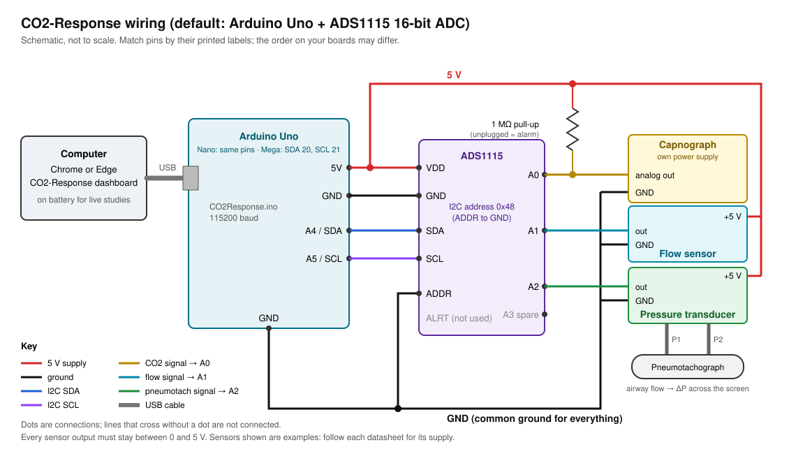

# CO2-Response: setup and operating guide

This guide takes you from a box of parts to a running session: wiring the sensors to the ADC board and the Arduino, loading the firmware, connecting to the computer, checking and calibrating the setup, and running and saving a session.

> **Which board?** This guide covers the ADC board (an ADS1115 reading analog sensors). For the current build, the **Arduino Uno R4 Minima with the SFM3304-D flow sensor and the SprintIR-6S CO2 sensor**, wire it from [docs/wiring.md](docs/wiring.md#uno-r4-board-digital-sensors), upload `firmware/CO2ResponseR4/CO2ResponseR4.ino` (Arduino IDE, board "Arduino UNO R4 Minima", no extra libraries), and install the app with `scripts/install.sh` or `scripts/install.ps1` ([README §1](README.md#in-a-terminal-any-computer)). From step 5 on (connect, check, alarms, the test) this guide applies to both; that board needs no volts-to-units calibration, only a 3 L syringe check of the flow and a calibration-gas check of the CO2.

> **Research use only.** CO2-Response is not a medical device. On a person or animal, a certified CO2 monitor must always be the primary alarm. Read [docs/safety.md](docs/safety.md) before any live use, and go through the Cook Lab / CMU safety process first.

**Contents**

1. [What you need](#1-what-you-need)
2. [Wire the ADC board and sensors](#2-wire-the-adc-board-and-sensors)
3. [Load the firmware onto the Arduino](#3-load-the-firmware-onto-the-arduino)
4. [Install and open the monitor app](#4-install-and-open-the-monitor-app)
5. [Connect the Arduino to the computer](#5-connect-the-arduino-to-the-computer)
6. [Check the setup](#6-check-the-setup)
7. [Calibrate](#7-calibrate)
8. [Run a session](#8-run-a-session)
9. [After the session](#9-after-the-session)
10. [Troubleshooting](#10-troubleshooting)

---

## 1. What you need

| Item | Notes |
| --- | --- |
| Arduino Uno R3 | A Nano or Mega 2560 also works (the firmware builds for all three). |
| USB cable for the Arduino | Must be a **data** cable. Charge-only cables power the board but no port appears. |
| ADS1115 16-bit ADC breakout | For example Adafruit 1085. It has 4 inputs and talks to the Arduino over I2C. |
| CO2 monitor / capnograph with an analog output | Plus its analog-output cable. The output must stay between 0 and 5 V. |
| Flow sensor with a 0–5 V analog output | |
| Pneumotachograph and a differential pressure transducer with a 0–5 V output | Example transducer: NXP MPXV7002DP (±2 kPa, 5 V supply, 0.5–4.5 V output). Plus two lengths of tubing to connect it. |
| 1 MΩ resistor | Pull-up on the CO2 input, so an unplugged capnograph raises an alarm instead of reading 0. |
| Piezo buzzer (passive) | Between Arduino pin 8 and GND. The board sounds it if the monitor app stops running, when nothing would be watching the CO2. Optional, but recommended for any live study. |
| Breadboard or perfboard, jumper wires | Use twisted pair or shielded cable for the pressure transducer's signal. |
| Computer | Windows 10/11, macOS or Linux, with **Python 3.10 or newer** (free from [python.org](https://www.python.org/downloads/)), or the standalone app, which needs no Python ([section 4](#4-install-and-open-the-monitor-app)). |
| For calibration | Room air, a certified CO2 calibration gas (for example 5 %), a 3 L calibration syringe. Optional: a reference flowmeter and a manometer. |
| For any live study | A medical-grade USB isolator, or a laptop running on battery. See [safety](docs/safety.md). |

The exact sensor models are still open questions in [PLAN.md](PLAN.md). Everything below works with any sensors whose outputs stay within 0–5 V; only the calibration numbers change.

---

## 2. Wire the ADC board and sensors



Do all wiring with the USB cable **unplugged**.

### 2.1 ADS1115 to Arduino

| ADS1115 pin | Arduino Uno / Nano | Arduino Mega 2560 | Wire colour in the diagram |
| --- | --- | --- | --- |
| VDD | 5V | 5V | red |
| GND | GND | GND | black |
| SDA | A4 (also labelled SDA on the Uno R3 header) | 20 (SDA) | blue |
| SCL | A5 (also labelled SCL on the Uno R3 header) | 21 (SCL) | purple |
| ADDR | GND | GND | black |
| ALRT | leave unconnected | leave unconnected | |

Wiring ADDR to GND gives the board I2C address 0x48, which is what the firmware expects. If ADDR is left floating or wired elsewhere, the board answers at 0x49–0x4B; the app's hardware check will tell you.

### 2.2 Sensors to ADS1115

| Sensor | Connect | To |
| --- | --- | --- |
| **Capnograph (CO2)** | analog output | ADS1115 **A0** |
| | analog-output ground | **GND** |
| | 1 MΩ resistor | between **A0** and **VDD** (the pull-up) |
| | power | its own supply. Do not power a capnograph from the Arduino. |
| **Flow sensor** | output | ADS1115 **A1** |
| | supply | **5V** (or its own supply, joined to GND) |
| | ground | **GND** |
| **Pressure transducer (pneumotach)** | output | ADS1115 **A2** |
| | supply | **5V** |
| | ground | **GND** |
| | high-pressure port (P1) | tubing to the pneumotach tap on the **upstream / circuit** side |
| | low-pressure port (P2) | tubing to the tap on the **patient** side |
| Spare | | ADS1115 **A3** is free (or the transducer's second output, below) |

With P1 on the circuit side, inspiration (flow toward the patient) gives a positive pressure difference and shows as **positive flow**, which is what breath detection expects. You will check the sign in [step 6](#6-check-the-setup).

### 2.3 Rules that prevent most problems

- **One common ground.** The Arduino, the ADS1115 and every sensor's signal ground must be connected together. A missing ground is the most common cause of noisy or drifting readings.
- **Keep every input between 0 and 5 V.** The ADS1115 can be damaged by any input below −0.3 V or above VDD + 0.3 V. If a sensor can output more than 5 V, put a resistor divider in front of it and include the divider ratio in its calibration.
- **Power budget.** Power from the Arduino's 5V pin comes from USB. Keep what you draw from it small (the pressure transducer and the ADS1115 together use a few tens of mA). Give anything hungrier, such as a heated flow sensor, its own supply, and join its ground to the Arduino's ground.
- **Twist the transducer's signal wire with its ground** (or use shielded cable), and route it away from pumps, heaters and mains wiring.
- **Short I2C wires.** Keep SDA and SCL under about 30 cm.

### 2.4 Variations

| If… | Do this |
| --- | --- |
| Your sensors output 0–3.3 V | In `firmware/CO2Response/config.h` set `ADS_GAIN` to `GAIN_ONE` (±4.096 V, finer resolution). In `co2response/config/channels.json` set `railHighV` to `4.096`. |
| Your transducer has two outputs (differential) | Connect them to A2 and A3, and set `PNEUMO_DIFFERENTIAL 1` in `config.h`. |
| You use an Arduino Mega | SDA is pin 20 and SCL is pin 21. Everything else is the same. |

| You have a piezo buzzer | Wire it between pin **8** and GND. It sounds if the monitor app stops sending its heartbeat for 3 s. Change `BUZZER_PIN` in `config.h` for another pin, or set it to -1 for none. |

### 2.5 Before you plug in

With a multimeter, check for continuity between 5V and GND. There must be none: a short there will cut out the USB port. If you can, power each sensor on its own first and measure its output to confirm it stays inside 0–5 V.

---

## 3. Load the firmware onto the Arduino

You only need to do this once per Arduino, and again after changing `config.h`.

### Option A: Arduino IDE (simplest)

1. Install the [Arduino IDE](https://www.arduino.cc/en/software) (version 2).
2. Get the code: on the GitHub repository page, **Code → Download ZIP**, and unzip it (or `git clone` it).
3. In the Arduino IDE, **File → Open** `firmware/CO2Response/CO2Response.ino`.
4. **Tools → Manage Libraries…**, search for **Adafruit ADS1X15**, and install it. Accept its dependencies (Adafruit BusIO).
5. **Tools → Board →** Arduino Uno (or your board). **Tools → Port →** the Arduino's port.
6. Press **Upload** (the right-arrow button). Wait for "Done uploading".
7. Check it: **Tools → Serial Monitor**, set the baud rate to **115200**. You should see:
   - `I,FW,1.1.0,ADC,ADS1115,CH,3,RATE,100,…`, then a stream of `D,…` lines. Good.
   - `E,ADC_NOT_FOUND` and `I,I2C_SCAN,…` instead: the ADS1115 is not answering. See [troubleshooting](#10-troubleshooting).
8. **Close the Serial Monitor.** Only one program can use the port at a time, and the monitor app needs it.

### Option B: PlatformIO (command line)

```bash
pip install platformio
```

```bash
cd firmware && pio run -e uno -t upload
```

Use `-e mega` or `-e nano` for those boards. `pio device monitor -b 115200` shows the output.

### Settings in `config.h`

| Setting | Default | Change it when |
| --- | --- | --- |
| `BAUD_RATE` | 115200 | You raise the sample rate above 150 Hz (also change it in the app's Settings > Connection). |
| `DEFAULT_RATE_HZ` | 100 | You need faster sampling (up to 200). The app can also change the rate live. |
| `ADS_I2C_ADDRESS` | 0x48 | ADDR is not wired to GND. |
| `ADS_GAIN` | `GAIN_TWOTHIRDS` (±6.144 V) | Your sensors are 0–3.3 V (use `GAIN_ONE`). |
| `PNEUMO_DIFFERENTIAL` | 0 | Your transducer has two outputs on A2/A3. |
| `WATCHDOG_TIMEOUT_MS` | 3000 | You want the board's buzzer to wait longer (or 0: no watchdog) when the app's heartbeat stops. |
| `BUZZER_PIN` | 8 | The buzzer is on another pin (-1: no buzzer; the built-in LED still blinks). |
| `VALVE_PIN` | 7 | The valve driver is on another pin (-1: no valve output; the app then never offers to switch the valve). |
| `SPO2_CHANNEL` | 0 | A pulse oximeter's analog output is wired to A3: set it to 1 and the board sends a fourth value. Not together with `PNEUMO_DIFFERENTIAL`, which uses A3. |

---

## 4. Install and open the monitor app

The monitor is a Python desktop program. It runs on Windows, macOS and Linux and talks to the Arduino's USB serial port directly.

> **No install?** The same monitor runs in the browser at <https://shrlak.github.io/CO2-Response/>. In desktop Chrome or Edge it can read the Arduino over USB (Web Serial); press **Connect Arduino (USB)** and pick the port. After one visit with internet it also starts with no internet (the site keeps a copy of itself in the browser). Sessions recorded there are kept in the browser, so export the ones you want to keep. For long or important sessions, the desktop app below is the more robust choice: it writes each recording straight to a file, and it keeps running when its window is in the background (a browser slows a background tab down, and the board's buzzer will say so).

> **No Python on the computer?** A standalone build of the desktop app (Windows, macOS, Linux) is attached to each [release](https://github.com/shrlak/CO2-Response/releases) once one is tagged: unzip it and run **CO2-Response**. On macOS the app is not signed, so right-click it and choose **Open** the first time. To check an installation, run `CO2-Response --sim --exit-after 12`: it runs the simulator for 12 s, prints what it measured and closes. Everything below about using the app applies to it; skip steps 1 to 4.

1. Install **Python 3.10 or newer** from [python.org](https://www.python.org/downloads/). On Windows, tick **Add python.exe to PATH** in the installer.
2. Get the code: on the GitHub repository page, **Code → Download ZIP** and unzip it, or `git clone` it.
3. Open a terminal (Windows: **PowerShell**; macOS: **Terminal**) in the unzipped folder and install the app's packages. Doing it inside a virtual environment keeps them separate from anything else on the computer:

```bash
python -m venv .venv
```

Windows:

```bash
.venv\Scripts\activate
```

macOS / Linux:

```bash
source .venv/bin/activate
```

```bash
pip install -r requirements.txt
```

4. Start the monitor:

```bash
python -m co2response
```

Next time, only the `activate` line and `python -m co2response` are needed.

The first time, a banner explains that this is research software; press **I understand**. To try the monitor without hardware, press **Start simulator** (or start it with `python -m co2response --sim`).

On Linux, alarm sounds need PortAudio (`sudo apt install libportaudio2`); without it the app falls back to the system beep and says so.

**Watching from a second computer.** Run Python acquisition on the computer that has the Arduino:

```bash
pip install -e python
```

```bash
co2r-daq serve --driver arduino --port COM3 --host 0.0.0.0
```

Use `co2r-daq list` to see port names. On the other computer, open the monitor and use **Settings → Connection → Python acquisition → Connect to Python** with the first computer's address (for example `ws://192.168.1.20:8765`). Only use `--host 0.0.0.0` on a trusted network: anyone who can reach the port can see the data. (`python bridge/serial_ws_bridge.py --port COM3 --host 0.0.0.0` does the same.)

### Using a different data-acquisition system

The same Python program runs other DAQs instead of the Arduino and ADS1115: NI-DAQmx boards (`--driver nidaq`), LabJack (`--driver labjack`), or any board with a Python library via a small driver file. The sensors connect to the DAQ's first three analog inputs (CO2, flow, pneumotach, in that order). Start it with, for example, `co2r-daq serve --driver nidaq --device Dev1`, then connect from **Settings → Connection → Python acquisition** (`ws://localhost:8765`). The monitor, noise removal, alarms, calibration and recording work unchanged. See **[docs/python-daq.md](docs/python-daq.md)**.

---

## 5. Connect the Arduino to the computer

1. Plug the Arduino's USB cable **directly into the computer**, not through a hub.
2. Close the Arduino IDE Serial Monitor, and any other program that might be using the port.
3. In the monitor, press **Connect Arduino (USB)**. A list of serial ports appears, with likely Arduinos first. Pick the Arduino and press **Connect**:
   - Windows: "Arduino Uno (COM3)" or similar; clones may show "USB-SERIAL CH340 (COM4)"
   - macOS: "/dev/cu.usbmodem…"; clones may show "/dev/cu.wchusbserial…"
   - Linux: "/dev/ttyACM0" or "/dev/ttyUSB0"
4. Within a couple of seconds the header shows **Arduino Uno (COM3) · 100 Hz · 0 dropped**, and the waveforms start sweeping. (An Uno restarts when its port is opened; the app waits for it and repeats the handshake if needed.)

You can also connect from the command line: `python -m co2response --port COM3`. `python -m co2response --list-ports` lists the ports.

Next time, the start screen offers **Reconnect Arduino Uno (COM3)**, which reopens it with one click.

**If the cable comes out during a session**, a medium-priority **DEVICE DISCONNECTED** alarm sounds. Plug the same Arduino back in and the app reconnects on its own (even if the port name changed), and any recording continues in the same file. You can turn this off in **Settings → Connection**.

**No port appears?** See [troubleshooting](#10-troubleshooting). The usual causes are a charge-only cable, a missing CH340 driver for clone boards (Windows/macOS), or, on Linux, not being in the `dialout` group.

---

## 6. Check the setup

Do this after wiring, after moving the setup, and at the start of each study day.

1. **Run the hardware check.** Go to **Settings → Diagnostics → Hardware check**, choose **10 s**, and press **Run hardware check**. Breathe through the sensors (or leave them running) while it runs. Every row should read **PASS**:

   | Check | What PASS means |
   | --- | --- |
   | Firmware handshake | The board runs CO2-Response firmware with an ADS1115 at 0x48 |
   | Sample rate | About 100 Hz per channel |
   | Dropped samples | Under 0.1 % |
   | Corrupt lines | None |
   | CO2 sensor (A0), Flow sensor (A1), Pneumotach transducer (A2) | Not stuck at 0 or 5 V, not clipping, and noise below the limit (shown in mmHg or L/min) |

   Anything marked **FAIL** or **CHECK** comes with what to do. **Save report** keeps a copy for your notes.

2. **For a new setup, run the 10-minute check once.** It is the acceptance test: under 0.1 % dropped samples over 10 minutes.

3. **Check the flow direction.** In **Settings → Display & units**, turn on **Show raw volts**. Go back to the monitor and breathe in through the circuit. Both flow traces should go **up** (positive) on inspiration. If one goes down, swap that sensor's tubing (P1 and P2), or flip the sign of its gain in **Settings → Calibration**.

4. **Check that each sensor responds.** Breathe out through the capnograph's sample line and watch the CO2 trace rise; breathe through the flow sensor and pneumotach and watch both flow traces move.

---

## 7. Calibrate

The app converts volts to real units using the numbers in **Settings → Calibration**. Until you calibrate, it uses placeholder values that are almost certainly wrong for your sensors. Calibrate in this order (full details in [docs/calibration.md](docs/calibration.md)):

1. **Barometric pressure.** In **Settings → Display & units**, set the lab's barometric pressure. Pittsburgh is usually near 735 mmHg, not 760; the difference changes every CO2 reading in mmHg by about 3 %.
2. **CO2: zero and span.** Calibration card **CO2 → Zero & span**:
   1. Flow room air through the sample line and press **Capture** on point A (0.04 %).
   2. Flow the calibration gas, enter its certified value (for example 5.00 %), and press **Capture** on point B.
   3. Press **Compute line**, check the preview, then **Save calibration**.
3. **Flow sensor.** With no flow, press **Enter values → Zero now (no flow)**. If you have a reference flowmeter, use **Two-point** or **Multi-point fit** as well. Then **Save calibration**.
4. **Pneumotach.**
   1. **Transducer:** enter the transducer's datasheet scaling under **Enter values**. For example, for an MPXV7002DP (2.5 V at 0 Pa, 1 V per kPa): gain **1000** Pa/V, offset **−2500** Pa.
   2. With no flow, press **Zero now (no flow)**, then **Save calibration**.
   3. **3 L syringe:** on the **3 L syringe** tab, press **Start stroke**, push the syringe fully in with one smooth stroke, press **Stop**, then **Apply** the new k1 and **Save calibration**.
   4. Push the syringe again and confirm VT on the monitor reads about 3000 mL.
5. **Gas conditions and timing** (only if they apply; **Settings → Display & units**, details in [docs/calibration.md](docs/calibration.md#gas-conditions-and-timing-settings--display--units)):
   - **CO2 signal delay** for a sidestream analyser. The field's hint shows the delay the monitor measures.
   - **Report volumes at body conditions (BTPS)**, with the room temperature.
   - **Bag gas correction** if the bag holds an oxygen-rich mix and the syringe calibration was done in air.
6. **Export a copy.** Press **Export calibration (JSON)** and keep it with your lab notes. Every recording also stores the calibration that was in use.

You can type any calibration in by hand (gain/offset, polynomial, or a lookup table) under **Enter values**.

---

## 8. Run a session

### Before you start

- [ ] A certified monitor is connected as the primary alarm (for any live study).
- [ ] The laptop runs on battery, or the Arduino is behind a USB isolator (for any live study).
- [ ] The computer will not sleep: set its power settings to never sleep while plugged in or on battery, and postpone OS updates. The app asks the computer to stay awake while a device is connected (Windows and macOS), but do not rely on that alone.
- [ ] The header shows **100 Hz · 0 dropped**, and the hardware check passed.
- [ ] Each calibration card shows today's date (or a recent one you trust). A blue **CALIBRATION** notice names any channel calibrated more than 24 h ago, or never.
- [ ] The study code is set in **Settings → Data & recordings**. **Never use a name, MRN or date of birth.** If the slope should be normalized for body size, enter the subject's height and weight there too (and age in years); they are cleared when the study code changes.
- [ ] Alarm limits are set: **Alarm limits** soft key (default: warning at 60 mmHg after 2 breaths; stop at 65 mmHg at once).
- [ ] If the board has a buzzer: close the app once with the Arduino connected, by ending its process (not with Disconnect), and check that the buzzer sounds within about 3 s. Start the app again.
- [ ] If the app switches the valve (**Settings → Alarms → Switch the valve from the app**): with nobody on the mouthpiece, press **Start rebreathing** and check the valve goes to the bag, then **Emergency stop** and check it returns to room air. The setting's hint says if the connected board has no valve output.
- [ ] If an oximeter is connected (**Settings → Display & units → SpO2 channel connected**): the SpO2 tile agrees with the oximeter's own display. If not, correct the scaling and offset there.
- [ ] The **Audio armed** soft key is green (it arms by itself when the app finds a sound output), then **Alarm limits → Test alarm**: you see the red banner and hear the high-priority tone, then the medium tone.

### Recording

Press **● Record**. The header shows **● REC** and a timer. The session file is written to disk every second (in **Documents/CO2-Response/sessions** unless you choose another folder), so a crash loses at most a second.

To start recording automatically whenever the Arduino connects, turn on **Settings → Data & recordings → Start recording when the Arduino connects**. This suits overnight runs.

### Running a rebreathing test

To see a whole test before running one, open the **Simulation** panel and choose **Whole rebreathing test** with Speed at 10×: the simulation presses these keys itself and every graph fills in, in about 20 s.

The keys under the trend tabs run the test and place its markers. Record first: the keys remind you with **NOT RECORDING** if you have not.

1. **Start baseline** once the subject is on the mouthpiece with the nose clip on, breathing room air. The line beside the keys shows the time and whether breathing is steady: at least 6 breaths in the last minute with EtCO2 within about ±1.5 mmHg and MV within about ±20 %.
2. **Start rebreathing** as you turn the valve to the bag. Coach the three deep breaths. The line shows the time since the valve was turned, against the time limit (5 min by default).
3. Watch EtCO2. At the **warning** (60 mmHg, amber, three pulses) the end is near. At **STOP TEST** (65 mmHg, red, ten pulses) turn the valve back to room air.
4. **End test** as you turn the valve back. Breaths after this are not fitted. **Emergency stop** does the same at once from any point, and with a valve output it sends the valve to room air even if the app does not normally switch it.
5. Open the **Ventilatory response** tab: filled points are fitted, rings are the baseline, faint rings are outside the fit (the first 30 s of rebreathing, and after the end), crosses were taken out by hand. **Click a point** to take an erratic breath (a cough, a sigh) out of the fit; click its cross to put it back. The line under the tabs gives slope, r, x-intercept, n and the baseline means.
6. **Stop rec**, then **Settings → Data & recordings → Export → CO2 response report (.pdf)** for the report.

**If the app switches the valve** (a valve driver on pin 7 and the setting on), Start rebreathing and End test turn it for you, and the stop alarm, apnea and a low SpO2 turn it back to room air by themselves and end the test. The line beside the keys says where the valve is. Stay ready to turn or remove it by hand: this has not been tested on hardware.

Otherwise the keys only place markers labelled **Baseline**, **Rebreathing** and **End of test**. A marker you place with **M** and label yourself works the same way ("CO2 rebreathing started", "Test ended" …).

### Reading the screen

| Area | Shows |
| --- | --- |
| Header | Study code, connection and sample rate, dropped samples, recording timer, alarm status (`ARMED`, `ALARM`, `SILENCED 1:42`, `AUDIO OFF`), clock |
| Alarm strip | The most important alarm: red flashing = high priority, amber = medium (technical), blue = information. "+N more" lists the rest. |
| CO2 row | Capnogram (yellow, with the warning limit dashed), **EtCO2** (large, with its limits beside it: warning / stop, and low), RR, FiCO2 |
| Flow row | Flow-sensor waveform (cyan), live flow, peak inspiratory flow, and SpO2 with its low limit when an oximeter is connected |
| Pneumotach row | Pneumotach flow (green), VT (with the expired volume under it), MV (the last breath's own: VT × 60 / its length) |
| Bottom chart | The trend: EtCO2, MV or RR per breath (the drop-down beside **Window**) over 5 min to the whole session, with the warning limit dashed, the stop limit solid, and alarm and event markers. The **Ventilatory response** tab plots each breath's own MV against its EtCO2 (see above). |

A number shows `---` when its sensor has sent no valid data for 2 s.

### During the session

| To | Do |
| --- | --- |
| Mark an event (e.g. "CO2 step started") | Press **M** (or **Mark event**) and type a label |
| Silence the alarm sound for 2 minutes | **Silence**, or **Acknowledge** on the alarm strip. The visual alarm stays on. |
| Clear an alarm that has resolved | **Clear** on the alarm strip |
| Look closely at the waveforms | **Freeze**. Numbers and alarms keep running underneath. |
| Change alarm limits | **Alarm limits** |

### Alarms and what to do

| Alarm | Priority | Meaning | What to do |
| --- | --- | --- | --- |
| STOP TEST | high (red) | CO2 at or above the stop limit (65 mmHg) for half a second, or one breath ending above it | Turn the valve back to room air. Check the subject first, then the primary monitor |
| EtCO2 HIGH | medium (amber) with a stop limit set; high (red) without one | EtCO2 above the warning limit (60 mmHg) for the trigger delay | The end of the test is near: get ready to turn the valve |
| REBREATHING TIME LIMIT | medium | The time limit has passed since the valve was turned | End the test |
| APNEA | high | No breath detected for 20 s | Check the subject and the airway connection |
| SpO2 LOW | high | SpO2 below its limit (90 %) for 10 s | Turn the valve to room air; check the subject, then the probe |
| SpO2: no reading | info (blue) | The SpO2 channel is on but gives no valid value | Check the probe, the wiring to A3 and the scaling |
| EtCO2 LOW (if set) | medium | EtCO2 below the low limit | Check for a leak, a disconnected sample line, or apnea |
| DEVICE DISCONNECTED | medium (amber) | USB link lost | Reconnect the cable; the app reconnects on its own |
| NO DATA FROM DEVICE | medium | Connected, but nothing received for 3 s | Check the Arduino; unplug and replug it |
| ADC NOT FOUND | medium | The Arduino cannot reach the ADS1115 | Check the ADC wiring (VDD, GND, SDA, SCL, ADDR) |
| … SIGNAL AT ADC RAIL | medium | A sensor reads 0 V or 5 V for 2 s | Sensor unplugged, unpowered or out of range |
| SIGNAL TOO NOISY | medium | 3 of the last 5 breaths were left out: noise, partial breaths, or flow beyond the pneumotach's range | Check the sample line and wiring. If breaths are simply too large for the pneumotach, its range does not suit this subject |
| VOLUME MISMATCH | info (blue) | Expired volume differs from inspired by more than 20 % over 5 breaths | Check for a leak at the mouthpiece, nose clip or mask; re-zero the pneumotach |
| CALIBRATION | info | A channel was calibrated more than 24 h ago, or never | Calibrate it ([section 7](#7-calibrate)) |
| SETTINGS NOT SAVED | info | The settings folder could not be written | Free disk space or fix the folder's permissions; changes are lost when the app closes |
| Audible alarm NOT armed | info (blue) | No sound output was found | Plug in speakers or headphones, then press **Arm audio** |

Alarms **latch**: after the condition clears, the alarm stays as "resolved" until someone presses **Clear**, so a short event is never missed. Silencing the warning does not mute the stop alarm: a new high-priority alarm cancels the silence.

**The board's own buzzer** (if wired) means the monitor app has stopped talking to the Arduino for 3 s: the app closed or crashed, the computer went to sleep, or (browser version) the tab went into the background. Nothing is checking the CO2 until the app is back, so look at the certified monitor and bring the app back.

**Keep the app open and the laptop awake.** The alarms work while the window is minimised or behind other windows (a high alarm also flashes the taskbar), but not if the app is closed or crashes, or the computer sleeps.

---

## 9. After the session

1. Press **■ Stop rec**. The session is finished as **one CSV file**, `co2r_<study code>_<date>-<time>.csv`, in the sessions folder (**Documents/CO2-Response/sessions** by default; **Settings → Data & recordings → Open folder** shows it). It is also listed in **Settings → Data & recordings**.
2. Copy the file to the lab's storage.
3. To look at it again, go to **Settings → Data & recordings → Open**. You get the summary (with the CO2 response), the response plot, zoomable charts and the event list. A breath that should not count (a cough you only noticed afterwards) can still be taken out: click it on the response plot. The file remembers it. Export the whole session, the breath table or the events, for everything or a zoomed time range, or **Replay** it on the monitor.
4. For the test report, use **CO2 response report (.pdf)** there, or `python -m co2response --report file.csv`. It has the results, the response plot and a table of every breath saying how it was used.
5. To analyse it further, open the file in Excel, MATLAB or R, or use `analysis/load_session.py` with Python. The columns and examples are in [docs/data-format.md](docs/data-format.md).
6. In **Settings → Connection** press **Disconnect**, then unplug the Arduino. (Disconnect tells the board the app is leaving, so its buzzer stays quiet.)

**Old LabChart recordings.** **Settings → Data & recordings → Import** also takes a LabChart (PowerLab) text export (`.txt`: in LabChart, File → Export → Text, with the time column and comments included). It needs a flow channel and a CO2 channel; the app works out the breaths, the response and the report from them. Check the first one against LabChart's own numbers.

**Updates (standalone app).** The downloaded app updates itself: it downloads a newer release in the background and installs it the next time you start the app, never during a recording (the old version is kept beside it). To stop it: **Settings → Display & units → Updates**, or set `CO2R_NO_UPDATE=1`. For a study with a fixed software version, turn it off before the study starts.

**Capnostream data exported after the study.** If the monitor's CO2 cannot be streamed live, export its data to a text/CSV file after the study and put it together with the Arduino recording: `co2response --merge-capno study.csv monitor-export.txt`. Hold your breath for about 10 s near the start of every study; it lets the program line the two clocks up without guessing. It says how it lined them up and whether it is sure. See [docs/capnostream.md](docs/capnostream.md).

If the app closes or the computer crashes while recording, the file is kept up to the last second; the next time the app starts it lists it as **Recovered**.

---

## 10. Troubleshooting

| Symptom | Likely cause | Fix |
| --- | --- | --- |
| `python` is not found, or `pip install` fails | Python not installed or not on PATH | Install Python 3.10+ from python.org (tick **Add python.exe to PATH** on Windows), open a new terminal, and try again |
| No port in the list | Charge-only USB cable; clone board without its CH340 driver; on Linux, not in `dialout` | Try a data cable. Install the CH340 driver (Windows/macOS). On Linux run `sudo usermod -a -G dialout $USER` and log out and back in. |
| "… is in use or not allowed" | Another program has the port | Close the Arduino IDE Serial Monitor, another copy of this app, and any other serial program |
| Connected but nothing arrives; NO DATA alarm | Wrong firmware, wrong baud rate, or the firmware is waiting for the ADC | Check **Settings → Diagnostics → Last raw lines**. If it shows `E,ADC_NOT_FOUND`, see the next rows. Otherwise reflash the firmware and match the baud rate. |
| ADC NOT FOUND, I2C scan "none" | The ADS1115 has no power, or SDA/SCL are not connected | Check VDD to 5V, GND to GND, SDA to A4 and SCL to A5 (20/21 on a Mega) |
| ADC NOT FOUND, I2C scan "0x49" (or 0x4A, 0x4B) | ADDR is not wired to GND | Wire ADDR to GND, or set `ADS_I2C_ADDRESS` in `config.h` to the scanned address and reflash |
| A number shows `---` and "SIGNAL AT ADC RAIL" | The sensor is unplugged, unpowered, or outputting more than 5 V | Check that sensor's power, ground and signal wire. For CO2, an unplugged capnograph reads 5 V because of the pull-up. |
| Readings jump around or drift | Missing common ground, long untwisted wires, nearby pumps or heaters | Join all grounds at one point, twist or shield the signal wires, re-route them, and keep **Low-pass filter** on |
| Flow goes negative when breathing in | Tubing or sensor reversed | Swap P1 and P2, or flip the sign of the gain in **Calibration** |
| EtCO2 lower than the reference monitor | Barometric pressure left at 760, calibration out of date, or a leak in the sample line | Set the real barometric pressure, redo zero and span, and check the sample line |
| VT is wrong | Pneumotach not zeroed, or k1 not calibrated | Zero with no flow, then redo the 3 L syringe calibration |
| Dropped samples above 0.1 % | USB hub, poor cable, or an overloaded computer | Plug in directly, use a short good-quality cable, close heavy programs |
| No alarm sound | No sound output found (on Linux: PortAudio missing), system volume muted, or sound going to another output | Check the computer's volume and output device (on Linux `sudo apt install libportaudio2`), press **Arm audio**, then **Test alarm** |
| Cannot find the recording file | It is in the sessions folder, not Downloads | **Settings → Data & recordings → Open folder**, or **Export → Whole session** to save a copy anywhere |
| The Arduino's buzzer sounds | The app's heartbeat stopped for 3 s: the app closed without Disconnect, froze, the computer slept, or the browser tab is in the background | Bring the app back to the front or restart it; the buzzer stops at the next heartbeat. To switch the watchdog off, set `WATCHDOG_TIMEOUT_MS 0` in `config.h` |
| The response line looks wrong | The markers are missing or misplaced, or erratic breaths are in the fit | Check the markers in **Data & recordings → Event markers** (labels can be edited). Click erratic breaths in the plot to take them out. The first seconds left out are set by **Leave out the start of rebreathing**, and the calibration at the start by **Calibration at the start** (breaths and seconds) |
| The computer went to sleep | OS power settings | Set the computer to never sleep, and keep it on mains through an isolator or on battery as your safety plan allows |

Still stuck? **Settings → Diagnostics** shows the last raw lines from the Arduino and the session log. **Save session log** in **Data & recordings** saves it to share.
