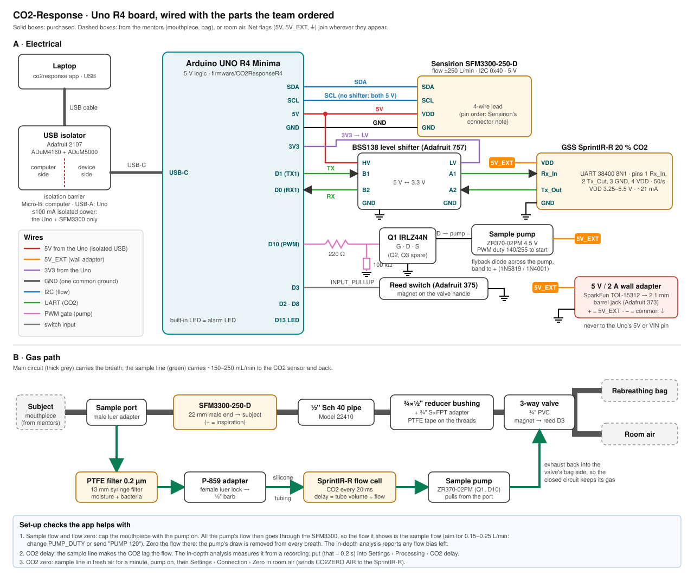
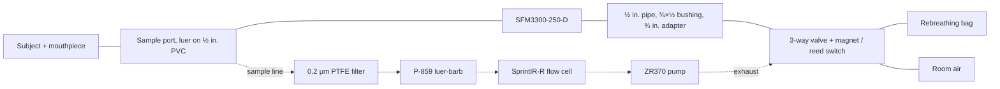
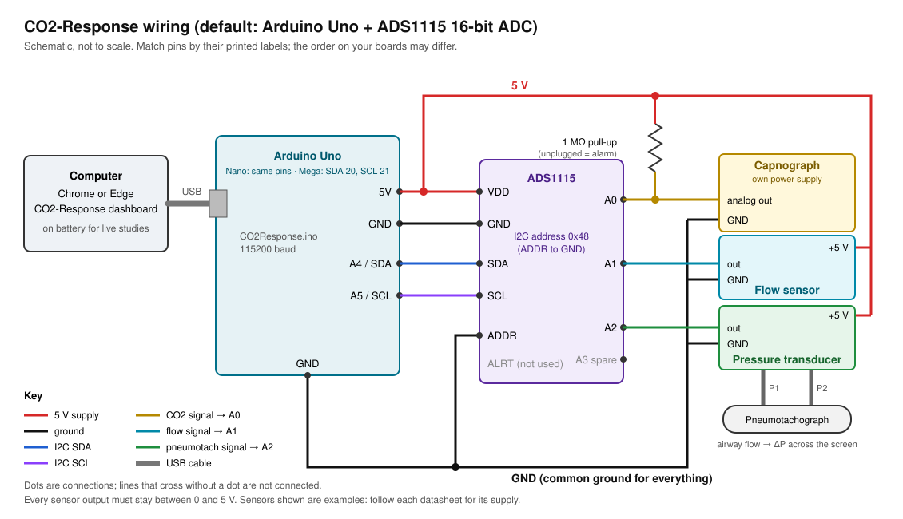

# Wiring

Quick reference. The step-by-step version, with checks and troubleshooting, is in the [setup and operating guide](../SETUP-GUIDE.md).

There are two boards. The app recognises which one is connected from its info line.

- **Uno R4 board, digital sensors** (the current build, below): an Arduino Uno R4 Minima with a Sensirion SFM3300-250-D flow sensor and a GSS SprintIR-R-20 CO2 sensor: the parts on the team's purchase list. Firmware: `firmware/CO2ResponseR4/`.
- **ADC board** (the earlier build, further down): an Arduino Uno with an ADS1115 16-bit ADC reading a capnograph, a flow sensor and a pneumotach. Firmware: `firmware/CO2Response/`.

## Uno R4 board (digital sensors)

### The parts, and what each one does

| Part (purchase list) | Job | Connected to |
| --- | --- | --- |
| Arduino UNO R4 Minima (ABX00080) | Reads both sensors, drives the pump, streams 100 lines/s to the laptop | USB-C to the isolator's device side |
| Adafruit 2107 USB isolator (ADuM4160 + ADuM5000) | Keeps the laptop and mains away from anything on the subject | Laptop USB → isolator → Uno. Set its speed switch to **Full Speed** (the Uno R4's USB is full speed). It gives up to about 100 mA of isolated 5 V: enough for the Uno and the SFM3300, **not** for the pump |
| Sensirion SFM3300-250-D | Flow, ±250 L/min, every 0.5 ms; breaths, VT and MV come from it | I2C at 5 V straight to the Uno's SDA/SCL (no level shifter needed), address 0x40, VDD from the Uno's 5V |
| GSS SprintIR-R-20 (CO2meter) | CO2, 0-20 %, 50 readings a second, sidestream | UART on D0/D1 through the BSS138 shifter (its logic is 3.3 V); VDD from 5V_EXT (it takes 3.25-5.5 V) |
| Adafruit 757 BSS138 4-channel level shifter | 5 V ↔ 3.3 V for the SprintIR-R's UART | HV = Uno 5V, LV = Uno 3V3, B1/B2 on the Uno side, A1/A2 on the SprintIR side; channels 3-4 spare |
| ZR370-02PM air pump (Adafruit 4699) | Pulls the CO2 sample through the filter and the SprintIR-R | + to 5V_EXT, − to Q1's drain |
| IRLZ44N MOSFET ×3 | Q1 switches the pump from D10 (PWM). Q2, Q3 spare (a louder buzzer, a valve later) | Gate via 220 Ω from D10, 100 kΩ gate to GND, source to GND |
| 5 V / 2 A wall adapter (SparkFun TOL-15312) + 2.1 mm barrel jack (Adafruit 373) | The **5V_EXT** rail: the pump and the SprintIR-R | + = 5V_EXT, − = common GND. **Never** to the Uno's 5V or VIN pin (VIN needs 6-24 V, and 5V would push power back into the isolator) |
| Magnetic contact switch (Adafruit 375) | Tells the app where the valve handle is: at the bag the rebreathing phase starts, back at room air the test ends | D3 and GND; the magnet on the valve handle |
| Silicone tubing (Adafruit 4661) | The sample line | Filter → adapter → SprintIR-R → pump |
| PTFE syringe filter 0.2 µm, 13 mm (ChromTech F13-PT020) | Keeps breath moisture and droplets out of the CO2 sensor | Its male luer into the sample line, as close to the sample port as practical; change it when wet |
| P-859 barbed adapter, female luer lock × ⅛" barb | Joins the filter's male luer to the silicone tubing | |
| ½" Sch 40 PVC pipe, ¾×½" reducer bushing, ¾" S×FPT adapters, PTFE tape | The main breathing circuit from the flow sensor to the valve | PTFE tape on every thread |

Not on the purchase list yet but in the design: the 3-way valve and extra luer adapters (in the budget increase request), the mouthpiece and rebreathing bag (from the mentors), a flyback diode across the pump (1N5819 or 1N4001, from the electronics kit), 4.7 kΩ pull-ups on SDA and SCL if the SFM3300 does not answer (the Uno R4 Minima has none of its own), and optionally a button and a buzzer.

### Pin by pin

| Uno R4 pin | Goes to | Notes |
| --- | --- | --- |
| SDA, SCL | SFM3300 SDA, SCL | 5 V I2C, 100 kHz, address 0x40. 4.7 kΩ pull-ups from each to 5V if the sensor does not answer |
| 5V | SFM3300 VDD; level shifter HV | Isolated USB power: keep this rail to the Uno, the SFM3300 and the shifter |
| 3V3 | Level shifter LV | A reference only: the shifter draws almost nothing |
| D1 (TX1) | Shifter B1 → A1 → SprintIR-R Rx_In | `Serial1`, 9600 8N1 |
| D0 (RX1) | Shifter B2 ← A2 ← SprintIR-R Tx_Out | |
| D10 (PWM) | Q1 IRLZ44N gate through 220 Ω; 100 kΩ gate to GND | Q1 drain = pump −, pump + = 5V_EXT, diode across the pump (band to +) |
| D3 | Reed switch, other lead to GND | `INPUT_PULLUP`; the magnet closes it at the bag position (`REED_CLOSED_IS_BAG`) |
| D13 (built-in LED) | nothing to wire | The alarm LED: follows the app's alarms and flashes if the app stops |
| D2 (optional) | Stop / marker button to GND | During rebreathing: emergency stop; otherwise a marker |
| D8 (optional) | Active piezo buzzer to GND | Sounds for a high alarm and if the app stops |
| GND | Common ground | Uno GND, the wall adapter's −, Q1's source, the shifter, both sensors, joined at one point |

The SprintIR-R's pin numbers differ between its header variants: wire by the signal names on its datasheet (GND, VDD, Rx_In, Tx_Out). Likewise check the SFM3300's 4-pin connector order (SDA, GND, VDD, SCL on the common cable) against its datasheet before powering up.

### The gas path

- **Sample port between the mouthpiece and the flow sensor**, as close to the mouth as possible, so the CO2 is the subject's breath and not the circuit's.
- **Flow direction:** the arrow on the SFM3300 points in its positive direction. Point it at the subject (inspiration positive), or set `SFM_FLOW_SIGN -1` in `config.h`.
- **Pump exhaust back into the valve's bag side**, so the closed rebreathing circuit keeps its gas and its CO2.

### Setting the sample flow, and zeroing the flow sensor

The pump draws its sample through the sample port, which is on the subject's side of the flow sensor. So during inspiration the SFM3300 carries the subject's flow plus the sample flow, and during expiration the subject's flow minus it. Every breath reads a little too much inspired and too little expired volume, by the sample flow.

1. Cap the mouthpiece with the pump running. All the pump's flow now goes through the SFM3300, so the flow the monitor shows **is the sample flow**. Aim for 0.15-0.25 L/min: change `PUMP_DUTY` in `config.h`, or send `PUMP 120` (any duty 2-255) from **Settings > Connection** to try values.
2. Still capped, zero the flow (**Settings > Calibration > Flow > Zero**). That removes the pump's draw from every breath.
3. Check a recording: the **in-depth analysis** reports the flow bias left over (net flow over a breath) and the inspired − expired volume; both should be near 0.

### The CO2 delay

The sample line makes the CO2 arrive later than the flow: roughly the tubing's volume divided by the sample flow (1 m of 2.5 mm tubing at 0.2 L/min is about 1.5 s), plus the sensor's response. Record a minute of quiet breathing and open it in **Data & recordings > Open** (or run `co2response --analyze file.csv`). The in-depth analysis gives **CO2 delay after expiration starts**; put (that − 0.2 s) × 1000 into **Settings > Processing > CO2 delay (ms)**, so each breath's CO2 is paired with its own flow.

### Zeroing the CO2 sensor

With the pump running, put the sample line in fresh air (outside air, or a well-ventilated room) for a minute, then press **Settings > Connection > CO2 sensor zero > Zero in room air** (it sends `CO2ZERO AIR`; the SprintIR-R takes that gas as 400 ppm). With nitrogen from the lab, use **Zero in nitrogen**. A calibration gas from the PFT lab can then check the gain (**Settings > Calibration**).

Software settings for this board are in `firmware/CO2ResponseR4/config.h` (pins, the flow sensor's sign, the flow averaging, the pump duty, the CO2 sensor's filter choice). Build and upload with the Arduino IDE (board "Arduino UNO R4 Minima", no extra libraries) or `pio run -d firmware/r4 -t upload`. The protocol differences are in [protocol.md](protocol.md#the-uno-r4-board-digital-sensors).

**With a Capnostream 35 as the CO2 source** ([capnostream.md](capnostream.md)): its FilterLine goes to the sample port in place of the SprintIR-R's sample line, and it has its own pump, so the SprintIR-R and the sample pump are not needed. Its data cable goes to the computer (RS-232 through an isolated USB adapter, or its network link), not to the Arduino.

**Not yet tested on hardware.** The SFM3300 interface (address 0x40, start command 0x1000, CRC-8 polynomial 0x31 with initial value 0x00, offset 32768, scale 120 per slm) and the SprintIR-R commands (`K 1`, `M 2`/`M 4`, `.`, `G`, `U`) follow the manufacturers' datasheets; check them against your parts. The firmware builds for the Uno R4 Minima (`pio run -d firmware/r4`).

## ADC board (ADS1115)

Arduino Uno + ADS1115 16-bit ADC breakout over I2C. Change `firmware/CO2Response/config.h` if yours differs.

### ADS1115 to Arduino

| ADS1115 | Arduino Uno / Nano | Arduino Mega |
| --- | --- | --- |
| VDD | 5V | 5V |
| GND | GND | GND |
| SCL | A5 (or the SCL pin) | 21 (SCL) |
| SDA | A4 (or the SDA pin) | 20 (SDA) |
| ADDR | GND (address 0x48) | GND |
| ALRT | not connected | not connected |

### Sensors to ADS1115

| ADS1115 input | Sensor | Notes |
| --- | --- | --- |
| A0 | Capnograph analog output | Add a 1 MΩ pull-up from A0 to VDD so an unplugged capnograph reads at the high rail and raises a technical alarm. |
| A1 | Flow sensor output | |
| A2 | Pneumotach pressure transducer output | Single-ended by default. |
| A3 | Spare, the transducer's second output, or a pulse oximeter's analog output | Set `PNEUMO_DIFFERENTIAL 1` to read A2–A3 differentially, **or** `SPO2_CHANNEL 1` to send A3 as a fourth value (SpO2). Not both. |

### Buzzer (host watchdog)

| Arduino pin | Part | Notes |
| --- | --- | --- |
| D8 | Piezo buzzer, other leg to GND | A passive piezo (the firmware drives it at 2.7 kHz). `BUZZER_PIN` in `config.h`; set it to -1 for no buzzer. |
| D13 (built-in LED) | nothing to wire | Blinks with the buzzer. |

The monitor app sends a heartbeat to the board once a second. If the heartbeats stop for 3 s (the app closed or crashed, the computer went to sleep, the browser tab was put in the background), the board sounds the buzzer and blinks the LED until they come back, because nothing on the computer is checking the CO2 alarms any more. The buzzer is not in the wiring diagram above. See [protocol.md](protocol.md#host-watchdog-heartbeat).

### Valve output (optional)

| Arduino pin | Part | Notes |
| --- | --- | --- |
| D7 | The input of a valve driver | HIGH = valve to the rebreathing bag, LOW = room air. `VALVE_PIN` in `config.h`; set it to -1 for no valve output. |

The pin gives a 5 V logic signal at a few milliamps. **It cannot drive a solenoid or a servo directly:** put a logic-level MOSFET or a relay module between it and the valve, with a flyback diode across a solenoid coil, and power the valve from its own supply with the grounds joined. Choose a valve that rests on room air with no power, so a pulled cable or a dead supply fails safe.

The board starts on room air and returns to room air by itself when the host watchdog trips (the app stopped). The app switches the valve only when **Settings > Alarms > Switch the valve from the app** is on; **Emergency stop** always sends it to room air. See [protocol.md](protocol.md) and [safety.md](safety.md). This output has not been tested on hardware.

### Pulse oximeter (optional)

Wire the oximeter's analog SpO2 output to A3 and its ground to the common ground, build the firmware with `SPO2_CHANNEL 1`, and switch on **Settings > Display & units > SpO2 channel connected**. Enter the output's scaling from the oximeter's manual (often 1 V = 100 %). The same input-range rule applies: nothing above VDD.

## Rules

- **Common ground.** Sensor grounds, ADC ground and Arduino ground must be joined. Most noise and offset problems are a missing ground.
- **Stay inside the input range.** With a 5 V supply no input may go below −0.3 V or above 5.3 V. If a sensor can output more than VDD, use a resistor divider and put the divider ratio into the calibration.
- **Match the PGA gain to the sensors.** `GAIN_TWOTHIRDS` (±6.144 V full scale) suits 0–5 V sensors. For 0–3.3 V sensors use `GAIN_ONE` (±4.096 V) for more resolution, and update `railHighV` in `co2response/config/channels.json`.
- **Pneumotach leads.** Use twisted or shielded wire between the pressure transducer and the ADC, and keep it away from pump or heater wiring.
- **Electrical isolation.** If anything is connected to a person or animal, power the setup from a battery laptop or through a medical-grade USB isolator. See [safety.md](safety.md).

## Checking the wiring

1. Flash the firmware, connect, and run **Settings > Diagnostics > Hardware check**. If the ADC is not answering, the check shows the firmware's I2C scan: `none` means no power or SDA/SCL not connected; `0x49`–`0x4B` means the ADDR pin is not on GND.
2. In **Settings > Display & units**, turn on **Show raw volts** to see each channel's voltage under its number.
3. A channel pinned at 0 V or 5 V for 2 s raises an "AT ADC RAIL" technical alarm (CO2 only at 5 V).
