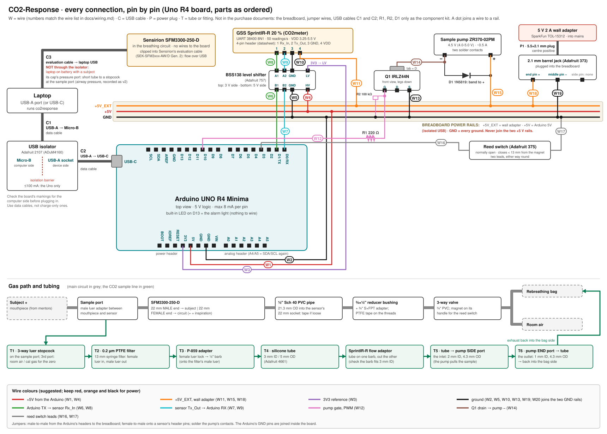
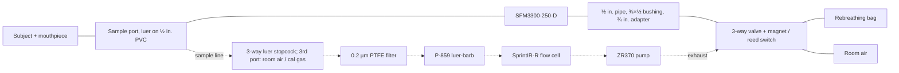

# Wiring

Quick reference. The step-by-step version, with checks and troubleshooting, is in the [setup and operating guide](../SETUP-GUIDE.md).

There are two boards. The app recognises which one is connected from its info line.

- **Uno R4 board, digital sensors** (the current build, below): an Arduino Uno R4 Minima with a Sensirion SFM3300-250-D flow sensor and a GSS SprintIR-R-20 CO2 sensor: the parts on the team's purchase list. Firmware: `firmware/CO2ResponseR4/`.
- **ADC board** (the earlier build, further down): an Arduino Uno with an ADS1115 16-bit ADC reading a capnograph, a flow sensor and a pneumotach. Firmware: `firmware/CO2Response/`.

## Uno R4 board (digital sensors)

### Every connection, pin by pin

The picture above shows the Arduino's two headers as they sit on the board (top view, USB-C on the left), the breadboard's three power rails, and every wire numbered. The lists below use the same numbers. `scripts/draw_connections.py` redraws it.

### On the breadboard, hole by hole

A half-size (400-point) breadboard: rows 1–30, columns a–e on one side of the centre channel and f–j on the other, and a pair of power rails down each long edge. A hole is its column letter plus its row number: **j12** is column j, row 12. The five holes a12–e12 are joined inside the board; the channel separates them from f12–j12. Each rail runs the full length of the board. The drawing has the board on its side (row 1 on the left); turn it so row 1 is at the top and it matches an upright board. `scripts/draw_breadboard.py` redraws it; a [high-resolution PNG](images/breadboard-r4.png) is there for printing.

The rails are named by the side they sit on: the **a side** (next to column a) or the **j side** (next to column j).

| Rail | Supply | Fed by | Feeds |
| --- | --- | --- | --- |
| **+** rail, a side (red line) | **+5V_EXT** (orange wires) | W22 from J1's end pin | W15 SprintIR-R VDD, W19 pump + |
| **−** rail, a side (blue line) | **GND** (black wires) | W23 from J1's middle pin | joined to the j-side − rail by W24 |
| **−** rail, j side (blue line) | **GND** (black wires) | W2 from the Arduino's GND | W9 shifter, W17 Q1 source, R2, W21 reed switch |
| **+** rail, j side (red line) | **+5V** (red wires) | W1 from the Arduino's 5V | W7 SFM3300 VDD, W8 shifter HV |

The two + rails carry different supplies: **never join them**. In the drawing every wire has its own colour, and its number sits on the hole at each end, so each one can be followed from end to end; the last column below is the jumper colour to use. Any hole of a rail will do; "by row 4" below is only where the drawing puts the wire end.

| Part | Holes |
| --- | --- |
| J1 barrel jack | Pins in c3 (end pin, +), c5 (middle pin, −), c7 (side pin, unused). Check with a meter that the plug's centre reaches row 3 |
| Q1 IRLZ44N | f7 gate, f8 drain, f9 source; its printed side towards column j |
| R1 220 Ω | h3 to h7 |
| R2 100 kΩ | i7 to the j-side − rail |
| U1 level shifter | A side in d23–d28 (A1, A2, LV, GND, A3, A4), B side in g23–g28 (B1, B2, HV, GND, B3, B4), straddling the channel. Check the names printed on your board and keep each wire in the row of the named pin |
| Reed switch leads | g15 and g17, either way round |

| # | From (hole or pin) | To (hole or pin) | Colour |
| --- | --- | --- | --- |
| W1 | Arduino 5V | + rail, j side (by row 30) | red |
| W2 | Arduino GND (power header) | − rail, j side (by row 30) | black |
| W3 | Arduino 3V3 | b25 (shifter LV) | purple |
| W4 | Arduino SCL | SFM3300 SCL (off the board) | yellow |
| W5 | Arduino SDA | SFM3300 SDA (off the board) | blue |
| W6 | Arduino GND (top header) | SFM3300 GND (off the board) | black |
| W7 | + rail, j side (by row 2) | SFM3300 VDD | red |
| W8 | + rail, j side (by row 26) | j25 (shifter HV) | red |
| W9 | − rail, j side (by row 28) | j26 (shifter GND, 5 V side) | black |
| W10 | Arduino D1/TX | j23 (shifter B1) | green |
| W11 | Arduino D0/RX | j24 (shifter B2) | cyan |
| W12 | a23 (shifter A1) | SprintIR-R pin 1 Rx_In | green |
| W13 | a24 (shifter A2) | SprintIR-R pin 2 Tx_Out | cyan |
| W14 | a26 (shifter GND, 3 V side) | SprintIR-R pin 3 GND | black |
| W15 | + rail, a side (by row 28) | SprintIR-R pin 4 VDD | orange |
| W16 | Arduino D10 | j3 (R1, then Q1's gate) | pink |
| W17 | j9 (Q1 source) | − rail, j side (by row 10) | black |
| W18 | Pump − contact | g8 (Q1 drain) | brown |
| W19 | Pump + contact | + rail, a side (by row 10) | orange |
| W20 | Arduino D3 | j15 (reed lead) | grey |
| W21 | j17 (other reed lead) | − rail, j side (by row 18) | grey |
| W22 | a3 (J1 end pin, +) | + rail, a side (by row 4) | orange |
| W23 | a5 (J1 middle pin, −) | − rail, a side (by row 6) | black |
| W24 | − rail, a side (by row 2) | − rail, j side (by row 2) | black |

The rows are a suggestion: any free row works as long as every wire that should meet lands in the same row on the same side of the channel, or on the same rail.

**Cables and plugs**

| # | From | To | Use |
| --- | --- | --- | --- |
| C1 | Laptop USB-A port | USB isolator, **Micro-B** (computer side) | A USB-A to Micro-B **data** cable (USB-C to Micro-B if the laptop has only USB-C). A charge-only cable shows no serial port |
| C2 | USB isolator, **USB-A socket** (device side) | Arduino UNO R4 Minima, **USB-C** | A USB-A to USB-C data cable |
| P1 | 5 V 2 A wall adapter (SparkFun TOL-15312), 5.5 × 2.1 mm plug, centre positive | 2.1 mm barrel jack (Adafruit 373) on the breadboard | Plug in last, after checking the rails with a meter |

Adafruit's page lists a Micro USB and a USB-A connector on the isolator without naming the sides; the USB-A socket is where a device plugs in, so it faces the Arduino. Check the markings on your board.

**Wires** (on a breadboard: male-to-male jumpers from the Arduino's headers; female-to-male onto a sensor's header pins)

| # | From | To | Colour | Notes |
| --- | --- | --- | --- | --- |
| W1 | Arduino **5V** (power header) | +5V rail | red | Isolated USB power for the Uno side only |
| W2 | Arduino **GND** (power header) | GND rail | black | |
| W3 | Arduino **3V3** (power header) | Shifter **LV** | purple | A reference only |
| W4 | Arduino **SCL** (top header, left end; also A5) | SFM3300 **SCL** | yellow | 5 V I2C, no shifter |
| W5 | Arduino **SDA** (top header, next to SCL; also A4) | SFM3300 **SDA** | blue | |
| W6 | Arduino **GND** (top header, next to AREF) | SFM3300 **GND** | black | |
| W7 | +5V rail | SFM3300 **VDD** | red | 5 V ± 5 % |
| W8 | +5V rail | Shifter **HV** | red | |
| W9 | GND rail | Shifter **GND** (HV side) | black | The shifter's two GND pins are joined on its board |
| W10 | Arduino **D1/TX** | Shifter **B1** | green | `Serial1` |
| W11 | Arduino **D0/RX** | Shifter **B2** | cyan | |
| W12 | Shifter **A1** | SprintIR-R pin **1 Rx_In** | green | |
| W13 | Shifter **A2** | SprintIR-R pin **2 Tx_Out** | cyan | |
| W14 | Shifter **GND** (LV side) | SprintIR-R pin **3 GND** | black | |
| W15 | +5V_EXT rail | SprintIR-R pin **4 VDD** | orange | 3.25-5.5 V, about 21 mA |
| W16 | Arduino **D10** | R1 220 Ω → Q1 **gate** | pink | R2 100 kΩ from the gate to the GND rail |
| W17 | Q1 **source** | GND rail | black | IRLZ44N, front view legs down: G, D, S |
| W18 | Q1 **drain** (tab or middle leg) | Pump **−** contact | brown | D1 1N5819 across the pump, band to + |
| W19 | +5V_EXT rail | Pump **+** contact | orange | Solder wires to the pump's two contacts |
| W20 | Arduino **D3** | Reed switch, either lead | grey | `INPUT_PULLUP` |
| W21 | Reed switch, other lead | GND rail | grey | Normally open; closes when the magnet is within about 13 mm |
| W22 | Barrel jack **end pin** (+) | +5V_EXT rail | orange | |
| W23 | Barrel jack **middle pin** (−) | GND rail | black | The **side pin** (switch) stays unconnected |
| W24 | − rail, a side | − rail, j side | black | Joins the two GND rails; the pump's current returns through it |

If the SFM3300 does not answer, the fix is two 4.7 kΩ pull-ups from the electronics component kit: SDA → +5V rail and SCL → +5V rail (the Uno R4 Minima has none of its own). The Uno R4 Minima allows at most 8 mA per pin, which every signal here stays under; the pump's 0.5 A goes through Q1, never through a pin.

**Tubes and fittings**

| # | Part | Fits |
| --- | --- | --- |
| T1 | 3-way luer stopcock | On the sample port; its third port open to room air (or calibration gas). Handle to the breath for a test, to room air to zero |
| T2 | 0.2 µm PTFE syringe filter (13 mm) | Female luer in from the stopcock, male luer out |
| T3 | P-859 adapter, female luer lock × ⅛" barb | Onto the filter's male luer; the barb takes the 3 mm silicone tube |
| T4 | Silicone tube, 3 mm ID / 5 mm OD (Adafruit 4661) | Adapter → SprintIR-R flow adaptor |
| T5 | Silicone tube | SprintIR-R flow adaptor → the pump's **side** port (its inlet: 2 mm ID, 4.3 mm OD) |
| T6 | Silicone tube | The pump's **end** port (its outlet: 1 mm ID, 4.3 mm OD) → back into the valve's bag side |

### The parts, and what each one does

| Part (purchase list) | Job | Connected to |
| --- | --- | --- |
| Arduino UNO R4 Minima (ABX00080) | Reads both sensors, drives the pump, streams 100 lines/s to the laptop | USB-C to the isolator's device side |
| Adafruit 2107 USB isolator (ADuM4160 + ADuM5000) | Keeps the laptop and mains away from anything on the subject | Laptop USB → isolator Micro-B (cable C1); isolator USB-A socket → Uno USB-C (cable C2). It works with full-speed USB devices like the Uno R4. Its isolated supply gives up to 100 mA: enough for the Uno and the SFM3300, **not** for the pump |
| Sensirion SFM3300-250-D | Flow, ±250 L/min, every 0.5 ms; breaths, VT and MV come from it | I2C at 5 V straight to the Uno's SDA/SCL (no level shifter needed), address 0x40, VDD from the Uno's 5V |
| GSS SprintIR-R-20 (CO2meter) | CO2, 0-20 %, 50 readings a second, sidestream | UART at 38,400 baud on D0/D1 through the BSS138 shifter (its inputs are rated to 5 V absolute maximum and its output high is only 2.6-3.0 V, so the shifter works both ways); pins 1 Rx_In, 2 Tx_Out, 3 GND, 4 VDD; VDD from 5V_EXT (3.25-5.5 V, about 21 mA) |
| Adafruit 757 BSS138 4-channel level shifter | 5 V ↔ 3.3 V for the SprintIR-R's UART | HV = Uno 5V, LV = Uno 3V3, B1/B2 on the Uno side, A1/A2 on the SprintIR side; channels 3-4 spare |
| ZR370-02PM air pump (Adafruit 4699) | Pulls the CO2 sample through the filter and the SprintIR-R | + to 5V_EXT, − to Q1's drain |
| IRLZ44N MOSFET ×3 | Q1 switches the pump from D10 (PWM). Q2, Q3 spare | Gate via 220 Ω from D10, 100 kΩ gate to GND, source to GND |
| 5 V / 2 A wall adapter (SparkFun TOL-15312) + 2.1 mm barrel jack (Adafruit 373) | The **5V_EXT** rail: the pump and the SprintIR-R | + = 5V_EXT, − = common GND. **Never** to the Uno's 5V or VIN pin (VIN needs 6-24 V, and 5V would push power back into the isolator) |
| Magnetic contact switch (Adafruit 375) | Tells the app where the valve handle is: at the bag the rebreathing phase starts, back at room air the test ends | D3 and GND; the magnet on the valve handle |
| Silicone tubing (Adafruit 4661) | The sample line | Filter → adapter → SprintIR-R → pump |
| PTFE syringe filter 0.2 µm, 13 mm (ChromTech F13-PT020) | Keeps breath moisture and droplets out of the CO2 sensor | Its male luer into the sample line, as close to the sample port as practical; change it when wet |
| P-859 barbed adapter, female luer lock × ⅛" barb | Joins the filter's male luer to the silicone tubing | |
| ½" Sch 40 PVC pipe, ¾×½" reducer bushing, ¾" S×FPT adapters, PTFE tape | The main breathing circuit from the flow sensor to the valve | PTFE tape on every thread |

**What is purchased.** Everything above, and everything in the budget increase request except four items that will not be bought: the SparkFun pulse oximeter and heart rate sensor (MAX30101 & MAX32664), the assorted pediatric and infant masks, the pediatric EtCO2 nasal cannulas and the SFM3400-33-D infant flow sensor. From that request:

- In this build: the electronics component kit (R1 220 Ω, R2 100 kΩ, the D1 flyback diode, jumpers, and 4.7 kΩ pull-ups if the flow sensor needs them), the ¾" three-way PVC ball valve, two more ¾×½" reducer bushings (one per valve port), the male and female luer-to-barb adapters (the sample port), the 3-way luer stopcocks (T1: switch the sample line between the breath and room air or calibration gas), a second 1 m of silicone tubing, and the ABS project enclosure for the electronics.
- Spares and supports: a spare SFM3300-250-D, the Sensirion Gen. 2 evaluation cable (reads a flow sensor straight from the laptop over USB, with Sensirion's software, for bench checks), the tubing stands and holders. The second level shifter and the Qwiic-to-breadboard cable were for the oximeter and are spare.

The mouthpieces, rebreathing bag and main tubing come from the mentors; the calibration syringe, CO2 calibration gas and test lung are borrowed from the PFT lab.

### Pin by pin

| Uno R4 pin | Goes to | Notes |
| --- | --- | --- |
| SDA, SCL | SFM3300 SDA, SCL | 5 V I2C, 100 kHz, address 0x40. 4.7 kΩ pull-ups from each to 5V if the sensor does not answer |
| 5V | SFM3300 VDD; level shifter HV | Isolated USB power: keep this rail to the Uno, the SFM3300 and the shifter |
| 3V3 | Level shifter LV | A reference only: the shifter draws almost nothing |
| D1 (TX1) | Shifter B1 → A1 → SprintIR-R Rx_In | `Serial1`, 38400 8N1 |
| D0 (RX1) | Shifter B2 ← A2 ← SprintIR-R Tx_Out | |
| D10 (PWM) | Q1 IRLZ44N gate through 220 Ω; 100 kΩ gate to GND | Q1 drain = pump −, pump + = 5V_EXT, diode across the pump (band to +) |
| D3 | Reed switch, other lead to GND | `INPUT_PULLUP`; the magnet closes it at the bag position (`REED_CLOSED_IS_BAG`) |
| D13 (built-in LED) | nothing to wire | The alarm LED: follows the app's alarms and flashes if the app stops |
| GND | Common ground | Uno GND, the wall adapter's −, Q1's source, the shifter, both sensors, joined at one point |

The SprintIR-R's pin numbers differ between its header variants: wire by the signal names on its datasheet (GND, VDD, Rx_In, Tx_Out). Likewise check the SFM3300's 4-pin connector order (SDA, GND, VDD, SCL on the common cable) against its datasheet before powering up.

### The gas path

- **Sample port between the mouthpiece and the flow sensor**, as close to the mouth as possible, so the CO2 is the subject's breath and not the circuit's.
- **Flow direction:** the SFM3300's positive flow runs from its 22 mm **female** end to its 22 mm **male** end (datasheet 4.1). Put the **male** end (15 mm female inside) towards the subject and the **female** end towards the valve, and inspiration reads positive. Mounted the other way, set `SFM_FLOW_SIGN -1` in `config.h`.
- **Fitting the pipe:** the female end is a 22 mm socket; ½" Sch 40 PVC is 21.3 mm across, so wrap it with tape until it seals.
- **Pump exhaust back into the valve's bag side**, so the closed rebreathing circuit keeps its gas and its CO2.

### Setting the sample flow, and zeroing the flow sensor

The pump draws its sample through the sample port, which is on the subject's side of the flow sensor. So during inspiration the SFM3300 carries the subject's flow plus the sample flow, and during expiration the subject's flow minus it. Every breath reads a little too much inspired and too little expired volume, by the sample flow.

1. Cap the mouthpiece with the pump running. All the pump's flow now goes through the SFM3300, so the flow the monitor shows **is the sample flow**. Aim for 0.15-0.25 L/min: change `PUMP_DUTY` in `config.h`, or send `PUMP 120` (any duty 2-255) from **Settings > Connection** to try values.
2. Still capped, zero the flow (**Settings > Calibration > Flow > Zero**). That removes the pump's draw from every breath.
3. Check a recording: the **in-depth analysis** reports the flow bias left over (net flow over a breath) and the inspired − expired volume; both should be near 0.

### The CO2 delay

The sample line makes the CO2 arrive later than the flow: roughly the tubing's volume divided by the sample flow (1 m of 2.5 mm tubing at 0.2 L/min is about 1.5 s), plus the sensor's response. Record a minute of quiet breathing and open it in **Data & recordings > Open** (or run `co2response --analyze file.csv`). The in-depth analysis gives **CO2 delay after expiration starts**; put (that − 0.2 s) × 1000 into **Settings > Processing > CO2 delay (ms)**, so each breath's CO2 is paired with its own flow.

### Zeroing the CO2 sensor

With the pump running, turn the stopcock (T1) to room air (fresh air: outside, or a well-ventilated room) for a minute, then press **Settings > Connection > CO2 sensor zero > Zero in room air** (it sends `CO2ZERO AIR`; the SprintIR-R takes that gas as 400 ppm). With nitrogen from the lab, use **Zero in nitrogen**. A calibration gas from the PFT lab can then check the gain (**Settings > Calibration**).

Software settings for this board are in `firmware/CO2ResponseR4/config.h` (pins, the flow sensor's sign, the flow averaging, the pump duty, the CO2 sensor's filter choice). Build and upload with the Arduino IDE (board "Arduino UNO R4 Minima", no extra libraries) or `pio run -d firmware/r4 -t upload`. The protocol differences are in [protocol.md](protocol.md#the-uno-r4-board-digital-sensors).

**With a Capnostream 35 as the CO2 source** ([capnostream.md](capnostream.md)): its FilterLine goes to the sample port in place of the SprintIR-R's sample line, and it has its own pump, so the SprintIR-R and the sample pump are not needed. Its data cable goes to the computer (RS-232 through an isolated USB adapter, or its network link), not to the Arduino.

**Not yet tested on hardware.** The SFM3300 interface (address 0x40, start command 0x1000, CRC-8 polynomial 0x31 with initial value 0x00, offset 32768, scale 120 per slm) and the SprintIR-R commands (`K 1`, `M 2`/`M 4`, `.`, `G`, `U`) follow the manufacturers' datasheets; check them against your parts. The firmware builds for the Uno R4 Minima (`pio run -d firmware/r4`).

## ADC board (ADS1115)

Arduino Uno + ADS1115 16-bit ADC breakout over I2C. Change `firmware/CO2Response/config.h` if yours differs.

### ADS1115 to Arduino

| ADS1115 | Arduino Uno / Nano | Arduino Mega |
| --- | --- | --- |
| VDD | 5V | 5V |
| GND | GND | GND |
| SCL | A5 (or the SCL pin) | 21 (SCL) |
| SDA | A4 (or the SDA pin) | 20 (SDA) |
| ADDR | GND (address 0x48) | GND |
| ALRT | not connected | not connected |

### Sensors to ADS1115

| ADS1115 input | Sensor | Notes |
| --- | --- | --- |
| A0 | Capnograph analog output | Add a 1 MΩ pull-up from A0 to VDD so an unplugged capnograph reads at the high rail and raises a technical alarm. |
| A1 | Flow sensor output | |
| A2 | Pneumotach pressure transducer output | Single-ended by default. |
| A3 | Spare, the transducer's second output, or a pulse oximeter's analog output | Set `PNEUMO_DIFFERENTIAL 1` to read A2–A3 differentially, **or** `SPO2_CHANNEL 1` to send A3 as a fourth value (SpO2). Not both. |

### Buzzer (host watchdog)

| Arduino pin | Part | Notes |
| --- | --- | --- |
| D8 | Piezo buzzer, other leg to GND | A passive piezo (the firmware drives it at 2.7 kHz). `BUZZER_PIN` in `config.h`; set it to -1 for no buzzer. |
| D13 (built-in LED) | nothing to wire | Blinks with the buzzer. |

The monitor app sends a heartbeat to the board once a second. If the heartbeats stop for 3 s (the app closed or crashed, the computer went to sleep, the browser tab was put in the background), the board sounds the buzzer and blinks the LED until they come back, because nothing on the computer is checking the CO2 alarms any more. The buzzer is not in the wiring diagram above. See [protocol.md](protocol.md#host-watchdog-heartbeat).

### Valve output (optional)

| Arduino pin | Part | Notes |
| --- | --- | --- |
| D7 | The input of a valve driver | HIGH = valve to the rebreathing bag, LOW = room air. `VALVE_PIN` in `config.h`; set it to -1 for no valve output. |

The pin gives a 5 V logic signal at a few milliamps. **It cannot drive a solenoid or a servo directly:** put a logic-level MOSFET or a relay module between it and the valve, with a flyback diode across a solenoid coil, and power the valve from its own supply with the grounds joined. Choose a valve that rests on room air with no power, so a pulled cable or a dead supply fails safe.

The board starts on room air and returns to room air by itself when the host watchdog trips (the app stopped). The app switches the valve only when **Settings > Alarms > Switch the valve from the app** is on; **Emergency stop** always sends it to room air. See [protocol.md](protocol.md) and [safety.md](safety.md). This output has not been tested on hardware.

### Pulse oximeter (optional)

No oximeter is being bought for this project; this is only for a team that has one.

Wire the oximeter's analog SpO2 output to A3 and its ground to the common ground, build the firmware with `SPO2_CHANNEL 1`, and switch on **Settings > Display & units > SpO2 channel connected**. Enter the output's scaling from the oximeter's manual (often 1 V = 100 %). The same input-range rule applies: nothing above VDD.

## Rules

- **Common ground.** Sensor grounds, ADC ground and Arduino ground must be joined. Most noise and offset problems are a missing ground.
- **Stay inside the input range.** With a 5 V supply no input may go below −0.3 V or above 5.3 V. If a sensor can output more than VDD, use a resistor divider and put the divider ratio into the calibration.
- **Match the PGA gain to the sensors.** `GAIN_TWOTHIRDS` (±6.144 V full scale) suits 0–5 V sensors. For 0–3.3 V sensors use `GAIN_ONE` (±4.096 V) for more resolution, and update `railHighV` in `co2response/config/channels.json`.
- **Pneumotach leads.** Use twisted or shielded wire between the pressure transducer and the ADC, and keep it away from pump or heater wiring.
- **Electrical isolation.** If anything is connected to a person or animal, power the setup from a battery laptop or through a medical-grade USB isolator. See [safety.md](safety.md).

## Checking the wiring

1. Flash the firmware, connect, and run **Settings > Diagnostics > Hardware check**. If the ADC is not answering, the check shows the firmware's I2C scan: `none` means no power or SDA/SCL not connected; `0x49`–`0x4B` means the ADDR pin is not on GND.
2. In **Settings > Display & units**, turn on **Show raw volts** to see each channel's voltage under its number.
3. A channel pinned at 0 V or 5 V for 2 s raises an "AT ADC RAIL" technical alarm (CO2 only at 5 V).
