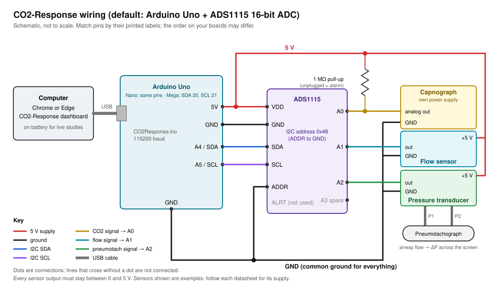

# Wiring

Quick reference. The step-by-step version, with checks and troubleshooting, is in the [setup and operating guide](../SETUP-GUIDE.md).

Default hardware: Arduino Uno + ADS1115 16-bit ADC breakout over I2C. Change `firmware/CO2Response/config.h` if yours differs.

## ADS1115 to Arduino

| ADS1115 | Arduino Uno / Nano | Arduino Mega |
| --- | --- | --- |
| VDD | 5V | 5V |
| GND | GND | GND |
| SCL | A5 (or the SCL pin) | 21 (SCL) |
| SDA | A4 (or the SDA pin) | 20 (SDA) |
| ADDR | GND (address 0x48) | GND |
| ALRT | not connected | not connected |

## Sensors to ADS1115

| ADS1115 input | Sensor | Notes |
| --- | --- | --- |
| A0 | Capnograph analog output | Add a 1 MΩ pull-up from A0 to VDD so an unplugged capnograph reads at the high rail and raises a technical alarm. |
| A1 | Flow sensor output | |
| A2 | Pneumotach pressure transducer output | Single-ended by default. |
| A3 | Spare, or the transducer's second output | Set `PNEUMO_DIFFERENTIAL 1` to read A2–A3 differentially. |

## Buzzer (host watchdog)

| Arduino pin | Part | Notes |
| --- | --- | --- |
| D8 | Piezo buzzer, other leg to GND | A passive piezo (the firmware drives it at 2.7 kHz). `BUZZER_PIN` in `config.h`; set it to -1 for no buzzer. |
| D13 (built-in LED) | nothing to wire | Blinks with the buzzer. |

The monitor app sends a heartbeat to the board once a second. If the heartbeats stop for 3 s (the app closed or crashed, the computer went to sleep, the browser tab was put in the background), the board sounds the buzzer and blinks the LED until they come back, because nothing on the computer is checking the CO2 alarms any more. The buzzer is not in the wiring diagram above. See [protocol.md](protocol.md#host-watchdog-heartbeat).

## Rules

- **Common ground.** Sensor grounds, ADC ground and Arduino ground must be joined. Most noise and offset problems are a missing ground.
- **Stay inside the input range.** With a 5 V supply no input may go below −0.3 V or above 5.3 V. If a sensor can output more than VDD, use a resistor divider and put the divider ratio into the calibration.
- **Match the PGA gain to the sensors.** `GAIN_TWOTHIRDS` (±6.144 V full scale) suits 0–5 V sensors. For 0–3.3 V sensors use `GAIN_ONE` (±4.096 V) for more resolution, and update `railHighV` in `co2response/config/channels.json`.
- **Pneumotach leads.** Use twisted or shielded wire between the pressure transducer and the ADC, and keep it away from pump or heater wiring.
- **Electrical isolation.** If anything is connected to a person or animal, power the setup from a battery laptop or through a medical-grade USB isolator. See [safety.md](safety.md).

## Checking the wiring

1. Flash the firmware, connect, and run **Settings > Diagnostics > Hardware check**. If the ADC is not answering, the check shows the firmware's I2C scan: `none` means no power or SDA/SCL not connected; `0x49`–`0x4B` means the ADDR pin is not on GND.
2. In **Settings > Display & units**, turn on **Show raw volts** to see each channel's voltage under its number.
3. A channel pinned at 0 V or 5 V for 2 s raises an "AT ADC RAIL" technical alarm (CO2 only at 5 V).
