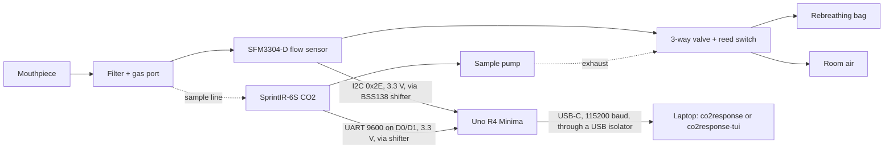

# Wiring

Quick reference. The step-by-step version, with checks and troubleshooting, is in the [setup and operating guide](../SETUP-GUIDE.md).

There are two boards. The app recognises which one is connected from its info line.

- **Uno R4 board, digital sensors** (the current build, below): an Arduino Uno R4 Minima with a Sensirion SFM3304-D flow sensor and a GSS SprintIR-6S-20 CO2 sensor. Firmware: `firmware/CO2ResponseR4/`.
- **ADC board** (the earlier build, further down): an Arduino Uno with an ADS1115 16-bit ADC reading a capnograph, a flow sensor and a pneumotach. Firmware: `firmware/CO2Response/`.

## Uno R4 board (digital sensors)

| Uno R4 pin | Goes to | Notes |
| --- | --- | --- |
| SDA, SCL | Level shifter HV1, HV2 → LV1, LV2 → SFM3304-D SDA, SCL | BSS138 4-channel shifter; HV = 5 V, LV = 3V3. 100 kHz I2C. |
| D1 (TX1), D0 (RX1) | Level shifter HV3, HV4 → LV3, LV4 → SprintIR pin 1 Rx_In, pin 2 Tx_Out | `Serial1`, 9600 8N1 |
| 5V | AMS1117-3.3 module IN; level shifter HV | The 3V3 rail feeds the SFM3304-D VDD, the SprintIR VDD and the shifter's LV |
| D2 | Stop / marker button, other leg to GND | `INPUT_PULLUP`. During rebreathing: emergency stop; otherwise: a marker |
| D3 | Valve reed switch, other leg to GND | `INPUT_PULLUP`; the magnet on the valve handle closes it at the bag position (`REED_CLOSED_IS_BAG`) |
| D7 | Alarm LED through 330 Ω to GND | Follows the app's alarms; flashes if the app stops |
| D8 | Active piezo buzzer to GND | Sounds for a high alarm and if the app stops |
| D9 (PWM) | Q1 IRLZ44N gate (220 Ω series, 100 kΩ to GND) | Q1 drain = HTR−: the SFM3304-D heater, powered from 5V_EXT |
| D10 (PWM) | Q2 IRLZ44N gate (220 Ω series, 100 kΩ to GND) | Q2 drain = pump −; pump + on 5V_EXT; 1N5819 diode across the motor |
| D6 (PWM, optional) | Valve servo signal | Set `SERVO_PIN 6` in `config.h`; power the servo from 5V_EXT |
| GND | Common ground | Arduino GND, the 5 V adapter's −, both MOSFET sources and the sensor grounds, joined at one point |

The separate 5 V / 2 A wall adapter (barrel jack) is the **5V_EXT** rail: SFM3304-D heater, pump and servo. Do not power them from the Arduino's 5 V pin.

Software settings for this board are in `firmware/CO2ResponseR4/config.h` (pins, the flow sensor's sign and fallback scale factor, the CO2 sensor's filter choice). Build and upload with the Arduino IDE (board "Arduino UNO R4 Minima") or `pio run -d firmware/r4 -t upload`. The protocol differences are in [protocol.md](protocol.md#the-uno-r4-board-digital-sensors).

**Not yet tested on hardware.** The SFM3304-D command codes and the fallback scale factor follow Sensirion's SFM3x19-family interface; check them against the datasheet of your part. The firmware asks the sensor for its own scale factor at start-up and uses the fallback only if the sensor does not answer.

## ADC board (ADS1115)

Arduino Uno + ADS1115 16-bit ADC breakout over I2C. Change `firmware/CO2Response/config.h` if yours differs.

### ADS1115 to Arduino

| ADS1115 | Arduino Uno / Nano | Arduino Mega |
| --- | --- | --- |
| VDD | 5V | 5V |
| GND | GND | GND |
| SCL | A5 (or the SCL pin) | 21 (SCL) |
| SDA | A4 (or the SDA pin) | 20 (SDA) |
| ADDR | GND (address 0x48) | GND |
| ALRT | not connected | not connected |

### Sensors to ADS1115

| ADS1115 input | Sensor | Notes |
| --- | --- | --- |
| A0 | Capnograph analog output | Add a 1 MΩ pull-up from A0 to VDD so an unplugged capnograph reads at the high rail and raises a technical alarm. |
| A1 | Flow sensor output | |
| A2 | Pneumotach pressure transducer output | Single-ended by default. |
| A3 | Spare, the transducer's second output, or a pulse oximeter's analog output | Set `PNEUMO_DIFFERENTIAL 1` to read A2–A3 differentially, **or** `SPO2_CHANNEL 1` to send A3 as a fourth value (SpO2). Not both. |

### Buzzer (host watchdog)

| Arduino pin | Part | Notes |
| --- | --- | --- |
| D8 | Piezo buzzer, other leg to GND | A passive piezo (the firmware drives it at 2.7 kHz). `BUZZER_PIN` in `config.h`; set it to -1 for no buzzer. |
| D13 (built-in LED) | nothing to wire | Blinks with the buzzer. |

The monitor app sends a heartbeat to the board once a second. If the heartbeats stop for 3 s (the app closed or crashed, the computer went to sleep, the browser tab was put in the background), the board sounds the buzzer and blinks the LED until they come back, because nothing on the computer is checking the CO2 alarms any more. The buzzer is not in the wiring diagram above. See [protocol.md](protocol.md#host-watchdog-heartbeat).

### Valve output (optional)

| Arduino pin | Part | Notes |
| --- | --- | --- |
| D7 | The input of a valve driver | HIGH = valve to the rebreathing bag, LOW = room air. `VALVE_PIN` in `config.h`; set it to -1 for no valve output. |

The pin gives a 5 V logic signal at a few milliamps. **It cannot drive a solenoid or a servo directly:** put a logic-level MOSFET or a relay module between it and the valve, with a flyback diode across a solenoid coil, and power the valve from its own supply with the grounds joined. Choose a valve that rests on room air with no power, so a pulled cable or a dead supply fails safe.

The board starts on room air and returns to room air by itself when the host watchdog trips (the app stopped). The app switches the valve only when **Settings > Alarms > Switch the valve from the app** is on; **Emergency stop** always sends it to room air. See [protocol.md](protocol.md) and [safety.md](safety.md). This output has not been tested on hardware.

### Pulse oximeter (optional)

Wire the oximeter's analog SpO2 output to A3 and its ground to the common ground, build the firmware with `SPO2_CHANNEL 1`, and switch on **Settings > Display & units > SpO2 channel connected**. Enter the output's scaling from the oximeter's manual (often 1 V = 100 %). The same input-range rule applies: nothing above VDD.

## Rules

- **Common ground.** Sensor grounds, ADC ground and Arduino ground must be joined. Most noise and offset problems are a missing ground.
- **Stay inside the input range.** With a 5 V supply no input may go below −0.3 V or above 5.3 V. If a sensor can output more than VDD, use a resistor divider and put the divider ratio into the calibration.
- **Match the PGA gain to the sensors.** `GAIN_TWOTHIRDS` (±6.144 V full scale) suits 0–5 V sensors. For 0–3.3 V sensors use `GAIN_ONE` (±4.096 V) for more resolution, and update `railHighV` in `co2response/config/channels.json`.
- **Pneumotach leads.** Use twisted or shielded wire between the pressure transducer and the ADC, and keep it away from pump or heater wiring.
- **Electrical isolation.** If anything is connected to a person or animal, power the setup from a battery laptop or through a medical-grade USB isolator. See [safety.md](safety.md).

## Checking the wiring

1. Flash the firmware, connect, and run **Settings > Diagnostics > Hardware check**. If the ADC is not answering, the check shows the firmware's I2C scan: `none` means no power or SDA/SCL not connected; `0x49`–`0x4B` means the ADDR pin is not on GND.
2. In **Settings > Display & units**, turn on **Show raw volts** to see each channel's voltage under its number.
3. A channel pinned at 0 V or 5 V for 2 s raises an "AT ADC RAIL" technical alarm (CO2 only at 5 V).
