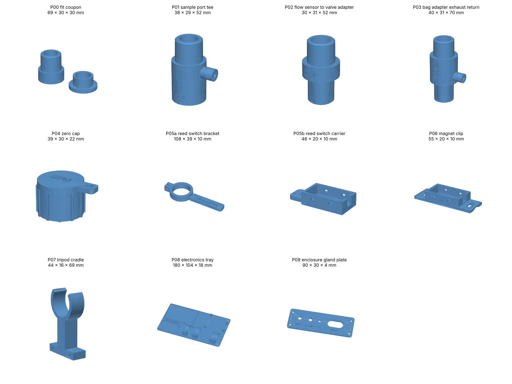
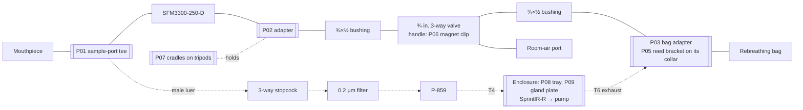
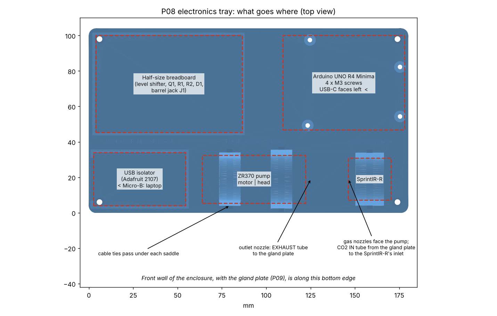

# 3D-printed parts for the clinic build

The purchased parts ([working budget, Purchased sheet](../../docs/wiring.md#the-parts-and-what-each-one-does) and the budget increase request) do not connect to each other, or mount, on their own in five places. These printed parts fill those gaps:

1. **The sample port.** Nothing purchased makes a side port on the breathing circuit between the mouthpiece and the flow sensor.
2. **The flow sensor to the valve.** The SFM3300's 22 mm socket does not fit ½" PVC pipe (21.3 mm) without wrapping tape until it seals.
3. **The bag and the pump exhaust.** Nothing joins the rebreathing bag to the valve's bag port or brings the pump's exhaust back into it.
4. **The reed switch.** The switch has to stay within 13 mm of a magnet on the valve handle, and nothing holds either half there.
5. **The electronics.** The Arduino, breadboard, isolator, pump and CO2 sensor have nothing to hold them inside the ABS enclosure.

## Files

| Folder | What it holds | Use it for |
| --- | --- | --- |
| `step/` | One STEP file per part | Opening and editing in Fusion (or any CAD program) |
| `stl/` | One STL file per part | Slicing and printing |
| `renders/` | A picture of each part, and the tray layout | Checking a part before printing |
| `build_parts.py` | The parametric source for every part | Changing a dimension after you measure (below), then `python hardware/3d-prints/build_parts.py` (needs `pip install cadquery`) |
| `render_parts.py` | Redraws `renders/` | `python hardware/3d-prints/render_parts.py` |

## Which parts are needed

| Part | Needed in the clinic? | Replaces or fixes | Purchased parts it joins |
| --- | --- | --- | --- |
| **P00** Fit coupon | Print first (10 min) | Checks your printer's fits before the real parts | SFM3300 ends, reducer bushing |
| **P01** Sample-port tee | **Yes** | The sample port (none purchased) | Mouthpiece, SFM3300 male end, male Luer-to-barb adapter, 3-way stopcock (T1) |
| **P02** Flow sensor to valve adapter | **Yes** | Tape-wrapped ½" pipe in the SFM3300's 22 mm socket | SFM3300 female end, ¾×½" reducer bushing, ¾" three-way ball valve |
| **P03** Bag adapter with exhaust return | **Yes** | A bag connection and the pump exhaust's return port (neither purchased) | Rebreathing bag, reducer bushing on the bag port, female Luer-to-barb adapter, tube T6 |
| **P04** Zero cap | **Yes** | Capping the mouthpiece end to zero the flow (README step 6) and to leak-test | P01 |
| **P05a + P05b** Reed-switch bracket and carrier | **Yes** | Nothing held the switch near the valve | Adafruit 375 switch half, P03 collar |
| **P06** Magnet clip | **Yes** | Nothing held the magnet on the valve handle | Adafruit 375 magnet half, valve handle |
| **P07** Tripod cradle (print 2) | Recommended | Keeps the circuit's weight off the subject's mouth | Adjustable tubing stands/tripods, P02 collar |
| **P08** Electronics tray | **Yes** | Nothing held the electronics in the enclosure | UNO R4 Minima, breadboard, USB isolator, ZR370 pump, SprintIR-R, ABS project enclosure |
| **P09** Enclosure gland plate | Recommended | Labelled holes for the tubes and cables through the enclosure wall | ABS enclosure, tubes T4/T6, reed-switch lead, USB cable, 5 V adapter |

Not printed: the mouthpiece, rebreathing bag and main tubing (from the mentors), the luer fittings, filter and stopcocks (purchased), and the SFM3300 itself (it clips into Sensirion's cable as it is).

## Where each part goes

### P01 Sample-port tee (mouth end of the circuit)
- **Where:** between the mouthpiece and the flow sensor, as close to the mouth as possible (wiring.md: "the CO2 is the subject's breath and not the circuit's").
- **Bottom (labelled `SFM`):** a 22 mm socket. Push it onto the SFM3300's **male** end (the end with 22 mm outside, 15 mm inside), which faces the subject so inspiration reads positive.
- **Top:** a 22 mm male cone for the mouthpiece, or for a disposable breathing filter with the mouthpiece on it.
- **Side boss:** push the barb of a **male Luer-to-barb adapter** into it (budget request, 25-pack) and seal it with a ring of 5-minute epoxy, male Luer facing out. A female port of the 3-way stopcock **T1** pushes onto it, and T1's male Luer goes into the filter (T2). That makes the sample line in [wiring.md](../../docs/wiring.md#uno-r4-board-digital-sensors): P01 → T1 → T2 → P-859 → T4.
- Dead space it adds: about 6 mL (15 mm bore, 34 mm long).

### P02 Flow sensor to valve adapter
- **Where:** between the SFM3300's **female** end and the valve's subject port.
- **Top (22 mm male cone):** into the SFM3300's 22 mm socket.
- **Collar (labelled `VALVE`, 30 mm):** the tripod cradle (P07) snaps onto it.
- **Bottom (½" pipe spigot, 21.3 mm):** into the ½" socket of the ¾×½" reducer bushing that sits in the valve port. Wrap it with two turns of the purchased PTFE tape. This replaces the tape-wrapped ½" pipe, so the ½" pipe is no longer needed on this side.
- Dead space it adds: about 10 mL (15.8 mm bore, 52 mm long).

### P03 Bag adapter with exhaust return
- **Where:** on the valve's **bag** port. The bag goes on top.
- **Bottom (½" pipe spigot):** into the second reducer bushing, with PTFE tape.
- **Side boss:** the barb of a **female Luer-to-barb adapter**, epoxied in, female Luer facing out. Fit a **male Luer-to-barb adapter** on the end of tube **T6** (the pump's exhaust) and plug it in here. The exhaust then goes back into the bag, so the closed rebreathing circuit keeps its gas.
- **Collar (labelled `BAG`):** the reed-switch bracket (P05a) clamps here.
- **Top (22 mm male cone):** into the rebreathing bag's 22 mm neck.

### P04 Zero cap
- Pushes over P01's mouth cone in place of the mouthpiece. Use it to zero the flow with the pump running (Settings > Calibration > Flow > Zero) and to check the circuit for leaks. Tie it to the circuit through its tab so it doesn't get lost.

### P05a Reed-switch bracket and P05b carrier
- **P05a** clamps round P03's collar (M3 × 16 screw and nut through the split ears). Its arm points up towards the valve handle.
- **P05b** holds the **switch** half of the Adafruit 375 (the half with the wires) in its pocket, with a small cable tie through the slots. Its lead leaves through the notch. Bolt P05b to P05a's slot with an M3 × 10 screw and nut.
- **Adjusting:** slide P05b along the slot, turn it on its screw, and turn P05a round the collar until the magnet clip (P06) sits **within 13 mm** of it when the handle is at the **bag** position. Check the app shows the valve phase change (wiring.md: "The valve phase is never detected" means it is too far).

### P06 Magnet clip
- Holds the **magnet** half of the Adafruit 375, cable-tied in its pocket. Two cable ties through the end slots strap it to the valve handle; the V-groove underneath seats it on a round or flat handle.

### P07 Tripod cradle (print two)
- Screws onto a tripod's ¼"-20 camera screw: press a ¼"-20 hex nut into the pocket underneath. Without a camera screw, strap it to a pole through the two cable-tie tunnels in its base.
- The C-clip snaps onto a 30 mm collar: P02's (holds the flow sensor end) or P03's (holds the valve and bag end). The circuit's weight then rests on the tripods rather than on the mouthpiece, as the budget request's justification for the tripods describes.

### P08 Electronics tray

- Sits on the floor of the ABS project enclosure, held by four countersunk M3 screws. Screw it down **before** fitting the breadboard and isolator, because they cover two of the screws.
- **Arduino UNO R4 Minima:** four M3 × 6 screws into the standoffs. The holes were checked against the team's `Arduino_R3.step`, which has the same hole pattern. Its USB-C faces left, across a gap of about 20 mm to the breadboard. Use a **right-angle USB-C cable** for C2 (isolator → Arduino).
- **Half-size breadboard:** peel its adhesive back and press it into the left rim.
- **USB isolator:** double-sided tape inside its rim, with the Micro-B end at the left wall. Cable C1 to the laptop comes in through the gland plate.
- **ZR370 pump:** lies in two saddles, with the motor end (solder tags) to the left and the head and outlet nozzle to the right. Put a strip of foam tape in each saddle against vibration, and hold it with cable ties through the tunnels under the saddles.
- **SprintIR-R:** lies in its saddle with the gas nozzles facing the pump and the pins facing right. Hold it with one cable tie.
- **Tubes:** T4 runs from the gland plate (`CO2 IN`) to the SprintIR-R inlet, T5 from the SprintIR-R outlet to the pump's side inlet, and T6 from the pump's end nozzle out through `EXHAUST`. Keep T4 short: every centimetre adds CO2 delay.
- The tallest item stands 31 mm above the tray. The enclosure needs at least **182 × 106 mm of inside floor and 45 mm inside height** (jumper wires on the breadboard).

### P09 Enclosure gland plate
- Cut one 70 × 16 mm rectangle in the enclosure's front wall, near the pump and SprintIR-R end, then screw the plate over it from outside with four M3 screws (or glue it). Centre the plate on the cut-out.
- `CO2 IN` and `EXHAUST`: the 5 mm silicone tubes pass through. `VALVE`: the reed-switch lead. `USB + 5V`: the laptop's USB cable (C1) and the 5 V adapter's lead. Pass their plugs through, then cable-tie each lead to the tray as strain relief.

## Measure these before you print

Every number below is a named constant at the top of `build_parts.py`. Measure with calipers, change the constant, and re-run `python hardware/3d-prints/build_parts.py`. The rest of the dimensions came from the datasheets and product pages cited in the code.

| # | Measure | On | Sets (constant) | Assumed now | Parts affected |
| --- | --- | --- | --- | --- | --- |
| 1 | **Print P00 first.** Does its socket push onto the SFM3300's male end and seal? Does its cone push into the SFM3300's female end and seal? Does its pipe ring push into the reducer bushing's ½" socket? | P00, SFM3300, bushing | `FEMALE_CLEARANCE` (socket loose: lower it; won't go on: raise it), `CONE_D_BIG`, `PIPE_OD` | 0.10 mm, 22.40 mm, 21.34 mm | P01–P04 |
| 2 | The mouthpiece's connector: inside diameter of its end, and whether it slides over a 22 mm cone | Mentors' mouthpiece | P01's top end (22 mm male cone now) | 22 mm female mouthpiece | P01 |
| 3 | The rebreathing bag's neck: inside diameter | Mentors' bag | P03's top end | 22 mm female neck | P03 |
| 4 | Luer-to-barb adapters: diameter over the barb ridges, and barb length, for both the male and female packs | Budget request adapters | `BARB_BORE`, `BARB_DEPTH` | 3.6 mm, 9 mm | P01, P03 |
| 5 | Valve handle: width and thickness where the clip goes; and, with the handle at the **bag** position, the distance from that spot to the centre of the bag-port fitting | ¾" three-way ball valve | P05a arm length (`arm_len` in `p05_reed_bracket`; the slot reaches 27–69 mm from the collar's centre now) | the magnet comes within reach of the slot; P06 straps to any handle with cable ties | P05a, P06 |
| 6 | **Inside floor length and width, and inside height**, of the ABS enclosure | ABS project enclosure (Newark) | `TRAY_L`, `TRAY_W` | needs ≥ 182 × 106 mm, ≥ 45 mm tall | P08 (and its layout if the box is smaller) |
| 7 | Which breadboard goes in the box. The repo's wiring diagram is drawn for a half-size board (82.5 × 54.6 mm), but the team's `Breadboard.step` is a 46 × 36 mm mini board | Breadboard | `BREADBOARD` | half-size | P08 |
| 8 | The tripod's mounting screw: ¼"-20 camera screw, or something else | Adjustable tubing stands | `NUT_AF`, `TRIPOD_BOLT` | ¼"-20 with a 7/16" hex nut | P07 |
| 9 | Quick checks against the datasheets: switch housing (Adafruit's page gives 29 × 15.2 × 9 mm; older stock is 14 mm wide), isolator board 52 × 30 mm, pump 27/24 mm diameter, SprintIR-R 23.8 mm diameter, silicone tube 5 mm outside | The parts | `REED_*`, `ISOLATOR`, `PUMP_*`, `SPRINTIR_*`, P09 holes | the datasheet values | P05b, P06, P08, P09 |
| 10 | Whether the USB cable's Micro-B plug and the 5 V adapter's barrel plug pass through a 22 × 11 mm slot; the enclosure's wall thickness | C1, P1, enclosure | P09 slot | 22 × 11 mm | P09 |

## Printing

| Part | Orientation on the bed | Notes |
| --- | --- | --- |
| P00–P03 | Standing, as drawn (cone up) | Airway parts: **PETG**, 0.2 mm layers, **5 walls** so they are gas-tight. Supports only under the side boss (touching the build plate is enough) |
| P04 | Open end down | PETG, 4 walls |
| P05a, P05b, P06 | Flat, as drawn | PETG or PLA, 4 walls, 40 % infill |
| P07 | **On its side** (the 16 mm face down) so the clip's layers run round the ring | PETG, 5 walls, 50 % infill |
| P08 | Flat | PETG or PLA, 3 walls, 20 % infill; 180 × 104 mm needs a bed at least that size |
| P09 | Flat, labels up | PLA or PETG |

After printing the airway parts, check them for leaks: assemble the circuit, put P04 on P01, turn the stopcock (T1) off towards P01, turn the valve to the **bag**, and squeeze the bag gently with the pump off. The flow should stay at zero.

## Extra hardware (not on either purchase list)

- M3 screws and nuts: 4 × M3 × 6 (Arduino), 4 × M3 × 8 countersunk (tray), 4 × M3 × 8 (gland plate), 1 × M3 × 16 and 1 × M3 × 10 with nuts (reed bracket).
- 2 × ¼"-20 hex nuts (P07).
- Small cable ties (2.5 mm), 5-minute epoxy, a strip of foam tape.
- A right-angle USB-C to USB-A cable (C2).

## For clinical use

- The printed airway parts (P01–P04) are in the breath path. Use **PETG**, wipe them with 70 % isopropyl alcohol between subjects, and put a disposable bacterial/viral breathing filter between each subject's mouthpiece and P01. Printed parts can't be autoclaved. They are research-prototype parts, so include them in the Cook Lab and CMU safety review ([safety.md](../../docs/safety.md)).
- The 22 mm cones follow the ISO 5356-1 breathing-circuit taper (1:40). Printed sizes vary between printers, which is why P00 comes first.
